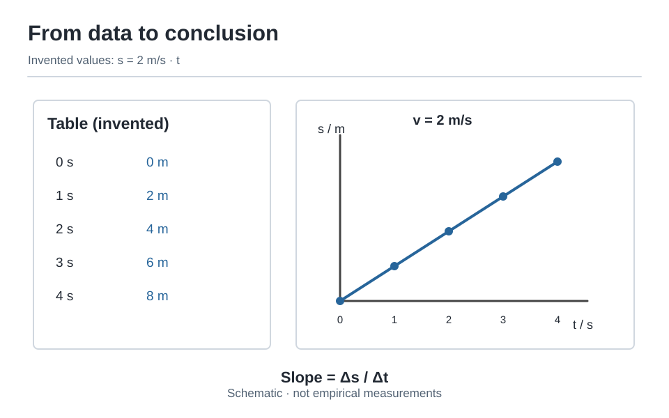

# M24-L2 – Interpreting Data-Driven Physics Tasks {#L2}

**Course area:** M24 – Abitur Practice and Scientific Reasoning. **Level:** Abitur preparation and exam methods. **Prerequisites:** [M24-L1](M24-L1.md), slope and uniform motion. **Learning objective:** Turn a table and graph into quantities, relationships, model checks and a justified conclusion.

## Starting question {#S1}

A problem supplies a graph, a table and a short description of an experiment. What information is actually present, and which statements would already be interpretations?

## Concepts and relationships {#S2}

Physics tasks with supplied materials require a deliberate **data-reading sequence**. Check the **axis labels and units**, whether the figure shows measured points or a model curve, the origin and scale, experimental conditions, apparent scatter and finally the question being asked. A line drawn through points is not automatically a law of nature. Determine whether the display is a measurement record, a theoretical assumption or a simple sketch.

For a distance–time graph, the secant slope $\Delta s/\Delta t$ represents the mean speed over the selected interval. A straight line with constant slope represents uniform motion. It does not, without additional evidence, predict behaviour outside the displayed range. On a velocity–time graph, however, slope has units of $\mathrm{m/s^2}$ and measures acceleration. **The axes determine the physics of the calculation**.

*Invented ideal data: the slope of a distance–time plot gives the constant speed.*

## Worked example {#S3}

An explicitly **invented** table gives $t/\mathrm{s}:0,1,2,3,4$ and $s/\mathrm{m}:0,2,4,6,8$. From $t=1\,\mathrm{s}$ to $4\,\mathrm{s}$, $\Delta s=8-2=6\,\mathrm{m}$ and $\Delta t=4-1=3\,\mathrm{s}$. Thus $v=\Delta s/\Delta t=2.0\,\mathrm{m/s}$. The associated straight line passes through the origin. This value describes the **ideal model data**, not the precision of real measurements.

## Investigation and practice {#S4}

Plot the values with clearly labelled axes and units. Add an explicitly **fictional model continuation**, $t=5\,\mathrm{s}$ and $s=10\,\mathrm{m}$. Then ask what one unexpected point at $t=3\,\mathrm{s}$ would do to the interpretation. Explain why the apparatus must be understood before a real-world extrapolation is justified.

## Check your learning {#S5}

### Questions

1. Calculate speed from the readings at $t=0$ and $t=4\,\mathrm{s}$.
2. What unit does the slope of a velocity–time plot have?
3. Distinguish a theoretical straight line from experimental points.
4. Must the displayed four seconds imply the same speed one hour later?

### Answers

1. $v=(8-0)\,\mathrm{m}/(4-0)\,\mathrm{s}=2.0\,\mathrm{m/s}$.
2. $\mathrm{m/s^2}$, the unit of acceleration.
3. A model line expresses an assumption; measured points are observations with uncertainty and possible deviations.
4. No; further observations or an independently justified model assumption are required.

## Model limitations {#S6}

All table entries are invented without scatter. Actual data include uncertainty, potential systematic errors and limits on applicability. Interpreting measurements calls for an argued relationship, not merely an attractive fitted line.

## Further reading (internal) {#S7}

- [M24-L1](M24-L1.md) · Reading instructions and operators
- [M24-L3](M24-L3.md) · Planning an experiment to obtain data

## Sources (external) {#S8}

- [KMK – Physics standards for the German Abitur (2020)](https://www.kmk.org/fileadmin/Dateien/veroeffentlichungen_beschluesse/2020/2020_06_18-BildungsstandardsAHR_Physik.pdf) · §3.2.1, pp. 24–25: physics tasks and interpretation of materials · Last accessed: 2026-11-21
- [OpenStax – College Physics 2e, §1.3](https://openstax.org/books/college-physics-2e/pages/1-3-accuracy-precision-and-significant-figures) · Accuracy, precision and uncertainty in interpreting measured data · Last accessed: 2026-11-21

## References {#S9}

