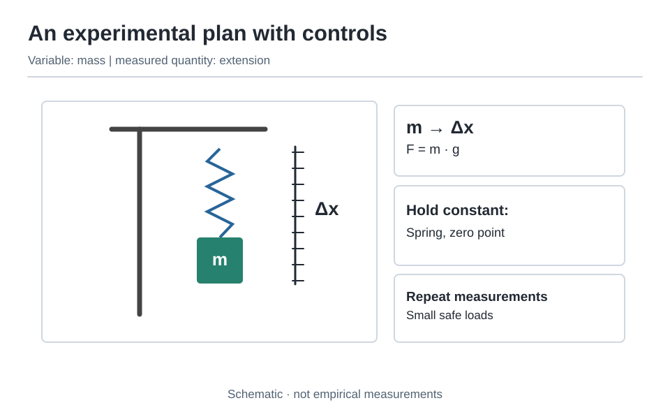

# M24-L3 – Planning and Checking Experimental Tasks {#L3}

**Course area:** M24 – Abitur Practice and Scientific Reasoning. **Level:** Abitur preparation and exam methods. **Prerequisites:** [M24-L2](M24-L2.md) and introductory investigation methods from M1. **Learning objective:** Design a safe, reproducible experiment with independent, dependent and controlled quantities and an uncertainty check.

## Starting question {#S1}

A class wants to test whether doubling the load on a spring doubles its extension. How can the experiment be organised so that the observation actually addresses the hypothesis?

## Concepts and relationships {#S2}

A **reproducible experimental plan** states a question, an **independent variable** to vary, a **dependent variable** to measure and **controlled variables** to hold constant. It specifies equipment, measurement range, reading procedure, repetitions, safety and evaluation. Comparing “before” and “after” without controls is often inconclusive.

In a **spring experiment**, $F=m\,g$ is the weight of the hanging object and $\Delta x$ is the extension relative to unloaded length. Within a linear elastic range, the Hooke model $F=D\,\Delta x$ uses spring constant $D$. Only small school-laboratory loads are appropriate; avoid overstretching. Repeated readings can test whether the graph of $F$ against $\Delta x$ is straight. Its slope is justified only over the investigated range.

Before data collection, define the zero point and units. Unusual values should **not be silently discarded**. A conclusion must report its tested range and how precisely extension could be read.

*Safe spring-experiment model: vary mass, measure extension and hold other conditions constant.*

## Worked example {#S3}

In an **invented** model experiment, unloaded spring length is $10.0\,\mathrm{cm}$; with mass $m=0.100\,\mathrm{kg}$ it is $12.0\,\mathrm{cm}$. Therefore $\Delta x=0.020\,\mathrm{m}$. Taking $g=9.81\,\mathrm{m/s^2}$ gives $F=0.981\,\mathrm{N}$ and $D=F/\Delta x=49.05\,\mathrm{N/m}$. This arithmetic illustrates the concept; it is not a calibration for an actual spring.

## Investigation and practice {#S4}

Use a suitable low-load classroom apparatus **with qualified supervision**, or plan the experiment on paper. Write five steps: unloaded measurement, a small load, reading at eye level, repeated trials and graphical checking. Identify one possible error (parallax) and a countermeasure (view the ruler squarely). Avoid heavy loads, high voltage and homemade radiation equipment.

## Check your learning {#S5}

### Questions

1. Which variable is varied and which is measured?
2. Calculate $D$ if $F=0.60\,\mathrm{N}$ and $\Delta x=0.015\,\mathrm{m}$.
3. Why is an unloaded reading needed?
4. Give two concrete safety or data-quality precautions.

### Answers

1. Mass or force is varied; extension $\Delta x$ is measured.
2. $D=0.60/0.015=40\,\mathrm{N/m}$.
3. Extension is a difference relative to initial length; without a zero value it is misidentified.
4. Use small loads within the elastic range, secure the stand, read at eye level or repeat readings.

## Model limitations {#S6}

Hooke's law applies to ideal or approximately linear-elastic deformation in the range tested. Real springs may show hysteresis, self-weight and permanent deformation. The figure is a **schematic**, not an instruction for unsupervised experiments.

## Further reading (internal) {#S7}

- [M24-L2](M24-L2.md) · Evaluating data and graphs
- [M24-L4](M24-L4.md) · Justifying results clearly

## Sources (external) {#S8}

- [KMK – Physics standards for the German Abitur (2020)](https://www.kmk.org/fileadmin/Dateien/veroeffentlichungen_beschluesse/2020/2020_06_18-BildungsstandardsAHR_Physik.pdf) · §2.2 and §3.2: inquiry and experimental tasks · Last accessed: 2026-11-21
- [OpenStax – College Physics 2e, §1.3](https://openstax.org/books/college-physics-2e/pages/1-3-accuracy-precision-and-significant-figures) · Experimental precision and uncertainty · Last accessed: 2026-11-21

## References {#S9}

