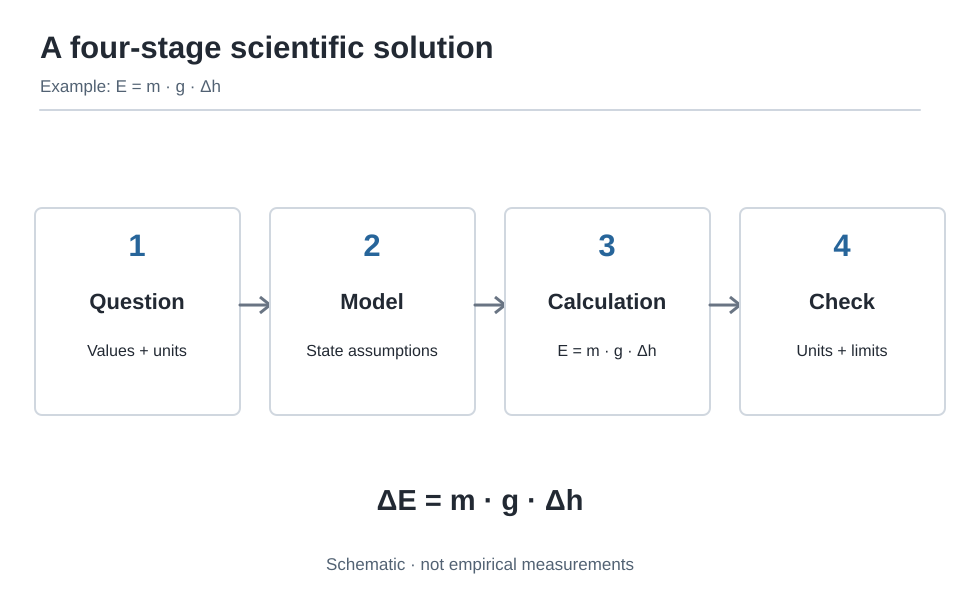

# M24-L4 – Justifying Multi-Step Physics Solutions {#L4}

**Course area:** M24 – Abitur Practice and Scientific Reasoning. **Level:** Abitur preparation and exam methods. **Prerequisites:** [M24-L3](M24-L3.md), energy and motion models. **Learning objective:** Communicate a multi-step solution with model assumptions, algebra, unit checks and a reasoned conclusion.

## Starting question {#S1}

A number with a correct unit is not automatically a complete physics answer. Why is $49\,\mathrm{J}$ alone less convincing than a solution that shows **what** was calculated, **under which assumptions**, and **what the result does and does not mean**?

## Concepts and relationships {#S2}

A coherent multi-step solution follows four stages: **(1) identify the situation and given quantities**, including symbols and units; **(2) state a suitable model and its assumptions**; **(3) rearrange symbolically before substituting** while tracking units; and **(4) check magnitude, sign, limits and physical meaning**. In chained questions, distinguish each intermediate result from what it is used to infer.

Technical language distinguishes reasoning from a fortunate calculation. “The energy increases” is ambiguous unless we know **which energy** and **which system boundary** is intended. For an ideal lifting process with frictional losses ignored, the increase in gravitational potential energy is $\Delta E_{\mathrm{pot}}=m\,g\,\Delta h$. This is not automatically the actual electrical energy consumed by a lifting machine.

*Physical reasoning links a model assumption to calculation, units and the limits of the result.*

## Worked example {#S3}

An object of mass $m=2.0\,\mathrm{kg}$ is lifted by $\Delta h=2.5\,\mathrm{m}$. **Model:** constant $g=9.81\,\mathrm{m/s^2}$ and potential-energy change relative to the starting height. **Equation:** $\Delta E_{\mathrm{pot}}=m\,g\,\Delta h$. **Substitution:** $2.0\,\mathrm{kg}\times9.81\,\mathrm{m/s^2}\times2.5\,\mathrm{m}=49.05\,\mathrm{J}\approx49\,\mathrm{J}$. **Check:** $\mathrm{kg\,m^2/s^2}$ equals a joule and the positive sign matches an increase in height. Machine losses have not been calculated.

## Investigation and practice {#S4}

Rewrite the calculation as connected prose. Ask a peer to identify the system boundaries from your explanation. Change the lifting height and check whether energy increases proportionally. Explain briefly why a real lifting device needs an efficiency model as well.

## Check your learning {#S5}

### Questions

1. Name the four stages of a clear physics solution.
2. Find $\Delta E_{\mathrm{pot}}$ if $m=3.0\,\mathrm{kg}$, $\Delta h=2.0\,\mathrm{m}$ and $g=9.81\,\mathrm{m/s^2}$.
3. Why would a result with units of $\mathrm{kg\,m/s}$ be suspect here?
4. Why need not $\Delta E_{\mathrm{pot}}$ equal the motor's input energy?

### Answers

1. Given quantities/question, model assumptions, calculation with units, plausibility and limits.
2. $3.0\times9.81\times2.0=58.86\,\mathrm{J}\approx59\,\mathrm{J}$.
3. $\mathrm{kg\,m/s}$ is momentum rather than energy; the dimensions disagree.
4. Real devices experience friction, heating and other losses, so required input energy can be larger.

## Model limitations {#S6}

The constant-$g$ model applies to small height changes near Earth's surface. Neither realistic device efficiency nor acceleration phases are included. A well-argued answer distinguishes model result, measurement and engineering use.

## Further reading (internal) {#S7}

- [M24-L3](M24-L3.md) · Testing assumptions experimentally
- [M24-L5](M24-L5.md) · Defending a physics argument orally

## Sources (external) {#S8}

- [KMK – Physics standards for the German Abitur (2020)](https://www.kmk.org/fileadmin/Dateien/veroeffentlichungen_beschluesse/2020/2020_06_18-BildungsstandardsAHR_Physik.pdf) · §2.3 and §3.2.1: technical communication and evaluation of physics answers · Last accessed: 2026-11-21

## References {#S9}

