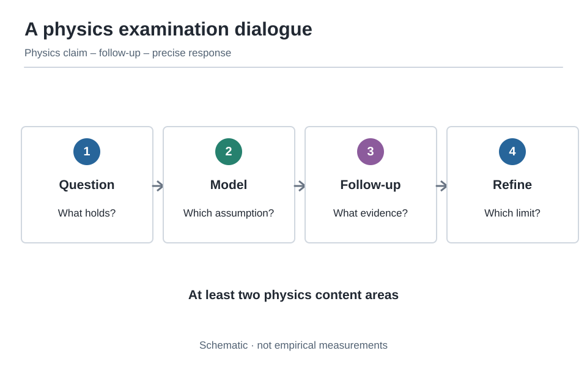

# M24-L5 – Oral Examinations and Reflective Learning {#L5}

**Course area:** M24 – Abitur Practice and Scientific Reasoning. **Level:** Abitur preparation and exam methods. **Prerequisites:** [M24-L4](M24-L4.md) and at least two previously studied content areas. **Learning objective:** Build a concise physical argument, respond to questions using evidence and plan targeted revision.

## Starting question {#S1}

An oral examination concerns more than the final number. The examiner may ask, “Which assumption underlies that explanation?” or “What should be measured to test it?” How can a student answer precisely without pretending to know what is uncertain?

## Concepts and relationships {#S2}

A clear oral response should make the chain **claim → physical reasoning → evidence or model test → limitation** explicit. Briefly organise the question, define technical terms and respond to the follow-up that was actually asked. If something is unknown, identify the gap and explain how it could be investigated instead of inventing numbers.

The German KMK framework describes an initial prepared presentation followed by an examination dialogue. In physics, §3.2.2 requires an oral exam to cover at least **two content areas** of the standards; details are governed by the states. Practise connecting topics such as motion and electromagnetism. **A study dialogue is not an official exam simulation.**

A useful reflection record asks: What could I explain independently? Where did my use of units, graph interpretation or model limitations break down? What exact practice question should I tackle next? Such observations become testable learning actions rather than global judgements of ability.

*Effective oral reasoning makes assumptions testable and uses follow-up questions to improve precision.*

## Worked example {#S3}

A student claims, “Doubling speed doubles kinetic energy.” The appropriate relationship is $E_{\mathrm{kin}}=\tfrac12m v^2$. With fixed mass, $E_{\mathrm{kin}}(2v)/E_{\mathrm{kin}}(v)=(2v)^2/v^2=4$. Energy is **four times** as large. A good answer states the constant-mass assumption and distinguishes energy from momentum $p=mv$, which merely doubles at $2v$.

## Investigation and practice {#S4}

Role-play a five-minute discussion. Start with the speed question, then ask another question involving electrical energy or induced voltage. One person explains; the other asks about units, available evidence and model boundaries. At the end, record **two specific strengths and one next learning action**. If a claim is uncertain, consult a reliable source rather than treating vague recollection as fact.

## Check your learning {#S5}

### Questions

1. How does $E_{\mathrm{kin}}$ change when speed triples at fixed mass?
2. How does momentum $p=mv$ change under the same conditions?
3. What is the purpose of a question about a model assumption?
4. Turn “I cannot do physics” into a testable learning action.

### Answers

1. It becomes nine times as large because $3^2=9$.
2. Momentum becomes three times as large.
3. It checks the conditions for validity and whether the explanation is justified.
4. For example, “I will solve three energy questions and check units and assumptions in each solution.”

## Model limitations {#S6}

The dialogue is invented and does not replace any state's exam rules, marking criteria or subject support. Reflective revision helps learning but does not guarantee exam success. Physical experiments belong only in suitable supervised teaching environments.

## Further reading (internal) {#S7}

- [M24-L4](M24-L4.md) · Reasoning with assumptions and units
- [M24-L1](M24-L1.md) · Revisiting task operators and demand levels
- [study-path.md](pages/study-path.md) · Organising revision

## Sources (external) {#S8}

- [KMK – Physics standards for the German Abitur (2020)](https://www.kmk.org/fileadmin/Dateien/veroeffentlichungen_beschluesse/2020/2020_06_18-BildungsstandardsAHR_Physik.pdf) · §§3.1.3 and 3.2.2, pp. 24 and 26: oral-exam structure and content areas · Last accessed: 2026-11-21
- [IQB – Supporting documents for natural sciences](https://www.iqb.hu-berlin.de/de/schule/sekundarstufe-ii/begleitendedokumente/) · Supporting evaluation and assessment guidance · Last accessed: 2026-11-21

## References {#S9}

