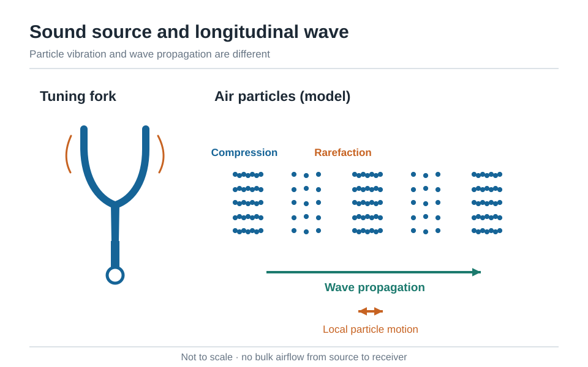

# M3-L1 – Sound sources and vibrations {#L1}

**Course area:** M3 – Sound and acoustics. **Level:** Lower secondary education. **Prior knowledge:** [M2-L6](M2-L6.md). **Learning objective:** Explain a vibrating source and the propagation of pressure disturbances through air using the longitudinal-wave model.

## Introduction {#S1}

Why can we hear a tuning fork even when its vibration is barely visible? A **sound source** is an object that makes its surroundings vibrate mechanically. Examples include a tuning fork, a guitar string, a drum membrane and the vibrating air column in a wind instrument. A single movement may create a brief sound pulse; regular vibrations can produce a tone.

## How sound is produced and transmitted {#S2}

A vibrating tuning fork alternately compresses nearby air and allows it to expand. It creates regions of **higher** and **lower pressure** (compressions and rarefactions) that propagate. Individual air particles mainly oscillate about their equilibrium positions; they do not travel from the fork all the way to the ear.

In air, audible sound is approximately a **longitudinal wave**: the motion of air particles is parallel to the direction of wave propagation. Solids can carry other types of mechanical waves as well. Sound requires a medium; a mechanical sound wave cannot propagate through an ideal vacuum.

**Original teaching diagram:** A tuning fork and schematic compressions/rarefactions; separate arrows distinguish wave propagation from local particle motion.

*Sound transfers a pressure disturbance through a medium; particles remain near their equilibrium positions.*

## Applying the vocabulary {#S3}

A ruler projects over the edge of a table. If its free end is displaced gently and released, it vibrates. Distinguish: **source** = ruler, **vibration** = back-and-forth motion, **sound wave** = travelling disturbance in the medium, **receiver** = ear or microphone. The entire ruler is not carried towards the ear.

## Safe investigation {#S4}

Hold a plastic ruler against a tabletop and gently vibrate its free end. Compare a short and a long overhanging section. Observe without allowing the ruler to strike people or objects. Do not produce loud tones or test loudspeakers directly next to the ear.

## Check your understanding {#S5}

### Questions

1. Identify the source, medium and receiver for a struck tuning fork.
2. Why is “the air travels as sound from the speaker to the ear” incorrect?
3. How do particles vibrate relative to the propagation direction in an ideal longitudinal wave?
4. Can sound travel in the ideal vacuum of space? Explain.

### Answers

1. Source: tuning fork; medium: for example air; receiver: ear or microphone.
2. The disturbance and energy are transmitted; air particles mainly oscillate locally.
3. Parallel to the direction of propagation.
4. No: the material medium needed to transmit the mechanical disturbance is missing.

## Model limits and next step {#S6}

The regular compression pattern is an idealized harmonic wave; real noises often contain many superimposed vibrations. Next we calculate [sound travel times](M3-L2.md).

## Sources {#S7}

- [Berlin-Brandenburg Education Portal – Physics (grades 7–10), official curriculum and materials](https://bildungsserver.berlin-brandenburg.de/rlp-online/c-faecher/physik) · Topics/teaching materials on sound and speed of sound · Last accessed: 2026-11-21 · Content verified: 2026-11-21
- [OpenStax – University Physics Volume 1, 17.1 Sound Waves](https://openstax.org/books/university-physics-volume-1/pages/17-1-sound-waves) · Longitudinal waves, compressions and rarefactions · Last accessed: 2026-11-21 · Content verified: 2026-11-21
- [Sichere Schule – Personal protective equipment (hearing protection)](https://www.sichere-schule.de/physik/praktisches-arbeiten/persoenliche-schutzausruestung) · School experiments, risk assessment, hearing protection · Last accessed: 2026-11-21 · Content verified: 2026-11-21
