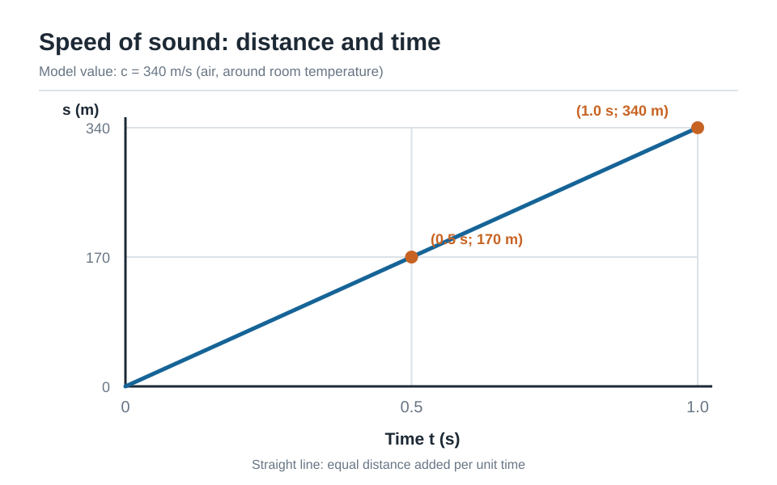

# M3-L2 – Speed of sound and sound transmission {#L2}

**Course area:** M3 – Sound and acoustics. **Level:** Lower secondary education. **Prior knowledge:** [M3-L1](M3-L1.md). **Learning objective:** Calculate sound travel times and distances using a stated sound speed and describe dependence on the medium.

## Introduction {#S1}

We see a distant firework flash before hearing the bang. At these distances light travel time is negligible, but sound takes a measurable amount of time. The **speed of sound** $c$ tells us how far a sound disturbance travels per unit time in a particular medium.

## Speed in a medium {#S2}

For a sound front travelling at approximately constant speed, $s=c\,t$, or $t=s/c$. In still air at about $20\,^\circ\mathrm{C}$, sound travels at roughly $343\,\mathrm{m/s}$; we use $340\,\mathrm{m/s}$ for approximate calculations. At $0\,^\circ\mathrm{C}$ it is slower, around $331\,\mathrm{m/s}$. Sound is typically faster in water or many solids. The precise value depends on material properties and conditions, not simply on density alone.

A material medium transmits the pressure disturbance. **Wave speed** is not the same as **particle speed**: the disturbance moves through the material although individual particles make only short movements.

**Original teaching diagram:** On a distance–time plot, $0.5\,\mathrm{s}$ corresponds to $170\,\mathrm{m}$ and $1.0\,\mathrm{s}$ to $340\,\mathrm{m}$ (model value $c=340\,\mathrm{m/s}$).

*At constant speed, the distance travelled by a sound wave grows in proportion to time.*

## Worked example {#S3}

A noise source is $204\,\mathrm{m}$ from an observer. With $c=340\,\mathrm{m/s}$:

$$t=\frac{s}{c}=\frac{204\,\mathrm{m}}{340\,\mathrm{m/s}}=0.60\,\mathrm{s}.$$

This is the **one-way path**. A returning echo travels to the reflecting surface and back.

## Safe investigation {#S4}

Make a soft tapping sound on a table and notice how difficult short delays are to measure with a handheld stopwatch. For more accurate work, use an existing sound recording or two microphones under guidance; do not use firecrackers, bursting balloons or other loud impulses.

## Check your understanding {#S5}

### Questions

1. Find the travel time for $68\,\mathrm{m}$ at $c=340\,\mathrm{m/s}$.
2. How far does a sound front travel in $1.5\,\mathrm{s}$ at that speed?
3. Why does speaking more loudly not simply increase $c$ in air at a fixed temperature?
4. Why should a precise experiment record air temperature?

### Answers

1. $t=68/340=0.20\,\mathrm{s}$.
2. $s=340\cdot1.5=510\,\mathrm{m}$.
3. The propagation speed of small disturbances is primarily set by the medium, not loudness.
4. Sound speed in air changes with temperature.

## Model limits and next step {#S6}

The equation assumes one travel path under approximately constant conditions. Wind, temperature gradients and obstacles can affect real measurements. Next we study [frequency and pressure amplitude](M3-L3.md).

## Sources {#S7}

- [Berlin-Brandenburg Education Portal – Physics (grades 7–10), official curriculum and materials](https://bildungsserver.berlin-brandenburg.de/rlp-online/c-faecher/physik) · Topics/teaching materials on sound and speed of sound · Last accessed: 2026-11-21 · Content verified: 2026-11-21
- [OpenStax – Physics, 14.1 Speed of Sound, Frequency, and Wavelength](https://openstax.org/books/physics/pages/14-1-speed-of-sound-frequency-and-wavelength) · Sound speed in media and v=fλ · Last accessed: 2026-11-21 · Content verified: 2026-11-21
- [OpenStax – College Physics 2e, 17.2 Speed of Sound, Frequency, and Wavelength](https://openstax.org/books/college-physics-2e/pages/17-2-speed-of-sound-frequency-and-wavelength) · Travel time and echo; temperature dependence · Last accessed: 2026-11-21 · Content verified: 2026-11-21
