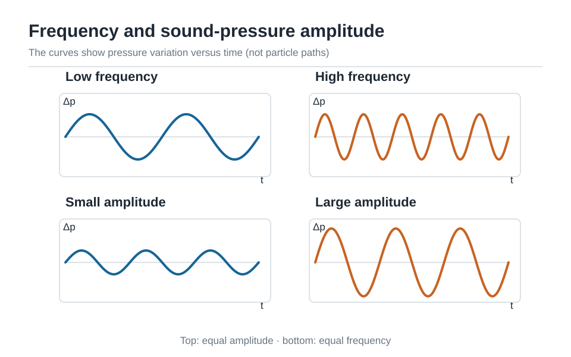

# M3-L3 – Pitch, frequency and loudness {#L3}

**Course area:** M3 – Sound and acoustics. **Level:** Lower secondary education. **Prior knowledge:** [M3-L2](M3-L2.md). **Learning objective:** Distinguish frequency, period, pitch and sound-pressure amplitude in words and in a diagram.

## Introduction {#S1}

A high-pitched tone need not be loud, and a low-pitched tone need not be quiet. **Pitch** and **loudness** describe different perceptual properties. A sound graph lets us distinguish the rate of repetition from the strength of the pressure variation.

## Frequency, period and amplitude {#S2}

**Frequency** $f$ is the number of complete cycles per second and is measured in hertz ($\mathrm{Hz}$). The **period** $T$ is the time taken for one cycle. They are related by:

$$f=\frac{1}{T},\qquad T=\frac{1}{f}.$$

For a simple periodic tone, a higher frequency generally corresponds to a higher perceived pitch. **Sound-pressure amplitude**, by contrast, is the maximum magnitude of a pressure variation from the equilibrium value. Under otherwise identical conditions, greater pressure amplitude means greater sound intensity. Perceived *loudness* also depends on frequency, duration and an individual's hearing. Sound level in **decibels** is logarithmic, not a linear amplitude measure.

**Original teaching diagram:** The top panels have the same amplitude but different frequencies; the bottom panels have the same frequency but different amplitudes. These curves show **pressure deviation versus time**, not air particles moving sideways.

*Frequency and sound-pressure amplitude are different properties.*

## Worked example {#S3}

A periodic sound trace repeats every $T=0.004\,\mathrm{s}$. Then:

$$f=\frac{1}{0.004\,\mathrm{s}}=250\,\mathrm{Hz}.$$

A second trace with $T=0.002\,\mathrm{s}$ has a frequency of $500\,\mathrm{Hz}$. Its frequency is twice as high; this does **not** mean it is perceived as twice as loud.

## Safe investigation {#S4}

Draw two sine waves with equal height but different numbers of cycles in the same time interval. Then change only their height. If you use a tone generator, choose a **very low level**, start muted and avoid testing hearing limits or prolonged headphone exposure.

## Check your understanding {#S5}

### Questions

1. Calculate $T$ for $f=100\,\mathrm{Hz}$.
2. What changes in a pressure–time plot for a higher tone under otherwise identical conditions?
3. One trace has twice the pressure amplitude but the same frequency. What stays the same and what changes?
4. Does doubling frequency also double loudness?

### Answers

1. $T=1/100\,\mathrm{s}=0.010\,\mathrm{s}$.
2. More complete cycles per second, or a shorter period.
3. Frequency is unchanged; the pressure variation becomes larger.
4. No. Pitch and loudness are distinct perceptual properties.

## Model limits and next step {#S6}

Real voices and instruments include many frequency components; equal sound levels can also sound differently loud. Next we examine [echoes and the role of room surfaces](M3-L4.md).

## Sources {#S7}

- [Berlin-Brandenburg Education Portal – Physics (grades 7–10), official curriculum and materials](https://bildungsserver.berlin-brandenburg.de/rlp-online/c-faecher/physik) · Topics/teaching materials on sound and speed of sound · Last accessed: 2026-11-21 · Content verified: 2026-11-21
- [OpenStax – Physics, 14.1 Speed of Sound, Frequency, and Wavelength](https://openstax.org/books/physics/pages/14-1-speed-of-sound-frequency-and-wavelength) · Sound speed in media and v=fλ · Last accessed: 2026-11-21 · Content verified: 2026-11-21
- [OpenStax – Physics, 14.2 Sound Intensity and Sound Level](https://openstax.org/books/physics/pages/14-2-sound-intensity-and-sound-level) · Pressure amplitude, intensity and logarithmic level · Last accessed: 2026-11-21 · Content verified: 2026-11-21
