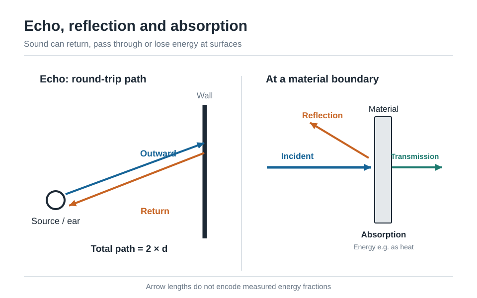

# M3-L4 – Echo, reflection and insulation {#L4}

**Course area:** M3 – Sound and acoustics. **Level:** Lower secondary education. **Prior knowledge:** [M3-L3](M3-L3.md). **Learning objective:** Calculate echo distances from round-trip time and distinguish reflection, absorption and sound insulation.

## Introduction {#S1}

Calling towards a rock face may cause you to hear your voice again after a delay. This **echo** happens because a surface reflects some sound energy. Inside a classroom, many closely spaced reflections can create **reverberation** that reduces speech clarity.

## Reflection, absorption and insulation {#S2}

A hard, smooth surface can reflect sound strongly; rough or structured surfaces scatter it in different directions. In porous materials some sound energy is converted to heat through friction and other processes: this is **absorption**. **Sound insulation**, in contrast, mainly aims to reduce sound *transmission through* a wall, door or window. Absorption within a room is not the same as insulation between rooms.

For an echo, sound must travel **to** the obstacle and **back**. If $d$ is the one-way distance and $t$ the total measured time, a constant sound speed $c$ gives:

$$2d=c\,t,\qquad d=\frac{c\,t}{2}.$$

**Original teaching diagram:** The echo's outward and return journeys are shown separately on the left; on the right, incident sound is partly reflected, absorbed and transmitted. Arrow sizes do not represent measured proportions.

*An echo travels out and back; interfaces may reflect, transmit or absorb sound.*

## Worked example {#S3}

An echo arrives $0.60\,\mathrm{s}$ after a call. For air at $c=343\,\mathrm{m/s}$:

$$d=\frac{343\,\mathrm{m/s}\cdot0.60\,\mathrm{s}}{2}=102.9\,\mathrm{m}\approx103\,\mathrm{m}.$$

Multiplying by $c$ without **dividing by two** incorrectly gives the total path length instead of the distance to the wall.

## Safe investigation {#S4}

Compare how clearly quiet speech can be understood in furnished and unfurnished rooms, without increasing the volume. List the soft and hard surfaces present. One subjective impression cannot establish a standardized sound-insulation rating.

## Check your understanding {#S5}

### Questions

1. An echo returns after $0.40\,\mathrm{s}$. Find $d$ for $c=340\,\mathrm{m/s}$.
2. Why is there a factor of $1/2$ in the echo equation?
3. How does an acoustic curtain inside a room differ from a well-sealed soundproof door?
4. Does every reflection produce a separately audible echo?

### Answers

1. $d=340\cdot0.40/2=68\,\mathrm{m}$.
2. The measured time includes **both** outward and return travel.
3. The curtain can absorb sound and reduce reverberation; the door aims to block transmission between rooms.
4. No. Many reflections merge and are perceived as reverberation.

## Model limits and next step {#S6}

How much a surface reflects, absorbs or transmits depends on frequency and construction. A single ray path is only a model. Next we assess [noise and effective hearing protection](M3-L5.md).

## Sources {#S7}

- [OpenStax – College Physics 2e, 17.2 Speed of Sound, Frequency, and Wavelength](https://openstax.org/books/college-physics-2e/pages/17-2-speed-of-sound-frequency-and-wavelength) · Travel time and echo; temperature dependence · Last accessed: 2026-11-21 · Content verified: 2026-11-21
- [Sichere Schule – Acoustics and noise protection](https://www.sichere-schule.de/technik/bauliche-anforderungen/akustik) · Room acoustics, absorption and insulation · Last accessed: 2026-11-21 · Content verified: 2026-11-21
- [Berlin-Brandenburg Education Portal – Physics (grades 7–10), official curriculum and materials](https://bildungsserver.berlin-brandenburg.de/rlp-online/c-faecher/physik) · Topics/teaching materials on sound and speed of sound · Last accessed: 2026-11-21 · Content verified: 2026-11-21
