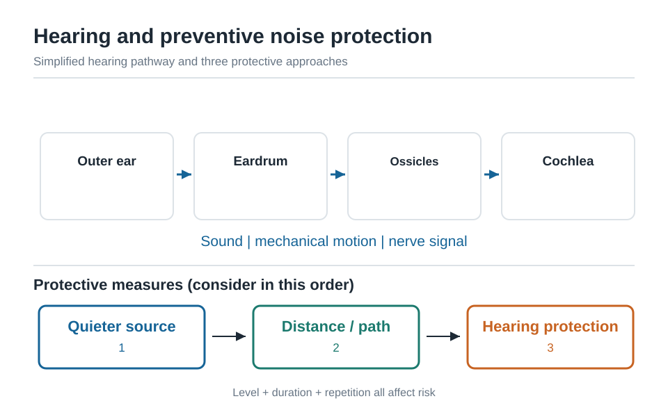

# M3-L5 – Hearing, noise and hearing protection {#L5}

**Course area:** M3 – Sound and acoustics. **Level:** Lower secondary education. **Prior knowledge:** [M3-L4](M3-L4.md). **Learning objective:** Outline the hearing pathway and assess hearing risks considering sound level, duration and protection measures.

## Introduction {#S1}

Sound is not necessarily harmless because it comes from music or a classroom experiment. Hearing responds to pressure changes, and the risk depends on **sound level**, **duration** and how often exposure occurs. Extremely loud single events can also be dangerous.

## From sound to perception {#S2}

The outer ear gathers sound, which reaches the **eardrum** through the ear canal. The ossicles pass the vibration into the inner ear. In the **cochlea**, sensory cells convert mechanical motion into nerve signals processed by the brain. Permanent damage to sensitive structures can impair hearing.

**Sound level** is measured on a logarithmic scale. Environmental noise is commonly assessed using the A-weighted level $L_{\mathrm{A}}$, in $\mathrm{dB(A)}$. A particular value is **not a universal threshold** that guarantees safety for all people and all exposure times. According to NIDCD, long or repeated exposure at around $85\,\mathrm{dB(A)}$ and above can contribute to hearing damage.

**Original teaching diagram:** On the left, a highly simplified pathway from sound to nerve response; on the right, a hierarchy of measures: **quieter source – distance/transmission path – personal hearing protection**. This is not a medical anatomy illustration.

*Simplified hearing pathway; controlling sound begins at the source.*

## Case study: level and duration {#S3}

For **occupational continuous exposure**, NIOSH recommends a reference value of $85\,\mathrm{dB(A)}$ over eight hours. Under its **3 dB exchange model**, recommended exposure time halves for each $3\,\mathrm{dB}$ increase: for example eight hours at $85\,\mathrm{dB(A)}$ and four hours at $88\,\mathrm{dB(A)}$. These are **preventive occupational recommendations**, not personal safety guarantees and not an invitation to test such levels. Classroom experiments require an appropriate risk assessment and applicable safety rules.

## Safe investigation {#S4}

Make a table of everyday *possible* noise sources, estimated exposure time and possible protective measures. An uncalibrated smartphone can offer only a rough indication. Do **not generate extra noise** just to measure it. Persistent hearing problems deserve professional medical advice.

## Check your understanding {#S5}

### Questions

1. Put eardrum, ossicles and cochlea in the correct order.
2. Why is level alone insufficient to assess exposure risk?
3. Under the cited NIOSH model, what time corresponds to $91\,\mathrm{dB(A)}$ if $85\,\mathrm{dB(A)}$ corresponds to eight hours?
4. Name two protective actions to consider before relying on earplugs.

### Answers

1. Eardrum → ossicles → cochlea.
2. Exposure depends on duration and repetition as well as level.
3. Two increments of $3\,\mathrm{dB}$: eight → four → **two hours** (occupational reference model).
4. Reduce the source volume and increase distance; also reduce time or sound transmission.

## Model limits and next step {#S6}

This outline is not an audiological examination or a substitute for risk assessment. The occupational recommendations are not a table of school exposure limits. The next module begins with [M4-L1 – Distinguishing temperature, internal energy and heat](M4-L1.md).

## Sources {#S7}

- [NIDCD – Noise-Induced Hearing Loss](https://www.nidcd.nih.gov/health/noise-induced-hearing-loss) · Hearing damage, noise levels and prevention · Last accessed: 2026-11-21 · Content verified: 2026-11-21
- [Sichere Schule – Personal protective equipment (hearing protection)](https://www.sichere-schule.de/physik/praktisches-arbeiten/persoenliche-schutzausruestung) · School experiments, risk assessment, hearing protection · Last accessed: 2026-11-21 · Content verified: 2026-11-21
- [CDC/NIOSH – Noise Myths Debunked](https://www.cdc.gov/niosh/bulletin/2021/cicada.html) · 3 dB exchange rate and occupational exposure recommendation · Last accessed: 2026-11-21 · Content verified: 2026-11-21
- [Sichere Schule – Acoustics and noise protection](https://www.sichere-schule.de/technik/bauliche-anforderungen/akustik) · Room acoustics, absorption and insulation · Last accessed: 2026-11-21 · Content verified: 2026-11-21
