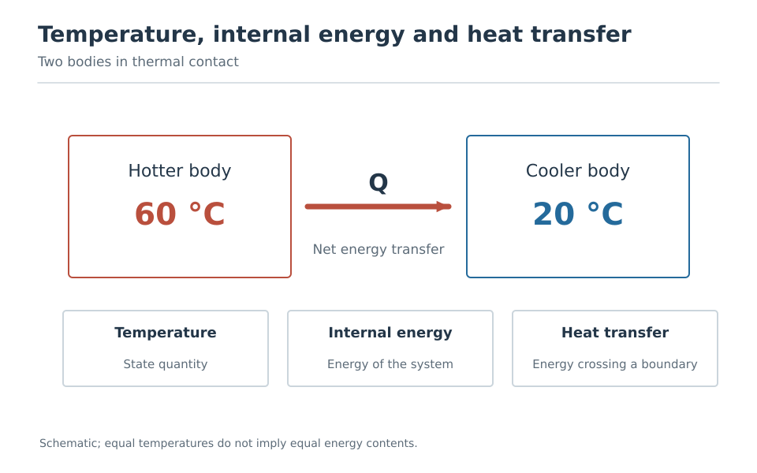

# M4-L1 – Distinguishing temperature, internal energy and heat {#L1}

**Course area:** M4 – Temperature, heat and particles. **Level:** Lower secondary education. **Prior knowledge:** [M1-L2](M1-L2.md). **Learning objective:** Use temperature, internal energy and heat accurately and convert a temperature difference.

## Introduction {#S1}

A full cup of lukewarm water can contain more internal energy than a single droplet of hot water. **Temperature** is not the same as total **energy content**. In thermal contact, energy is transferred from the warmer to the cooler body. This process is called **heating by energy transfer**.

## Concepts and physical model {#S2}

**Temperature** describes a body's thermal state and determines the direction of spontaneous net heat transfer. It is often measured in degrees Celsius ($^\circ\mathrm{C}$); the SI base unit of thermodynamic temperature is kelvin ($\mathrm{K}$). The conversion is $T/\mathrm{K}=\vartheta/^\circ\mathrm{C}+273.15$. A temperature **difference** of $1\,\mathrm{K}$ has the same size as a difference of $1\,^\circ\mathrm{C}$.

**Internal energy** $U$ includes microscopic kinetic and interaction energies of the particles in a system. It depends on factors such as the amount of substance, physical state and temperature. **Heat** $Q$ is energy transferred across a system boundary because of a temperature difference; heat is not a substance stored in a body. Energy can also enter through mechanical or electrical work.

**Original draft diagram:** Two bodies at different temperatures, an energy-transfer arrow, and separate labels for temperature, internal energy and heat transfer.

*Temperature is a state quantity, internal energy belongs to the system, and heat is an energy transfer.*

## Worked example and application {#S3}

One body is at $60\,^\circ\mathrm{C}$ and another at $20\,^\circ\mathrm{C}$. Their temperature difference is $\Delta T=60-20=40\,\mathrm{K}$. Their temperatures are $333.15\,\mathrm{K}$ and $293.15\,\mathrm{K}$. In thermal contact, net heat transfer is from the hotter to the cooler body. We **cannot calculate the transferred energy** from temperature readings alone: mass, material and conditions matter.

## Safe investigation {#S4}

Using a suitable classroom thermometer and teacher supervision, measure the temperatures of two cups of water that have been kept in different room-temperature locations. Then place them side by side without mixing. Do **not** use touch to judge the temperatures; perception is not a calibrated measurement. Avoid hot water. Record time and approximate instrument uncertainty.

## Self-check {#S5}

### Exercises

1. Why can two different masses of water have different internal energies at the same temperature?
2. Convert $22\,^\circ\mathrm{C}$ to kelvin.
3. Which is a process quantity: temperature, internal energy or heat?
4. Two spheres are at $42\,^\circ\mathrm{C}$ and $17\,^\circ\mathrm{C}$. Find their difference in kelvin.

### Solutions

1. Internal energy depends partly on amount or mass, not just on temperature.
2. $T=22+273.15=295.15\,\mathrm{K}$.
3. Heat $Q$: energy transferred due to a temperature difference.
4. $\Delta T=42-17=25\,\mathrm{K}$.

## Model limitations and transition {#S6}

Ordinary language often speaks of “heat in a body”; physics distinguishes stored internal energy from heat transfer. The simple arrow represents the **net** direction, not actual particle trajectories. Continue with [M4-L2](M4-L2.md).

## Sources {#S7}

- [Berlin-Brandenburg education server – Physics curriculum: topics and content](https://bildungsserver.berlin-brandenburg.de/rlp-online/c-faecher/physik/themen-und-inhalte) · Sections 3.1, 3.4 and 3.11 · Thermal behaviour, heat transfer and energy · Last accessed: 2026-11-21 · Content verified: 2026-11-21
- [NIST – The International System of Units (SI), SP 330, Section 2](https://www.nist.gov/pml/special-publication-330/sp-330-section-2) · Kelvin, Celsius temperature and temperature difference · Last accessed: 2026-11-21 · Content verified: 2026-11-21
- [BIPM – SI Base Unit: Kelvin](https://www.bipm.org/en/web/guest/si-base-units/kelvin) · Definition of the SI temperature unit · Last accessed: 2026-11-21 · Content verified: 2026-11-21
