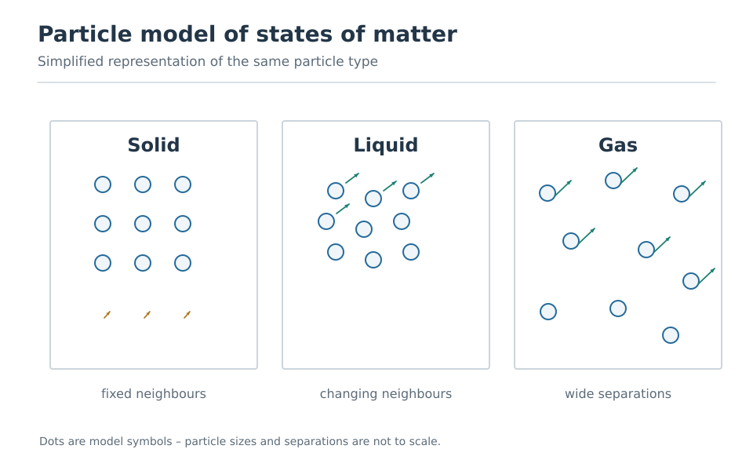

# M4-L2 – Particle model and states of matter {#L2}

**Course area:** M4 – Temperature, heat and particles. **Level:** Lower secondary education. **Prior knowledge:** [M4-L1](M4-L1.md). **Learning objective:** Compare solids, liquids and gases using a simple particle model and explain a phase change.

## Introduction {#S1}

An ice cube keeps its shape. Melted water takes the shape of a container, while water vapour can spread throughout the available space. These are three states of the same substance, not three different chemicals.

## Concepts and physical model {#S2}

In the **simple particle model**, matter is represented by very small particles. In a **solid**, neighbours remain largely fixed while particles vibrate around equilibrium positions. In a **liquid**, particles stay close together but can change neighbours. In a **gas**, they are typically much farther apart and move freely between collisions.

**Melting** changes a solid into a liquid; **freezing** reverses it. **Vaporisation** turns liquid into gas; **condensation** reverses it. Liquid water can also **evaporate** below its boiling temperature. These changes require or release energy; the temperature of the whole sample need not rise throughout a phase change.

Each drawn dot is a **model symbol**. Particles do not become physically larger when a sample is gently heated; it is their spacing, motion and interactions that change.

**Original draft diagram:** Three panels with equal numbers of symbolic particles showing different arrangements and types of motion.

*The same particles may differ in mobility and separation across states of matter.*

## Worked example and application {#S3}

A closed system initially contains $100\,\mathrm{g}$ of water. If some liquid becomes vapour but no matter escapes, the **total mass** stays $100\,\mathrm{g}$. Only its distribution between phases changes. **Never heat a completely sealed glass vessel:** dangerous pressure can develop.

## Safe investigation {#S4}

At room temperature, place a small drop of water on each of two comparable surfaces so that the drops cover different areas. Predict which may dry faster and observe without extra heating. Note that air flow and humidity also affect the outcome. A drawing comparing ice, water and vapour is an experiment-free alternative.

## Self-check {#S5}

### Exercises

1. Match fixed neighbours, changing neighbours and large separations to the three states.
2. Why can evaporation occur at room temperature?
3. Do water molecules grow in size when heated?
4. Does melting ice change its chemical identity or particle arrangement?

### Solutions

1. Solid: fixed neighbours; liquid: changing neighbours; gas: usually large separations.
2. Some particles can escape the liquid even below its boiling temperature.
3. No; the model changes motion, separation and interactions.
4. Particle arrangement and mobility change, but it remains water ($\mathrm{H_2O}$).

## Model limitations and transition {#S6}

Particle drawings are schematic and not to scale. Real materials have different interactions and internal structures. The observation cannot determine an accurate latent heat. Continue with [M4-L3](M4-L3.md).

## Sources {#S7}

- [Berlin-Brandenburg education server – Physics curriculum: topics and content](https://bildungsserver.berlin-brandenburg.de/rlp-online/c-faecher/physik/themen-und-inhalte) · Sections 3.1, 3.4 and 3.11 · Thermal behaviour, heat transfer and energy · Last accessed: 2026-11-21 · Content verified: 2026-11-21
- [LEIFIphysik – Specific latent heat of fusion and vaporisation](https://www.leifiphysik.de/waermelehre/innere-energie-waermekapazitaet/grundwissen/spezifische-schmelz-und-verdampfungswaerme) · Energy transfer in phase changes and the particle model · Last accessed: 2026-11-21 · Content verified: 2026-11-21
