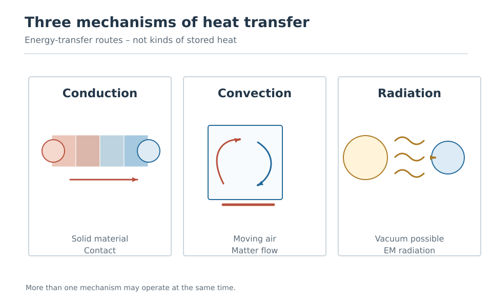

# M4-L3 – Conduction, convection and thermal radiation {#L3}

**Course area:** M4 – Temperature, heat and particles. **Level:** Lower secondary education. **Prior knowledge:** [M4-L2](M4-L2.md). **Learning objective:** Identify three heat-transfer mechanisms in everyday situations and describe an energy-transfer pathway.

## Introduction {#S1}

A metal spoon gradually warms along its handle in warm soup. Air flows above a radiator, and sunlight reaches Earth across space. All three processes transfer energy, but by different mechanisms.

## Concepts and physical model {#S2}

In **conduction**, energy passes through a material or between materials in contact. The material as a whole does not move along the energy-transfer path. Metals commonly conduct energy well.

In **convection**, energy is carried along by a moving **fluid** – a liquid or gas. Warm air can rise if a density difference produces buoyancy-driven circulation; fans and pumps can also force fluid motion.

**Thermal radiation** is energy transfer by electromagnetic radiation. It requires no material medium, which is why solar radiation crosses space. Multiple mechanisms often act simultaneously. These names describe energy-transfer routes, not three types of heat stored inside a body.

**Original draft diagram:** Three independent panels showing contact conduction, circulating matter and radiation waves.

*Conduction, convection and radiation transfer energy through different mechanisms.*

## Worked example and application {#S3}

A vacuum-insulated bottle reduces conduction and convection through its walls. A reflective coating can reduce radiative exchange. Its cap and structural connections may still conduct energy. **Perfect insulation does not exist**, but different designs reduce losses by different amounts.

## Safe investigation {#S4}

Put identical containers of **lukewarm**, not hot, water on two safe supports such as wood and metal, and record their temperatures at matched intervals. This is a qualitative comparison, not proof of a single mechanism: the vessel, surrounding air and contact area also matter. Do not use flames or hot metal.

## Self-check {#S5}

### Exercises

1. Why can energy from the Sun cross the vacuum of space?
2. Which mechanism requires bulk fluid motion?
3. Why does the handle of a metal spoon often warm faster than that of a wooden one?
4. Classify these: rising warm air by a window; energy crossing a solid wall.

### Solutions

1. Electromagnetic radiation travels through a vacuum.
2. Convection, which transports energy with moving liquid or gas.
3. Metals usually have greater thermal conductivity than wood.
4. Air motion: convection; through a solid wall: mainly conduction.

## Model limitations and transition {#S6}

In a real energy balance, conduction, convection and radiation overlap. Thermal imaging indicates surface temperatures; it does not directly measure heat flow. Continue with [M4-L4](M4-L4.md).

## Sources {#S7}

- [Berlin-Brandenburg education server – Physics curriculum: topics and content](https://bildungsserver.berlin-brandenburg.de/rlp-online/c-faecher/physik/themen-und-inhalte) · Sections 3.1, 3.4 and 3.11 · Thermal behaviour, heat transfer and energy · Last accessed: 2026-11-21 · Content verified: 2026-11-21
- [LEIFIphysik – Heat transfer](https://www.leifiphysik.de/waermelehre/waermetransport/grundwissen/waermetransport) · Conduction, convection, radiation and combinations of mechanisms · Last accessed: 2026-11-21 · Content verified: 2026-11-21
- [LEIFIphysik – Thermal radiation](https://www.leifiphysik.de/waermelehre/waermetransport/grundwissen/waermestrahlung-temperaturstrahlung) · Electromagnetic energy transfer in a vacuum · Last accessed: 2026-11-21 · Content verified: 2026-11-21
