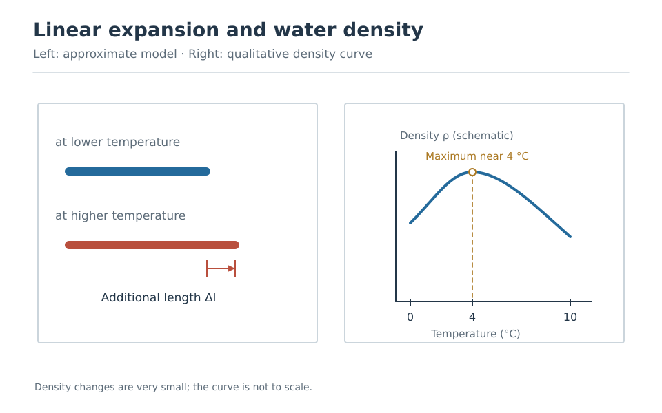

# M4-L4 – Thermal expansion and water’s density anomaly {#L4}

**Course area:** M4 – Temperature, heat and particles. **Level:** Lower secondary education. **Prior knowledge:** [M4-L3](M4-L3.md). **Learning objective:** Calculate a thermal length change and explain the density maximum of liquid water near 4 °C.

## Introduction {#S1}

Bridges and rails must allow for temperature changes. The volume of many liquids also changes as they warm or cool. Near its freezing point, water behaves unusually.

## Concepts and physical model {#S2}

Many solids **expand on heating**. For a thin rod over a moderate temperature range, a linear approximation gives the change in length:

$$\Delta l=\alpha\,l_0\,\Delta T.$$

Here $l_0$ is initial length, $\Delta T$ the temperature change and $\alpha$ the material's linear expansion coefficient in $\mathrm{K^{-1}}$. This approximation applies within a limited range. Engineered structures must allow movement or accommodate resulting stresses.

For **liquid water**, density reaches a maximum at about $4\,^\circ\mathrm{C}$ under ordinary pressure conditions. Cooling from around $10\,^\circ\mathrm{C}$ to $4\,^\circ\mathrm{C}$ slightly reduces the volume of a fixed mass, but cooling from $4\,^\circ\mathrm{C}$ to $0\,^\circ\mathrm{C}$ increases it. Ice is less dense than liquid water and floats, allowing lakes to freeze at the surface.

**Original draft diagram:** A lengthening rod and a qualitative water-density graph peaking near 4 °C.

*Heating can lengthen a rod, while liquid water has a density anomaly near 4 °C.*

## Worked example and application {#S3}

Consider a steel rod of initial length $l_0=2.0\,\mathrm{m}$. For this calculation, **assume** $\alpha=12\cdot10^{-6}\,\mathrm{K^{-1}}$ and $\Delta T=50\,\mathrm{K}$.

$$\Delta l=(12\cdot10^{-6}\,\mathrm{K^{-1}})(2.0\,\mathrm{m})(50\,\mathrm{K})=0.0012\,\mathrm{m}=1.2\,\mathrm{mm}.$$

The model assumes even heating and unrestrained expansion.

## Safe investigation {#S4}

Do not try to measure expansion by heating metal yourself. Use diagrams or a **simulation** of an expansion joint. For water, sketch a qualitative density graph from provided temperatures. Measuring small density changes accurately requires suitable laboratory equipment.

## Self-check {#S5}

### Exercises

1. Calculate $\Delta l$ for $l_0=1.5\,\mathrm{m}$, $\alpha=12\cdot10^{-6}\,\mathrm{K^{-1}}$ and $\Delta T=20\,\mathrm{K}$.
2. At roughly what temperature is liquid water most dense?
3. Why may rails require room for expansion?
4. Does water become denser or less dense when warmed from 0 °C to 4 °C?

### Solutions

1. $\Delta l=12\cdot10^{-6}\cdot1.5\cdot20\,\mathrm{m}=0.00036\,\mathrm{m}=0.36\,\mathrm{mm}$.
2. About $4\,^\circ\mathrm{C}$, depending slightly on conditions.
3. Thermal expansion can create stress and deformation if movement is constrained.
4. Denser: its density increases as it warms towards about 4 °C.

## Model limitations and transition {#S6}

Linear expansion is an approximation. The plotted water-density relation is **schematic, not measured data**; density also depends slightly on pressure and composition. Continue with [M4-L5](M4-L5.md).

## Sources {#S7}

- [Berlin-Brandenburg education server – Physics curriculum: topics and content](https://bildungsserver.berlin-brandenburg.de/rlp-online/c-faecher/physik/themen-und-inhalte) · Sections 3.1, 3.4 and 3.11 · Thermal behaviour, heat transfer and energy · Last accessed: 2026-11-21 · Content verified: 2026-11-21
- [LEIFIphysik – Density anomaly of water](https://www.leifiphysik.de/waermelehre/ausdehnung-bei-erwaermung/aufgabe/anomalie-des-wassers) · Density maximum of water near 4 °C and qualitative model · Last accessed: 2026-11-21 · Content verified: 2026-11-21
