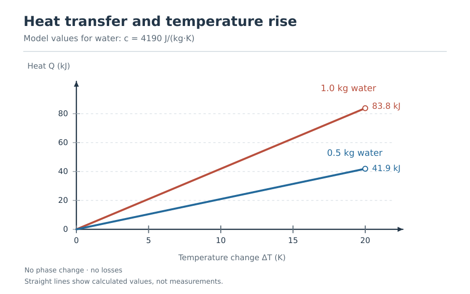

# M4-L5 – Specific heat capacity and temperature change {#L5}

**Course area:** M4 – Temperature, heat and particles. **Level:** Lower secondary education. **Prior knowledge:** [M4-L4](M4-L4.md). **Learning objective:** Calculate energy transferred during heating from mass, specific heat capacity and temperature change.

## Introduction {#S1}

A small cup of water can be warmed faster than a large one using the same heater power. The resulting temperature rise for a given energy input also depends on the material.

## Concepts and physical model {#S2}

**Specific heat capacity** $c$ describes the energy required per kilogram for a temperature increase of one kelvin. For heating **without a phase change**, using an approximately constant value of $c$:

$$Q=m\,c\,\Delta T.$$

Here $Q$ is energy transferred as heat, $m$ is mass, $c$ is specific heat capacity in $\mathrm{J/(kg\,K)}$ and $\Delta T$ is the temperature change in kelvin. If no other relevant energy flows occur, $Q$ equals the internal-energy change. For classroom calculations, water can be assigned $c\approx4190\,\mathrm{J/(kg\,K)}$. A difference of $20\,^\circ\mathrm{C}$ corresponds to $20\,\mathrm{K}$.

**Original draft diagram:** Two model lines of energy versus temperature rise for $0.5\,\mathrm{kg}$ and $1.0\,\mathrm{kg}$ of water, using the same value of $c$. Values are explicitly model values, not measurements.

*For the same material and temperature rise, heat transfer scales with mass.*

## Worked example and application {#S3}

For $m=0.50\,\mathrm{kg}$ of water and $\Delta T=20\,\mathrm{K}$:

$$Q=0.50\,\mathrm{kg}\cdot4190\,\frac{\mathrm{J}}{\mathrm{kg\,K}}\cdot20\,\mathrm{K}=41\,900\,\mathrm{J}=41.9\,\mathrm{kJ}.$$

For $1.0\,\mathrm{kg}$ under otherwise identical conditions, the value is $83.8\,\mathrm{kJ}$. In the simple model, twice the mass requires twice the energy.

## Safe investigation {#S4}

Design a **thought experiment** comparing two similarly insulated containers with different masses of water. Calculate expected energy inputs from given data. A real electrical-heating investigation must use approved school equipment and teacher supervision; input power and heat losses would also need measurement.

## Self-check {#S5}

### Exercises

1. Calculate $Q$ for $0.25\,\mathrm{kg}$ of water heated by $10\,\mathrm{K}$.
2. What is the SI unit of $c$?
3. Why does a kettle’s electrical input not exactly equal the energy received by the water?
4. What assumption fails during melting?

### Solutions

1. $Q=0.25\cdot4190\cdot10=10\,475\,\mathrm{J}\approx10.5\,\mathrm{kJ}$.
2. $\mathrm{J/(kg\,K)}$.
3. Some energy heats the container and surroundings; further losses may occur.
4. A phase change occurs, so energy changes the state rather than only the temperature.

## Model limitations and transition {#S6}

The formula requires a suitable material value and works best over restricted temperature ranges with no phase change. Plotted values are predictions rather than measured data. Continue with [M4-L6](M4-L6.md).

## Sources {#S7}

- [Berlin-Brandenburg education server – Physics curriculum: topics and content](https://bildungsserver.berlin-brandenburg.de/rlp-online/c-faecher/physik/themen-und-inhalte) · Sections 3.1, 3.4 and 3.11 · Thermal behaviour, heat transfer and energy · Last accessed: 2026-11-21 · Content verified: 2026-11-21
- [LEIFIphysik – Specific heat capacity](https://www.leifiphysik.de/waermelehre/innere-energie-waermekapazitaet/grundwissen/spezifische-waermekapazitaet) · Equation Q = mcΔT, water value 4190 J/(kg·K) · Last accessed: 2026-11-21 · Content verified: 2026-11-21
