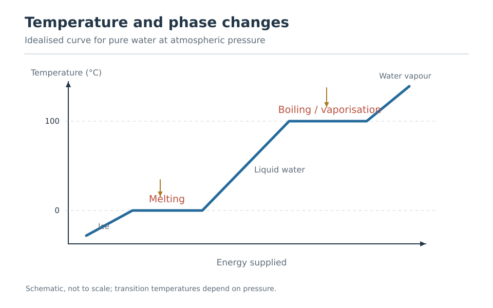

# M4-L6 – Melting, vaporisation and latent heat {#L6}

**Course area:** M4 – Temperature, heat and particles. **Level:** Lower secondary education. **Prior knowledge:** [M4-L5](M4-L5.md). **Learning objective:** Interpret temperature plateaus during phase changes and calculate their energy requirements.

## Introduction {#S1}

Ice can melt near $0\,^\circ\mathrm{C}$ while energy keeps entering. Why does its temperature not immediately rise? Under these conditions, the added energy changes the arrangement and interactions of particles.

## Concepts and physical model {#S2}

Pure substances often change phase at approximately fixed temperatures while pressure remains constant, for example during **melting** and **boiling**. The transferred energy is called **latent heat** or phase-change energy. For a complete phase change of mass $m$, a useful approximation is:

$$Q_{\mathrm{phase}}=m\,L.$$

$L$ is the specific latent heat in $\mathrm{J/kg}$. Melting and vaporisation require energy input; freezing and condensation release energy. Liquid can **evaporate below boiling temperature**, which can cool the remaining liquid.

An ideal heating curve for pure water at normal atmospheric pressure has sloping parts and nearly flat sections around $0\,^\circ\mathrm{C}$ and $100\,^\circ\mathrm{C}$. Actual results depend on conditions.

**Original draft diagram:** Schematic temperature-versus-energy curve with melting and boiling plateaus, explicitly not to scale.

*Energy can enter during a phase transition without raising the temperature.*

## Worked example and application {#S3}

Take $0.20\,\mathrm{kg}$ of ice **already at $0\,^\circ\mathrm{C}$**. Using an approximate specific latent heat of fusion of $L_f=335\,\mathrm{kJ/kg}$, the energy needed to melt it is:

$$Q=0.20\,\mathrm{kg}\cdot335\,\mathrm{kJ/kg}=67.0\,\mathrm{kJ}.$$

Energy to warm colder ice to 0 °C, or warm the resulting water above 0 °C, is **additional**.

## Safe investigation {#S4}

Examine a **provided** temperature–time graph and mark intervals where temperature changes little. A real school investigation can use small pieces of ice and **lukewarm** water with supervision. Boiling water, steam and pressurised containers are not suitable self-directed activities. Compare measurements with the idealised curve.

## Self-check {#S5}

### Exercises

1. Why can temperature remain nearly constant during melting?
2. Find the energy needed to melt $0.10\,\mathrm{kg}$ of ice at $0\,^\circ\mathrm{C}$ if $L_f=335\,\mathrm{kJ/kg}$.
3. What is the reverse of condensation?
4. Why does $Q=mc\Delta T$ alone not describe a phase-change plateau?

### Solutions

1. Energy is used mainly to change phase and particle arrangement.
2. $Q=0.10\cdot335=33.5\,\mathrm{kJ}$.
3. Vaporisation: liquid to gas.
4. On a plateau $\Delta T$ is almost zero even though substantial phase-change energy is transferred.

## Model limitations and transition {#S6}

Plateaus describe an ideal pure substance at nearly constant pressure. Mixtures, heat losses and measurement lag modify actual curves. Boiling point depends on pressure. Continue with [M4-L7](M4-L7.md).

## Sources {#S7}

- [Berlin-Brandenburg education server – Physics curriculum: topics and content](https://bildungsserver.berlin-brandenburg.de/rlp-online/c-faecher/physik/themen-und-inhalte) · Sections 3.1, 3.4 and 3.11 · Thermal behaviour, heat transfer and energy · Last accessed: 2026-11-21 · Content verified: 2026-11-21
- [LEIFIphysik – Specific latent heat of fusion and vaporisation](https://www.leifiphysik.de/waermelehre/innere-energie-waermekapazitaet/grundwissen/spezifische-schmelz-und-verdampfungswaerme) · Energy transfer in phase changes and the particle model · Last accessed: 2026-11-21 · Content verified: 2026-11-21
- [LEIFIphysik – Time–temperature graph](https://www.leifiphysik.de/waermelehre/innere-energie-waermekapazitaet/aufgabe/zeit-temperatur-diagramm) · Heating plateaus and approximate latent heat of fusion of ice 335 kJ/kg · Last accessed: 2026-11-21 · Content verified: 2026-11-21
