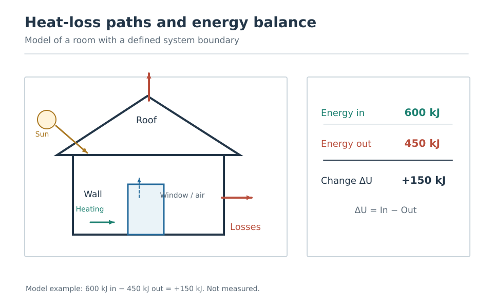

# M4-L7 – Thermal insulation and an energy balance {#L7}

**Course area:** M4 – Temperature, heat and particles. **Level:** Lower secondary education. **Prior knowledge:** [M4-L6](M4-L6.md). **Learning objective:** Analyse heat-loss pathways, balance energy inputs and outputs, and justify insulation measures.

## Introduction {#S1}

In winter, a heated building can cool if energy escapes faster than the heating system supplies it. Effective insulation reduces the required energy input; insulation does not generate heat itself.

## Concepts and physical model {#S2}

Energy is conserved for a **clearly defined system**. A simplified balance is:

$$\Delta U=E_{\mathrm{in}}-E_{\mathrm{out}},$$

provided the terms include the relevant forms of transfer for that model. Inputs include heating and sunlight; outputs include energy transfer through walls, roof, windows and ventilation. The signs depend on the system boundary.

**Insulation** reduces conduction and often convection. Multiple glazing can reduce heat transfer, while reflective surfaces can alter radiation. Gaps let air carry energy away. A **thermal bridge** is a path with relatively high heat flow, for example at some junctions between building elements.

**Original draft diagram:** Building cross-section with energy-transfer paths through walls, roof and an air gap, plus a separate input–output balance without invented measurements.

*The internal-energy change is modelled as energy in minus energy out.*

## Worked example and application {#S3}

In a chosen time interval, a model room receives $500\,\mathrm{kJ}$ from heating and $100\,\mathrm{kJ}$ from sunlight. It loses $450\,\mathrm{kJ}$ across its boundary during that interval. For this defined model:

$$\Delta U=(500+100-450)\,\mathrm{kJ}=150\,\mathrm{kJ}.$$

This does **not directly imply** a particular increase in room temperature: materials, masses, heat capacities and other processes must be included.

## Safe investigation {#S4}

Make a **calculated comparison table** for two model rooms receiving the same input but with different assumed losses. Evaluate sealing draughts, insulating surfaces and appropriate ventilation. Altering real building fabric is not a classroom experiment. Ventilation and moisture requirements must not be ignored.

## Self-check {#S5}

### Exercises

1. Find $\Delta U$ if $E_{\mathrm{in}}=800\,\mathrm{kJ}$ and $E_{\mathrm{out}}=620\,\mathrm{kJ}$.
2. Why is insulation not an energy source?
3. Name two different heat-loss pathways in a house.
4. Why can we not infer “the room warms by 5 °C” from $\Delta U$ alone?

### Solutions

1. $\Delta U=800-620=180\,\mathrm{kJ}$.
2. It reduces transfer rates; it does not create energy.
3. Conduction through building materials and convection/ventilation losses, or thermal radiation.
4. The effective heat capacity, mass and temperature distribution and further conditions are unknown.

## Model limitations and transition {#S6}

A real building balance needs time dependence, air exchange, moisture, radiation, thermal bridges and measurements. The diagram is a model, not an energy certificate. The next module starts with [M5-L1 – Electric charge and electrostatic forces](M5-L1.md).

## Sources {#S7}

- [Berlin-Brandenburg education server – Physics curriculum: topics and content](https://bildungsserver.berlin-brandenburg.de/rlp-online/c-faecher/physik/themen-und-inhalte) · Sections 3.1, 3.4 and 3.11 · Thermal behaviour, heat transfer and energy · Last accessed: 2026-11-21 · Content verified: 2026-11-21
- [LEIFIphysik – Heat transfer](https://www.leifiphysik.de/waermelehre/waermetransport/grundwissen/waermetransport) · Conduction, convection, radiation and combinations of mechanisms · Last accessed: 2026-11-21 · Content verified: 2026-11-21
