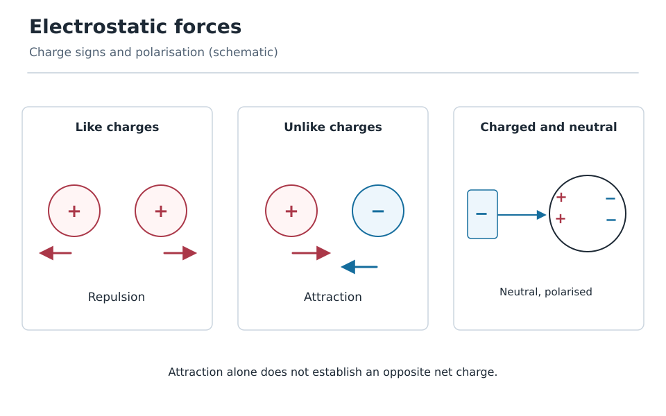

# M5-L1 – Electric charge and electrostatic forces {#L1}

**Course area:** M5 – Electric charge and circuits. **Level:** Lower secondary education. **Prior knowledge:** [M1-L2](M1-L2.md). **Learning objective:** Explain attraction and repulsion using the sign-of-charge model and distinguish neutral from charged objects.

## Starting question {#S1}

A rubbed plastic balloon can stick to a wall. How can this happen when the wall may be electrically neutral overall? The explanation begins with electric charges and their distribution.

## Physical concepts and model {#S2}

**Electric charge** is a physical property of particles and objects. Its symbol is $Q$ and its SI unit is the **coulomb** ($\mathrm{C}$). Charge can be positive ($+$) or negative ($-$). An object is **electrically neutral** when its positive and negative contributions balance overall. Neutral does not mean that it contains no charged particles.

Protons in atoms are positively charged; electrons are negatively charged. When suitable materials are brought into contact and then separated, electrons can be transferred, leaving the materials charged. Rubbing may increase this transfer. **Total charge is conserved**: charge is moved, not created from nothing.

- **Like charges repel** ($+/+$ or $-/-$).
- **Unlike charges attract** ($+/-$).
- A charged object can also attract a neutral object: the distribution of charge inside the neutral object can shift (**polarisation**). Attraction alone therefore cannot identify the sign of an unknown object's charge.

**Original teaching diagram:** Two pairs of charges with force arrows and a polarised neutral object.

*The diagram contrasts repulsion of like charges and attraction of unlike charges or polarised neutral objects.*

## Worked example or application {#S3}

Two small spheres with the same negative net charge hang freely close to one another. They move apart, consistent with the charge model. If a negatively charged plastic rod approaches a light paper ball that was initially neutral, the ball may be attracted. This does **not** prove the paper has a positive net charge: polarisation can explain the observation.

## Safe observation and experiment {#S4}

**Safe classroom observation:** A teacher rubs a plastic balloon with dry fabric and brings it near small paper pieces. Observe before contact and again after a brief touch. Keep the materials away from sensitive electronics. Do not use high-voltage devices, mains outlets or ignition sources. Record whether the observation establishes a charge sign.

## Check your learning {#S5}

### Questions

1. What does “neutral” mean in the charge model?
2. What happens between two positively charged spheres?
3. Why does attraction of neutral paper not prove an opposite net charge?
4. A sphere loses electrons. How can that change its net charge?

### Answers

1. The positive and negative contributions balance; charged particles are still present.
2. They repel one another.
3. The charged object can redistribute charges inside the paper, causing attraction.
4. Its charge becomes more positive relative to its initial state because it has lost negative charge.

## Limits and transition {#S6}

The arrows indicate force directions, not magnitudes. The force also depends on separation and amount of charge. Charging by friction depends on materials and humidity. Electric field-line models will be developed later.

**Next:** [M5-L2](M5-L2.md)

## Sources {#S7}

- [Berlin-Brandenburg education server – Physics curriculum: topics and content](https://bildungsserver.berlin-brandenburg.de/rlp-online/c-faecher/physik/themen-und-inhalte) · 3.5 Electric current and charge · Last accessed: 2026-11-21 · Content verified: 2026-11-21
- [LEIFIphysik – Electricity and charge](https://www.leifiphysik.de/elektrizitaetslehre/einfache-stromkreise/grundwissen/elektrizitaet-und-ladung) · Signs of charge, charge balancing, electrostatic attraction and repulsion · Last accessed: 2026-11-21 · Content verified: 2026-11-21
