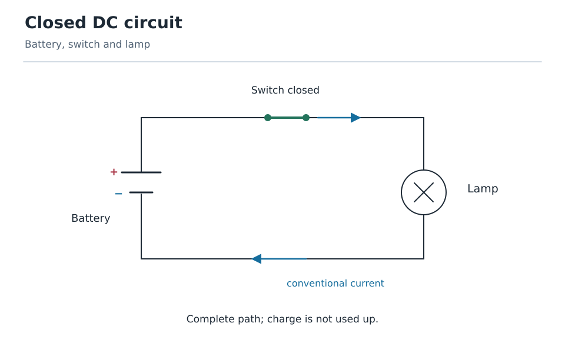

# M5-L2 – Electric current and the closed circuit {#L2}

**Course area:** M5 – Electric charge and circuits. **Level:** Lower secondary education. **Prior knowledge:** [M5-L1](M5-L1.md). **Learning objective:** Draw a simple closed DC circuit and apply current $I=\Delta Q/\Delta t$.

## Starting question {#S1}

A battery, a small lamp, a switch and wires will only light the lamp if the circuit forms a complete path. A single wire from the battery to the lamp is not enough.

## Physical concepts and model {#S2}

An **electric current** is a directed transport of electric charge. In metals, mobile electrons are the main charge carriers; in other materials ions can also transport charge. A simple circuit needs an energy source, conducting connections and a load (such as a suitable lamp).

With a **closed switch** a complete conducting path exists; an **open switch** breaks the path. In the external circuit, **conventional current direction** is defined from the positive to the negative terminal of the source. In metallic wires the mean electron drift is in the opposite direction. Electric signals propagate much faster than the electrons drift.

**Current** is the amount of charge transferred per unit time:

$$
I=\frac{\Delta Q}{\Delta t}, \qquad [I]=\mathrm{A},\quad 1\,\mathrm{A}=1\,\mathrm{C/s}.
$$

The source supplies energy; charge is not “used up” in the idealised closed circuit. **Original teaching diagram:** Battery, switch and lamp in a closed circuit, with conventional current direction marked.

*The simple circuit provides a complete path and shows conventional current direction.*

## Worked example or application {#S3}

A wire carries $8\,\mathrm{C}$ in $20\,\mathrm{s}$. Its average current is

$$
I=\frac{8\,\mathrm{C}}{20\,\mathrm{s}}=0.40\,\mathrm{A}.
$$

At a constant current of $0.15\,\mathrm{A}$, the charge carried in $40\,\mathrm{s}$ is $6.0\,\mathrm{C}$.

## Safe observation and experiment {#S4}

**Use only an approved current-limited classroom supply or a suitable battery holder:** A teacher or supervised learners connect an appropriate low-voltage lamp through a switch. Assemble the circuit with the source switched off; observe the lamp as the switch changes position. Never short-circuit battery terminals or use a household mains outlet.

## Check your learning {#S5}

### Questions

1. What condition is necessary for the lamp to shine continuously?
2. A current transfers $3\,\mathrm{C}$ in $5\,\mathrm{s}$. Calculate $I$.
3. Which way do electrons drift in a metal compared with conventional current?
4. Is electric charge consumed in the lamp?

### Answers

1. A complete conducting path and a suitable source and lamp are needed.
2. $I=3/5\,\mathrm{A}=0.60\,\mathrm{A}$.
3. In the opposite direction to conventional current.
4. No. Charge continues through the idealised steady circuit; energy is converted.

## Limits and transition {#S6}

The equation gives average current over a finite interval; changing current requires a suitably short interval. A closed path does not guarantee light if the source or lamp is unsuitable. A short circuit is also a closed path but is hazardous and not a working lamp circuit.

**Next:** [M5-L3](M5-L3.md)

## Sources {#S7}

- [Berlin-Brandenburg education server – Physics curriculum: topics and content](https://bildungsserver.berlin-brandenburg.de/rlp-online/c-faecher/physik/themen-und-inhalte) · 3.5 Electric current and charge · Last accessed: 2026-11-21 · Content verified: 2026-11-21
- [LEIFIphysik – Electric circuits and their quantities](https://www.leifiphysik.de/elektrizitaetslehre/elektrische-grundgroessen/grundwissen/elektrische-stromkreise-und-ihre-groessen) · Charge carriers, current and the concept of voltage · Last accessed: 2026-11-21 · Content verified: 2026-11-21
- [LEIFIphysik – Electric current and the ampere](https://www.leifiphysik.de/elektrizitaetslehre/elektrische-grundgroessen/grundwissen/elektrische-stromstaerke-und-die-einheit-ampere) · Current as charge per unit time and its SI unit · Last accessed: 2026-11-21 · Content verified: 2026-11-21
