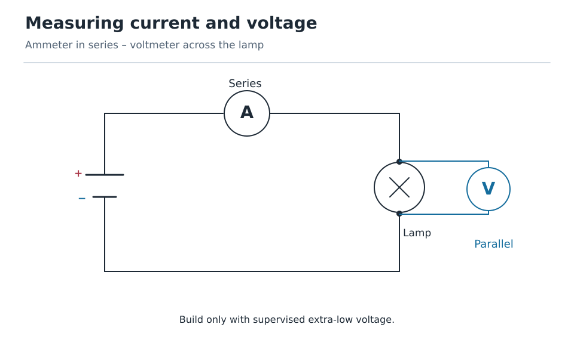

# M5-L3 – Measuring voltage and current correctly {#L3}

**Course area:** M5 – Electric charge and circuits. **Level:** Lower secondary education. **Prior knowledge:** [M5-L2](M5-L2.md). **Learning objective:** Place an ammeter in series and a voltmeter in parallel with a component, and interpret simple readings.

## Starting question {#S1}

Two instruments might display “0.20 A” and “3.0 V”. They do not measure the same quantity and therefore must not be connected to the circuit in the same way.

## Physical concepts and model {#S2}

**Current $I$** expresses charge crossing a conductor section per unit time (unit: ampere). **Voltage $U$** between two points expresses transferable energy per unit charge (unit: volt). For an energy transfer $\Delta E$ associated with a charge magnitude $\Delta Q$, an appropriate idealised relation is

$$
U=\frac{\Delta E}{\Delta Q},\qquad 1\,\mathrm{V}=1\,\mathrm{J/C}.
$$

An **ammeter (A)** is connected **in series** in the branch whose current is to be measured; current passes through it. A **voltmeter (V)** is connected **in parallel** across a component, between its two terminals. It compares the electrical potentials at its ends.

An ideal ammeter has negligible internal resistance; an ideal voltmeter has extremely high internal resistance. Meter range, polarity and socket selection must match the instrument and supply. **Original teaching diagram:** A simple circuit with the ammeter in series and a voltmeter parallel to the lamp.

*Current is measured in series; voltage is measured across two component terminals.*

## Worked example or application {#S3}

Measurements for a small lamp are $U=3.0\,\mathrm{V}$ and $I=0.20\,\mathrm{A}$. In $10\,\mathrm{s}$, charge $\Delta Q=I\Delta t=2.0\,\mathrm{C}$ passes a section of the circuit. If the readings stay approximately constant, the electrical energy transferred at the lamp in that time is

$$
\Delta E=U\Delta Q=3.0\,\mathrm{V}\cdot 2.0\,\mathrm{C}=6.0\,\mathrm{J}.
$$

## Safe observation and experiment {#S4}

Only on a **current-limited extra-low-voltage circuit** under supervision: switch the supply off first. Select the meter terminals and ranges as instructed. Insert the ammeter into a break in the branch and place the voltmeter across the two lamp terminals. Turn the supply on only after teacher inspection. Never connect an ammeter directly across a battery; never experiment on mains voltage.

## Check your learning {#S5}

### Questions

1. How is an ammeter connected to measure lamp current?
2. How is a voltmeter connected to measure voltage across that lamp?
3. Calculate charge transferred in $5\,\mathrm{s}$ at $0.40\,\mathrm{A}$.
4. What energy corresponds to $5\,\mathrm{C}$ at $2\,\mathrm{V}$?

### Answers

1. In series in the lamp branch; charge passes through the meter.
2. In parallel across the lamp terminals.
3. $\Delta Q=I\Delta t=0.40\,\mathrm{A}\cdot5\,\mathrm{s}=2.0\,\mathrm{C}$.
4. $\Delta E=U\Delta Q=2\,\mathrm{V}\cdot5\,\mathrm{C}=10\,\mathrm{J}$.

## Limits and transition {#S6}

The equation $U=\Delta E/\Delta Q$ requires a clear choice of the two measurement points and associated energy transfer. Real instruments can slightly alter the circuit. The readings apply only to the specified operating conditions; a lamp may change resistance as it warms.

**Next:** [M5-L4](M5-L4.md)

## Sources {#S7}

- [Berlin-Brandenburg education server – Physics curriculum: topics and content](https://bildungsserver.berlin-brandenburg.de/rlp-online/c-faecher/physik/themen-und-inhalte) · 3.6 Current, voltage, resistance and power · Last accessed: 2026-11-21 · Content verified: 2026-11-21
- [LEIFIphysik – Connecting measuring instruments](https://www.leifiphysik.de/elektrizitaetslehre/elektrische-grundgroessen/grundwissen/schaltung-von-messgeraeten) · Ammeter in series, voltmeter in parallel · Last accessed: 2026-11-21 · Content verified: 2026-11-21
- [LEIFIphysik – Electric circuits and their quantities](https://www.leifiphysik.de/elektrizitaetslehre/elektrische-grundgroessen/grundwissen/elektrische-stromkreise-und-ihre-groessen) · Charge carriers, current and the concept of voltage · Last accessed: 2026-11-21 · Content verified: 2026-11-21
