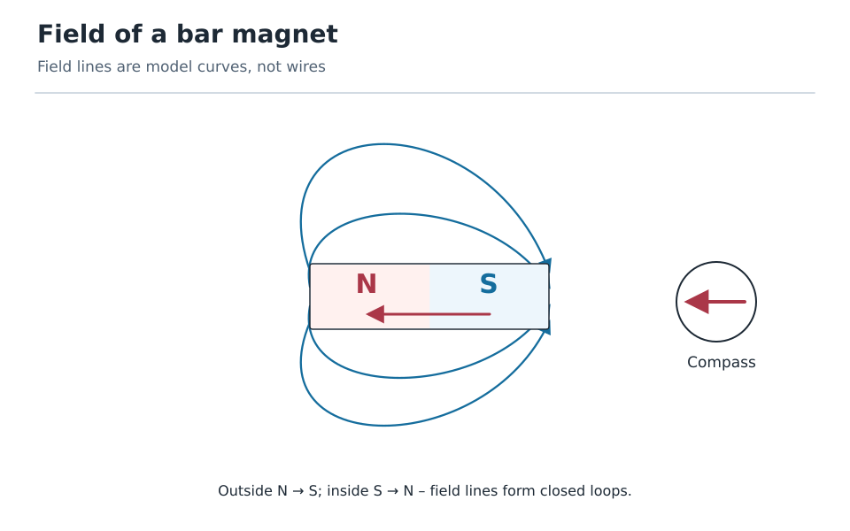

# M5-L4 – Permanent magnets and the magnetic field {#L4}

**Course area:** M5 – Electric charge and circuits. **Level:** Lower secondary education. **Prior knowledge:** [M5-L3](M5-L3.md). **Learning objective:** Name north and south poles, predict attraction and repulsion, and read a basic magnetic-field-line diagram.

## Starting question {#S1}

A compass turns when placed close to a magnet. The magnet can affect the needle without touching it. A magnetic field describes this region of influence.

## Physical concepts and model {#S2}

Every ordinary **permanent magnet** has a **north pole (N)** and a **south pole (S)**. Like poles repel and unlike poles attract. A piece of iron can be attracted by either pole; attraction alone does not show that the iron is an opposite magnetic pole.

A **magnetic field** describes magnetic influence in space. **Field lines** are drawn model curves, not physical threads. Outside a bar magnet their conventional direction is from the north to the south pole; inside the magnet the closed path continues from south to north. A compass needle aligns with the local field direction. Closely spaced model lines indicate a stronger field; the exact number drawn is arbitrary.

The **Earth** also has a magnetic field. A simple bar-magnet model approximately explains compass alignment. In reality the field is generated mainly by electric currents in the fluid outer core and varies in space and time. Geographic and magnetic poles are not identical. **Original teaching diagram:** Bar magnet, closed field lines and a compass needle.

*Field lines run from N to S outside the magnet and complete the loop within.*

## Worked example or application {#S3}

Bring the north pole of one bar magnet towards the north pole of another: they repel. Turn one around so that north faces south: the poles attract. A nearby compass may turn to a new direction; its orientation depends on where it is placed.

## Safe observation and experiment {#S4}

Place a small compass on a desk and slowly move a weak classroom magnet around it at a safe distance. Sketch the needle orientation at several positions. Keep magnets away from medical implants, magnetic storage and sensitive electronics. Avoid handling strong neodymium magnets close to fingers (pinching risk).

## Check your learning {#S5}

### Questions

1. Which magnetic poles repel each other?
2. In which direction do conventional field lines run outside a bar magnet?
3. Are field lines physical fibres?
4. Why need a compass near a bar magnet not point towards geographic north?

### Answers

1. Two north poles or two south poles.
2. From N to S outside; the lines close through the magnet.
3. No; they are a model for field direction and structure.
4. The nearby bar magnet changes the net local magnetic field.

## Limits and transition {#S6}

A bar-magnet model is not a full three-dimensional field description and only crudely approximates Earth’s geodynamo. Line count and thickness are drawing choices; a schematic alone gives no precise magnetic-field magnitude.

**Next:** [M5-L5](M5-L5.md)

## Sources {#S7}

- [Berlin-Brandenburg education server – Physics curriculum: topics and content](https://bildungsserver.berlin-brandenburg.de/rlp-online/c-faecher/physik/themen-und-inhalte) · 3.9 Magnetic fields and electromagnetic induction · Last accessed: 2026-11-21 · Content verified: 2026-11-21
- [LEIFIphysik – Magnetic field and field lines](https://www.leifiphysik.de/elektrizitaetslehre/permanentmagnetismus/grundwissen/magnetfeld-und-feldlinien) · Field-line model, compass and Earth’s magnetic field · Last accessed: 2026-11-21 · Content verified: 2026-11-21
- [LEIFIphysik – Properties of permanent magnets](https://www.leifiphysik.de/elektrizitaetslehre/permanentmagnetismus/grundwissen/eigenschaften-von-permanentmagneten) · Poles and attraction/repulsion · Last accessed: 2026-11-21 · Content verified: 2026-11-21
