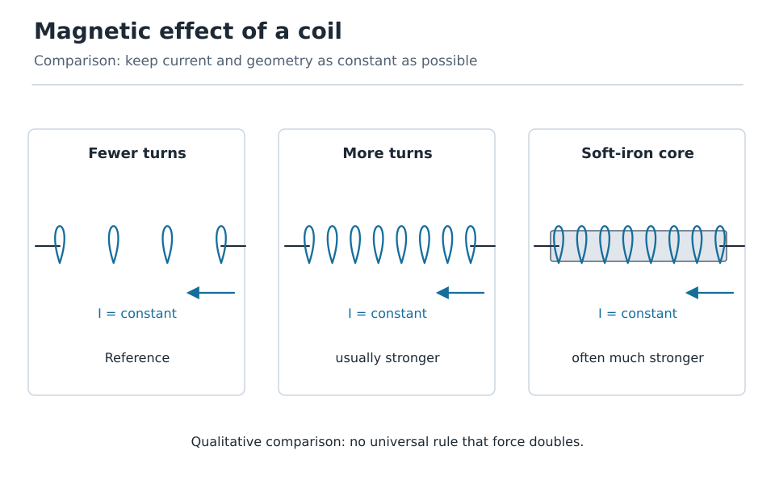

# M5-L5 – The magnetic effect of electric current {#L5}

**Course area:** M5 – Electric charge and circuits. **Level:** Lower secondary education. **Prior knowledge:** [M5-L4](M5-L4.md). **Learning objective:** Distinguish current direction, turn count and iron core as variables affecting a current-carrying coil.

## Starting question {#S1}

An electromagnet can hold an object and release it again. This is possible because electric current creates a magnetic field that can be changed by switching the circuit on and off.

## Physical concepts and model {#S2}

A **current-carrying conductor** is surrounded by a magnetic field. A **coil** combines the effects of its turns. With direct current, its two ends behave magnetically much like the poles of a bar magnet. **Reversing current direction** swaps which end acts as north and which as south, provided the winding orientation stays the same.

The electromagnet’s effect depends on **current**, **number of turns** and **core material**. With other conditions held equal, adding turns can strengthen the field. A suitable **soft-iron core** often increases the magnetic effect considerably. To test one variable, keep the others as constant as possible. Note that a coil with more turns may also have higher electrical resistance, so current can change even when using the same battery.

**Original teaching diagram:** Two comparison coils, a current arrow and the variables held constant.

*At controlled current, turn count and core material affect the magnetic response.*

## Worked example or application {#S3}

Compare coil A with 20 turns and coil B with 40 turns at the **same current and similar geometry**. The simple model predicts a stronger field for B. This does not imply that its lifting force must double. Inserting a suitable soft-iron core into one coil will usually increase the magnetic effect markedly.

## Safe observation and experiment {#S4}

**Teacher supervision required**, using an approved current-limited extra-low-voltage supply and a suitable classroom coil. With power off, place a compass near the coil. Switch on briefly and observe its deflection. Switch off again before moving the core or rebuilding the setup. Do not connect unprotected homemade wire coils directly to batteries: low resistance can cause overheating or a short circuit. Do not use mains power or powerful magnets.

## Check your learning {#S5}

### Questions

1. What happens to coil poles when current direction is reversed?
2. Why must current be controlled when comparing coils with 20 and 40 turns?
3. What does a suitable soft-iron core usually do?
4. Does twice the turn count guarantee twice the lifting force?

### Answers

1. North and south swap ends.
2. More turns can change the resistance and thus current; the cause of any difference would otherwise be unclear.
3. It generally strengthens the coil’s magnetic effect.
4. No. Force also depends on field geometry, air gaps and materials.

## Limits and transition {#S6}

This is a qualitative school-level model. Field strength, magnetisation and force are not always linear; iron cores may saturate. Heat generation limits how long a coil may safely remain on.

**Next:** [M5-L6](M5-L6.md)

## Sources {#S7}

- [Berlin-Brandenburg education server – Physics curriculum: topics and content](https://bildungsserver.berlin-brandenburg.de/rlp-online/c-faecher/physik/themen-und-inhalte) · 3.9 Magnetic fields and electromagnetic induction · Last accessed: 2026-11-21 · Content verified: 2026-11-21
- [LEIFIphysik – Magnetic effects of electric current](https://www.leifiphysik.de/elektrizitaetslehre/stromwirkungen/grundwissen/magnetische-wirkung-des-elektrischen-stroms) · Magnetic effect of a coil and a soft iron core · Last accessed: 2026-11-21 · Content verified: 2026-11-21
