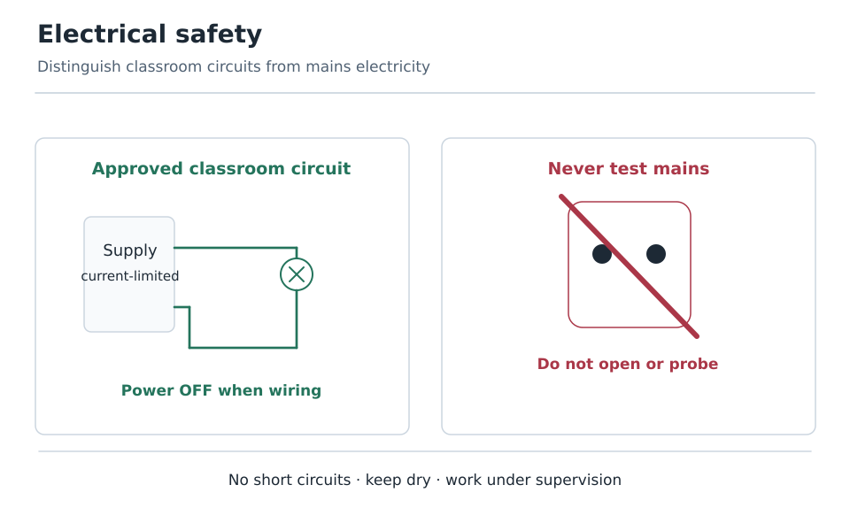

# M5-L6 – Electrical safety in learning and everyday life {#L6}

**Course area:** M5 – Electric charge and circuits. **Level:** Lower secondary education. **Prior knowledge:** [M5-L5](M5-L5.md). **Learning objective:** Identify risks from short circuits, moisture and mains voltage and justify safe precautions.

## Starting question {#S1}

A classroom experiment with a suitable small battery is not the same as an experiment involving a mains socket. Why are the safety rules different, and why can even a battery become hot in a short circuit?

## Physical concepts and model {#S2}

The human body can conduct electric current. **Current through the body** may cause serious injury; risk depends on current path, magnitude, duration and environmental conditions. Moisture can lower the electrical resistance of skin and surroundings. Household **mains voltage must not be used for student experiments**.

A **short circuit** is an unintended very-low-resistance connection, for example directly between two battery terminals. It can cause high current, heating or fire even if the supply voltage is modest. Batteries and rechargeable cells are not necessarily safe against short circuits.

**Precautions:** Use only approved, suitable and supervised classroom equipment; wire circuits with the power off; check the supply and current limit; avoid damaged wires and moisture; never open sockets or household electrical appliances; ask a teacher or qualified professional when unsure. Fuses and residual-current devices can reduce risk but do not make touching live parts or improvised experiments safe. **Original teaching diagram:** Approved low-voltage classroom arrangement contrasted with prohibited mains experimentation.

*Classroom experiments need a suitable current-limited supply; testing mains electricity is prohibited.*

## Worked example or application {#S3}

Situation A: A small lamp is wired to a suitable classroom supply through a switch while the supply is off. Under supervision, switching it on may be an appropriate teaching activity.

Situation B: Someone tries to measure current at a mains socket by inserting the probes of a multimeter set to ammeter mode. This is a **potentially lethal mistake**: an ammeter has very low internal resistance and may create a short circuit. The attempt **must not be made**.

## Safe observation and experiment {#S4}

**No mains experiment:** Assess drawings only, or use an approved current-limited extra-low-voltage setup. On paper, mark (1) the current limiter, (2) the switch, and (3) a point where directly joining the positive and negative terminals would create a short circuit. Never make that short circuit in reality.

## Check your learning {#S5}

### Questions

1. Why can moisture increase electrical danger?
2. Why must battery terminals not be joined directly by a wire?
3. Does a residual-current device make it safe to touch live electrical conductors?
4. What should be done with a damaged mains cable?

### Answers

1. Wet skin and surroundings can reduce resistance, making dangerous current more likely.
2. Very low resistance can cause severe heating or damage.
3. No. It is an additional protection device, not permission to contact live parts.
4. Do not use or open it; report it to a responsible adult or qualified professional.

## Limits and transition {#S6}

This lesson is not professional electrical-safety training and does not define any universally safe voltage limit. Safety depends on the complete setup and applicable school procedures. In a real electrical accident, protect yourself first, arrange a safe disconnection by competent persons and request emergency assistance; do not touch a person who may still be in contact with live electrical equipment.

**Looking ahead:** The next module begins with [M6-L1 – Position, distance, time and reference frames](M6-L1.md).

## Sources {#S7}

- [Berlin-Brandenburg education server – Physics curriculum: topics and content](https://bildungsserver.berlin-brandenburg.de/rlp-online/c-faecher/physik/themen-und-inhalte) · 3.5 Electric current and charge · Last accessed: 2026-11-21 · Content verified: 2026-11-21
- [Sichere Schule – Electrical experiments in physics lessons](https://www.sichere-schule.de/physik/praktisches-arbeiten/elektrik) · Supervision, suitable voltage sources and safety precautions for school experiments · Last accessed: 2026-11-21 · Content verified: 2026-11-21
- [LEIFIphysik – Connecting measuring instruments](https://www.leifiphysik.de/elektrizitaetslehre/elektrische-grundgroessen/grundwissen/schaltung-von-messgeraeten) · Ammeter in series, voltmeter in parallel · Last accessed: 2026-11-21 · Content verified: 2026-11-21
