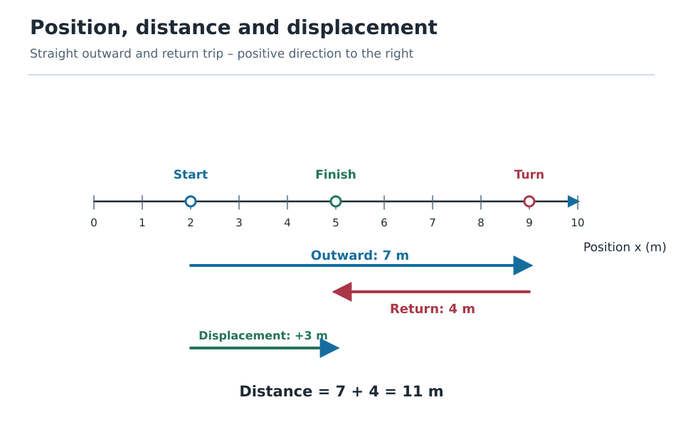

# M6-L1 – Position, distance, time and reference frames {#L1}

**Course area:** M6 – Motion and speed. **Level:** Lower secondary education. **Prior knowledge:** [M1-L5](M1-L5.md). **Learning objective:** Distinguish position, displacement, distance travelled and elapsed time in a chosen reference frame.

## Starting question {#S1}

A train enters a station. To people on the platform it moves; to a passenger the seat beside them stays at the same position. Both observations can be correct because they use different reference frames.

## Physical concepts and model {#S2}

To describe motion, first say **relative to what** it is measured. A **reference frame** includes a reference object, a position axis and a clock. For now we use straight-line motion along an oriented $x$-axis. **Position $x$** is the coordinate at time $t$; its sign depends on the chosen origin and positive direction.

**Displacement** is $\Delta x=x_2-x_1$ and can be positive or negative. **Distance travelled** $s$ adds the lengths of the path segments and is non-negative. If an object travels along a straight line without turning back, $s=|\Delta x|$; otherwise distance is larger. Time instants ($t_1$, $t_2$) are different from elapsed time $\Delta t=t_2-t_1$. SI units are metres ($\mathrm{m}$) and seconds ($\mathrm{s}$).

**Original teaching diagram:** A position axis showing an outward and return journey, with separate markers for distance and displacement.

*Distance adds both path segments; displacement compares only start and finish.*

## Worked example or application {#S3}

A student starts at $x_1=2\,\mathrm{m}$, walks to $x=9\,\mathrm{m}$ and returns to $x_2=5\,\mathrm{m}$. Then

$$
\Delta x=5-2=3\,\mathrm{m},\qquad s=(9-2)+(9-5)=11\,\mathrm{m}.
$$

The movement lasts from $t_1=4\,\mathrm{s}$ to $t_2=14\,\mathrm{s}$, so $\Delta t=10\,\mathrm{s}$. The difference between $11\,\mathrm{m}$ and $3\,\mathrm{m}$ is not an error: they are different quantities.

## Safe observation and experiment {#S4}

**Safe classroom activity:** Mark a two-metre scale along an unobstructed floor section. Mark start, turn and finish and time the movement with a stopwatch. Compute distance from path segments and displacement from coordinates. Do not block exits or routes used by others.

## Check your learning {#S5}

### Questions

1. How is position different from distance travelled?
2. An object moves from $x=-2\,\mathrm{m}$ to $x=6\,\mathrm{m}$ without turning. Find $\Delta x$ and $s$.
3. A child walks $3\,\mathrm{m}$ forward, then $2\,\mathrm{m}$ back. Find distance and displacement.
4. What information must be defined to describe motion in a reference frame?

### Answers

1. Position is a coordinate at one instant; distance sums the lengths of the path segments.
2. $\Delta x=6-(-2)=8\,\mathrm{m}$ and $s=8\,\mathrm{m}$.
3. $s=5\,\mathrm{m}$, $\Delta x=+1\,\mathrm{m}$ with forward taken as positive.
4. A reference object and oriented position axis, plus time measured with a clock.

## Limits and transition {#S6}

The model is restricted to straight-line motion. Curved paths require more than one coordinate. Here different reference frames are treated as simple observer viewpoints; relativistic effects are outside the scope.

**Next:** [M6-L2](M6-L2.md)

## Sources {#S7}

- [Berlin-Brandenburg education server – Physics topics and content](https://bildungsserver.berlin-brandenburg.de/rlp-online/c-faecher/physik/themen-und-inhalte) · Motion, speed, acceleration, motion laws and diagrams · Last accessed: 2026-11-21 · Content verified: 2026-11-21
- [LEIFIphysik – Uniform motions](https://www.leifiphysik.de/mechanik/lineare-bewegung-gleichungen/grundwissen/gleichfoermige-bewegungen) · Position–time law, constant velocity and unit conversion · Last accessed: 2026-11-21 · Content verified: 2026-11-21
- [KMK – Educational standards in Germany](https://www.kmk.org/bildungsministerkonferenz/bildungsthemen/bildungsstandards.html) · 2024 lower-secondary school-leaving standards – mechanics competencies · Last accessed: 2026-11-21 · Content verified: 2026-11-21
