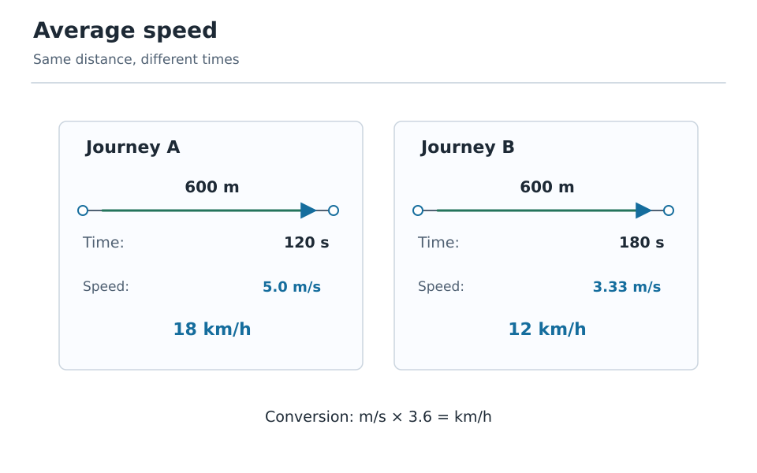

# M6-L2 – Average speed and unit conversion {#L2}

**Course area:** M6 – Motion and speed. **Level:** Lower secondary education. **Prior knowledge:** [M6-L1](M6-L1.md). **Learning objective:** Calculate average speed and convert between metres per second and kilometres per hour.

## Starting question {#S1}

Two people cover the same 600-metre distance, but one takes two minutes and the other three. Average speed lets us compare their overall pace.

## Physical concepts and model {#S2}

**Average speed** is the total distance travelled divided by the elapsed time:

$$
\bar v_{\mathrm{speed}}=\frac{s}{\Delta t}.
$$

For directed straight-line motion, **average velocity** is $\bar v_x=\Delta x/\Delta t$ and has a sign. The distinction matters when an object reverses direction: an outward-and-return trip can have a large total distance but zero average velocity. Everyday use of “speed” and “velocity” is sometimes loose, so we will state which quantity is meant.

The SI unit is $\mathrm{m/s}$. Since $1\,\mathrm{km}=1000\,\mathrm{m}$ and $1\,\mathrm{h}=3600\,\mathrm{s}$:

$$
1\,\mathrm{m/s}=3.6\,\mathrm{km/h},\quad 1\,\mathrm{km/h}=\frac{1}{3.6}\,\mathrm{m/s}.
$$

**Original teaching diagram:** Two distance-and-time comparisons and a unit conversion for the same scenario.

*The same distance completed in less time implies higher average speed.*

## Worked example or application {#S3}

A cyclist covers $600\,\mathrm{m}$ in $120\,\mathrm{s}$:

$$
\bar v=\frac{600\,\mathrm{m}}{120\,\mathrm{s}}=5.0\,\mathrm{m/s}=18\,\mathrm{km/h}.
$$

If the same distance takes $180\,\mathrm{s}$, the average speed is $3.33\,\mathrm{m/s}$ or $12\,\mathrm{km/h}$. The calculation uses the full distance and total time, not the highest instantaneous speed.

## Safe observation and experiment {#S4}

**Safe classroom activity:** Measure a straight ten-metre distance in a gym. One learner walks at a steady pace while another measures time. Repeat a few times and compare the readings; start timing and human reaction introduce uncertainty. Do not run or measure traffic speeds on roads.

## Check your learning {#S5}

### Questions

1. A bicycle covers $300\,\mathrm{m}$ in $60\,\mathrm{s}$. Find average speed.
2. Convert $8\,\mathrm{m/s}$ to $\mathrm{km/h}$.
3. Convert $54\,\mathrm{km/h}$ to $\mathrm{m/s}$.
4. What is the average velocity for a complete trip that returns to the starting point?

### Answers

1. $\bar v=300/60=5\,\mathrm{m/s}$.
2. $8\times3.6=28.8\,\mathrm{km/h}$.
3. $54/3.6=15\,\mathrm{m/s}$.
4. Zero because the total displacement is $\Delta x=0$, even though average speed can be positive.

## Limits and transition {#S6}

An average does not tell us the highest speed, short stops or changes along the route. A simple arithmetic mean of segment speeds is not generally the overall average. Measurements have uncertainties.

**Next:** [M6-L3](M6-L3.md)

## Sources {#S7}

- [Berlin-Brandenburg education server – Physics topics and content](https://bildungsserver.berlin-brandenburg.de/rlp-online/c-faecher/physik/themen-und-inhalte) · Motion, speed, acceleration, motion laws and diagrams · Last accessed: 2026-11-21 · Content verified: 2026-11-21
- [LEIFIphysik – Uniform motions](https://www.leifiphysik.de/mechanik/lineare-bewegung-gleichungen/grundwissen/gleichfoermige-bewegungen) · Position–time law, constant velocity and unit conversion · Last accessed: 2026-11-21 · Content verified: 2026-11-21
- [KMK – Educational standards in Germany](https://www.kmk.org/bildungsministerkonferenz/bildungsthemen/bildungsstandards.html) · 2024 lower-secondary school-leaving standards – mechanics competencies · Last accessed: 2026-11-21 · Content verified: 2026-11-21
