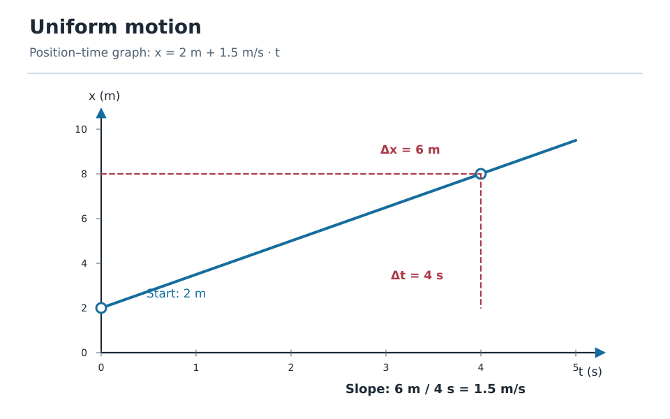

# M6-L3 – Uniform straight-line motion {#L3}

**Course area:** M6 – Motion and speed. **Level:** Lower secondary education. **Prior knowledge:** [M6-L2](M6-L2.md). **Learning objective:** Identify uniform motion from a straight position–time graph and calculate position values.

## Starting question {#S1}

A person moves with constant velocity along a straight path. In each additional second they cover the same displacement. A straight line appears on the position–time graph.

## Physical concepts and model {#S2}

In **uniform straight-line motion** the directed velocity $v_x$ is constant. For starting position $x_0$ at $t=0$,

$$
x(t)=x_0+v_x t.
$$

The **slope** of the line on a **position–time graph** is $\Delta x/\Delta t=v_x$. A horizontal line represents rest, while a line with negative slope represents motion in the negative direction. Only when $x_0=0$ and the object travels in the positive direction can we simply write $s=vt$ for distance. A **distance–time graph** instead shows total distance, which cannot decrease. Keeping the two graphs distinct avoids mistakes when direction changes.

**Original teaching diagram:** Two lines on an $x$–$t$ graph with a marked initial position and slope triangle.

*The slope of a straight position–time line gives constant directed velocity.*

## Worked example or application {#S3}

A cart is at $x_0=2\,\mathrm{m}$ when $t=0$ and moves steadily at $v_x=1.5\,\mathrm{m/s}$. After four seconds:

$$
x(4\,\mathrm{s})=2\,\mathrm{m}+1.5\,\mathrm{m/s}\cdot4\,\mathrm{s}=8\,\mathrm{m}.
$$

The graph points $(0\,\mathrm{s},2\,\mathrm{m})$ and $(4\,\mathrm{s},8\,\mathrm{m})$ define the straight line; its slope is $(8-2)/4=1.5\,\mathrm{m/s}$.

## Safe observation and experiment {#S4}

**Safe activity:** Roll a toy cart across a smooth table or low ramp and mark positions at equal time intervals using a short video. Check whether the points lie approximately on a straight line. Friction may slow the cart, so uniform motion is only an approximation.

## Check your learning {#S5}

### Questions

1. What does the slope of a position–time line mean?
2. An object moves at $2\,\mathrm{m/s}$ from $x_0=3\,\mathrm{m}$. Find $x$ after $5\,\mathrm{s}$.
3. What does a horizontal position–time line show?
4. What does a negative slope mean for an oriented $x$-axis?

### Answers

1. The constant directed velocity $v_x$.
2. $x=3+2\cdot5=13\,\mathrm{m}$.
3. Position stays constant: rest in this reference frame.
4. Motion in the negative axis direction.

## Limits and transition {#S6}

An approximately straight measured line does not prove exactly constant velocity; uncertainty and sampling may hide small changes. When acceleration occurs, the graph is no longer straight.

**Next:** [M6-L4](M6-L4.md)

## Sources {#S7}

- [Berlin-Brandenburg education server – Physics topics and content](https://bildungsserver.berlin-brandenburg.de/rlp-online/c-faecher/physik/themen-und-inhalte) · Motion, speed, acceleration, motion laws and diagrams · Last accessed: 2026-11-21 · Content verified: 2026-11-21
- [LEIFIphysik – Uniform motions](https://www.leifiphysik.de/mechanik/lineare-bewegung-gleichungen/grundwissen/gleichfoermige-bewegungen) · Position–time law, constant velocity and unit conversion · Last accessed: 2026-11-21 · Content verified: 2026-11-21
- [LEIFIphysik – Relations between motion graphs](https://www.leifiphysik.de/mechanik/lineare-bewegung-gleichungen/grundwissen/zusammenhang-der-diagramme) · Position–time slopes and velocity–time areas · Last accessed: 2026-11-21 · Content verified: 2026-11-21
- [KMK – Educational standards in Germany](https://www.kmk.org/bildungsministerkonferenz/bildungsthemen/bildungsstandards.html) · 2024 lower-secondary school-leaving standards – mechanics competencies · Last accessed: 2026-11-21 · Content verified: 2026-11-21
