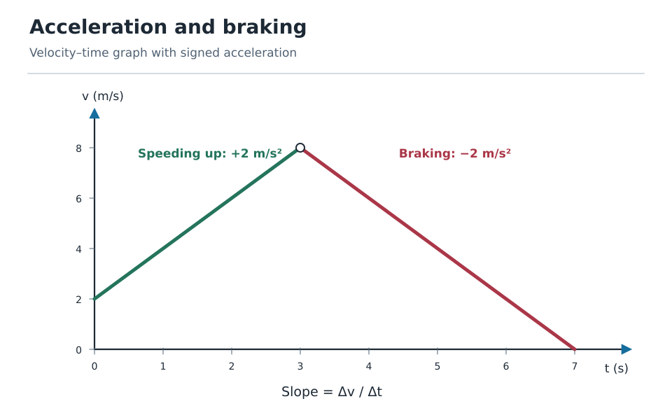

# M6-L4 – Acceleration and deceleration {#L4}

**Course area:** M6 – Motion and speed. **Level:** Lower secondary education. **Prior knowledge:** [M6-L3](M6-L3.md). **Learning objective:** Calculate acceleration as change in directed velocity per time, including sign and unit.

## Starting question {#S1}

A scooter starts at a light and gains speed. Later the rider brakes. Both actions change the velocity and can be described using acceleration.

## Physical concepts and model {#S2}

**Average acceleration** in straight-line motion is the change in directed velocity divided by elapsed time:

$$
\bar a_x=\frac{v_{x,2}-v_{x,1}}{t_2-t_1},\qquad [a]=\mathrm{m/s^2}.
$$

If the direction of travel is positive, positive acceleration initially increases velocity in that direction. A negative acceleration when velocity is positive represents **deceleration**. Negative acceleration does not always mean slowing down: an object travelling left with negative velocity can speed up if its acceleration is also negative.

For **constant** acceleration, $v_x(t)=v_{x,0}+a_x t$. We must state that assumption whenever we use the relation. **Original teaching diagram:** Velocity–time lines for speeding up, cruising and braking.

*Slope on a velocity–time graph represents acceleration.*

## Worked example or application {#S3}

A cart accelerates uniformly in the positive direction from $2\,\mathrm{m/s}$ to $8\,\mathrm{m/s}$ in $3\,\mathrm{s}$:

$$
\bar a=\frac{8-2}{3}=2\,\mathrm{m/s^2}.
$$

It then brakes from $8\,\mathrm{m/s}$ to rest in $4\,\mathrm{s}$, giving $\bar a=(0-8)/4=-2\,\mathrm{m/s^2}$. The two accelerations have equal magnitude but opposite directions.

## Safe observation and experiment {#S4}

**Safe activity:** Examine a short video of a slowly moving toy cart. Estimate velocities for successive intervals, then calculate average acceleration from their differences. Use low speeds on an unobstructed tabletop; do not carry out risky vehicle experiments.

## Check your learning {#S5}

### Questions

1. What is the SI unit of acceleration?
2. An object goes from rest to $6\,\mathrm{m/s}$ in $3\,\mathrm{s}$. Find $\bar a$.
3. An object moving in the positive direction slows from $10\,\mathrm{m/s}$ to $4\,\mathrm{m/s}$ in $2\,\mathrm{s}$. Find $\bar a$.
4. Can an object speed up with negative acceleration?

### Answers

1. Metres per second squared: $\mathrm{m/s^2}$.
2. $\bar a=(6-0)/3=2\,\mathrm{m/s^2}$.
3. $\bar a=(4-10)/2=-3\,\mathrm{m/s^2}$.
4. Yes, if velocity and acceleration both point in the negative direction.

## Limits and transition {#S6}

Real-world acceleration often varies with time. Average acceleration does not specify its instantaneous value. Motion along a curve can involve acceleration even at constant speed, but that is beyond this lesson.

**Next:** [M6-L5](M6-L5.md)

## Sources {#S7}

- [Berlin-Brandenburg education server – Physics topics and content](https://bildungsserver.berlin-brandenburg.de/rlp-online/c-faecher/physik/themen-und-inhalte) · Motion, speed, acceleration, motion laws and diagrams · Last accessed: 2026-11-21 · Content verified: 2026-11-21
- [LEIFIphysik – Constant acceleration](https://www.leifiphysik.de/mechanik/beschleunigte-bewegung/grundwissen/beschleunigung-bei-gleichmaessig-beschleunigter-bewegung) · Acceleration as the change in velocity per unit time · Last accessed: 2026-11-21 · Content verified: 2026-11-21
- [KMK – Educational standards in Germany](https://www.kmk.org/bildungsministerkonferenz/bildungsthemen/bildungsstandards.html) · 2024 lower-secondary school-leaving standards – mechanics competencies · Last accessed: 2026-11-21 · Content verified: 2026-11-21
