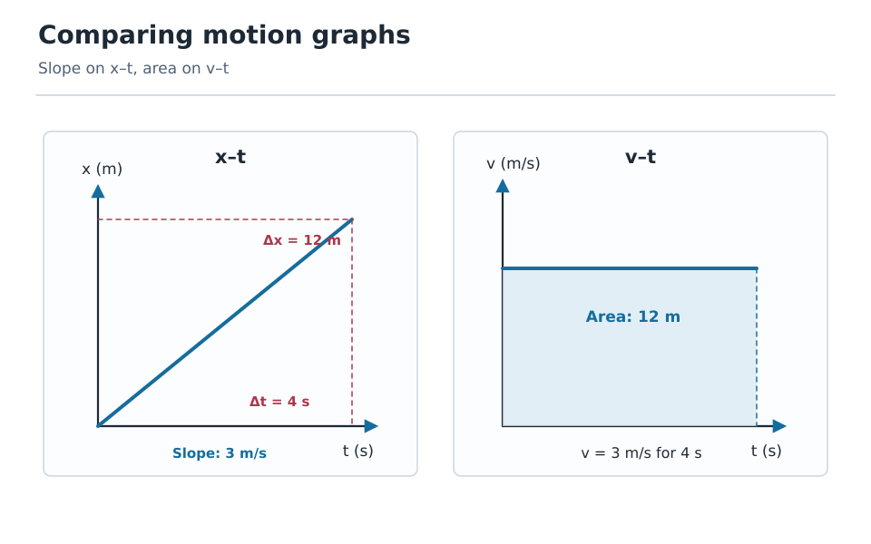

# M6-L5 – Reading and drawing motion graphs {#L5}

**Course area:** M6 – Motion and speed. **Level:** Lower secondary education. **Prior knowledge:** [M6-L4](M6-L4.md). **Learning objective:** Distinguish position–time from velocity–time graphs using slopes and areas.

## Starting question {#S1}

Two graphs can look similar while describing different physics. The vertical-axis quantity is what determines their meaning.

## Physical concepts and model {#S2}

A **position–time ($x$–$t$) graph** plots position $x$ against time $t$. Its slope $\Delta x/\Delta t$ gives average velocity. A steep rising line means a large positive velocity; a falling line means negative velocity. For a curved graph, a local tangent slope gives instantaneous velocity.

A **velocity–time ($v_x$–$t$) graph** plots directed velocity $v_x$ against time $t$. Its slope $\Delta v_x/\Delta t$ gives average acceleration. The **signed area between the graph and the time axis** gives displacement $\Delta x$. Areas below the axis count negatively. Total distance travelled is the sum of the magnitudes of the separate areas.

Graphs need labelled axes, units and appropriate scales. **Original teaching diagram:** A linear $x$–$t$ graph beside a constant $v$–$t$ graph, with a slope triangle and a shaded area.

*Slope on a position–time graph gives velocity; area under velocity–time gives displacement.*

## Worked example or application {#S3}

From $t=0$ to $t=4\,\mathrm{s}$ a velocity–time graph shows constant $v_x=3\,\mathrm{m/s}$. The area is a rectangle:

$$
\Delta x=3\,\mathrm{m/s}\cdot4\,\mathrm{s}=12\,\mathrm{m}.
$$

On the matching position–time graph with $x_0=0$, position rises linearly from $0$ to $12\,\mathrm{m}$; the slope is $12\,\mathrm{m}/4\,\mathrm{s}=3\,\mathrm{m/s}$. If a velocity–time graph has an upward-sloping line, its slope instead represents acceleration.

## Safe observation and experiment {#S4}

**Safe activity:** Make a table of four position measurements at one-second intervals and plot the $x$–$t$ graph on squared paper. Calculate successive slopes and make a simple $v$–$t$ graph. Do not conceal measurement uncertainty with overly precise drawn lines.

## Check your learning {#S5}

### Questions

1. What does the slope of an $x$–$t$ graph show?
2. What does the slope of a $v_x$–$t$ graph show?
3. An object has $v_x=4\,\mathrm{m/s}$ for $5\,\mathrm{s}$. Find displacement from the area.
4. An object moves for 2 s at $+3\,\mathrm{m/s}$ and 2 s at $-3\,\mathrm{m/s}$. Find displacement and distance.

### Answers

1. Directed velocity: average from a secant slope or instantaneous from a tangent.
2. Acceleration: average from a secant slope or instantaneous from a tangent.
3. $\Delta x=4\times5=20\,\mathrm{m}$.
4. Displacement $+6-6=0\,\mathrm{m}$; distance $6+6=12\,\mathrm{m}$.

## Limits and transition {#S6}

Areas on velocity–time graphs only have physical meaning if axis units are correct. A curve fitted to uncertain measurements is a model, not exact ground truth. The diagram uses simplified noise-free motion.

**Next:** [M6-L6](M6-L6.md)

## Sources {#S7}

- [Berlin-Brandenburg education server – Physics topics and content](https://bildungsserver.berlin-brandenburg.de/rlp-online/c-faecher/physik/themen-und-inhalte) · Motion, speed, acceleration, motion laws and diagrams · Last accessed: 2026-11-21 · Content verified: 2026-11-21
- [LEIFIphysik – Relations between motion graphs](https://www.leifiphysik.de/mechanik/lineare-bewegung-gleichungen/grundwissen/zusammenhang-der-diagramme) · Position–time slopes and velocity–time areas · Last accessed: 2026-11-21 · Content verified: 2026-11-21
- [LEIFIphysik – Velocity–time diagram](https://www.leifiphysik.de/mechanik/lineare-bewegung-gleichungen/grundwissen/zeit-geschwindigkeit-diagramm) · Constant and changing velocity plotted against time · Last accessed: 2026-11-21 · Content verified: 2026-11-21
- [KMK – Educational standards in Germany](https://www.kmk.org/bildungsministerkonferenz/bildungsthemen/bildungsstandards.html) · 2024 lower-secondary school-leaving standards – mechanics competencies · Last accessed: 2026-11-21 · Content verified: 2026-11-21
