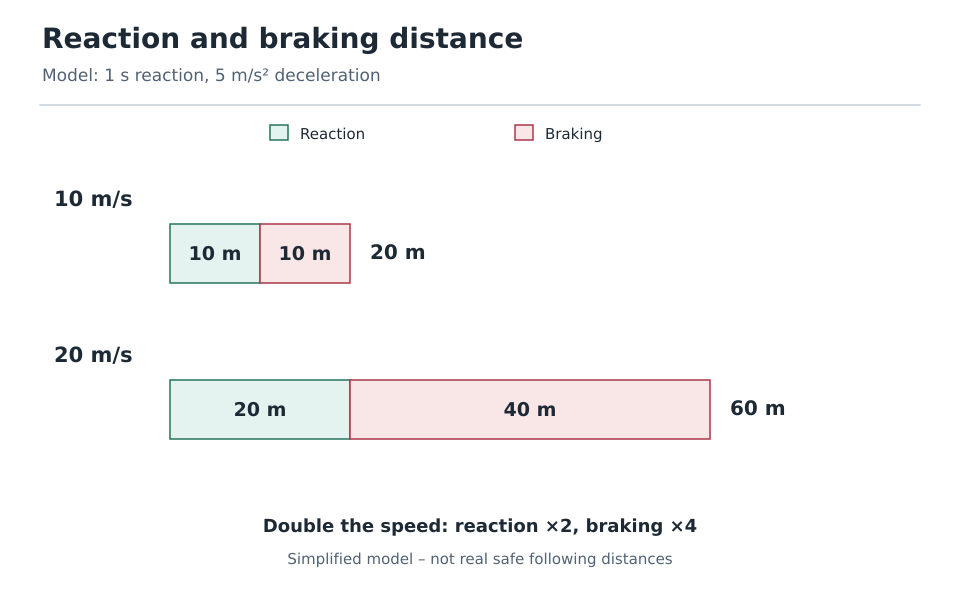

# M6-L6 – Motion and road safety {#L6}

**Course area:** M6 – Motion and speed. **Level:** Lower secondary education. **Prior knowledge:** [M6-L5](M6-L5.md). **Learning objective:** Combine reaction distance and braking distance into stopping distance and explain their speed dependence within a model.

## Starting question {#S1}

A vehicle travels over the same surface first at a low speed, then at twice that speed. Why might stopping require far more than twice the distance?

## Physical concepts and model {#S2}

In a simplified model **stopping distance** is the sum of **reaction distance** and **braking distance**:

$$
s_{\mathrm{stop}}=s_{\mathrm{reaction}}+s_{\mathrm{brake}}.
$$

At constant speed $v_0$ during an assumed reaction time $t_r$, $s_{\mathrm{reaction}}=v_0t_r$. With a constant braking deceleration magnitude $b>0$:

$$
s_{\mathrm{brake}}=\frac{v_0^2}{2b}.
$$

Under the same conditions reaction distance grows directly with speed, but braking distance grows with its **square**. Doubling speed therefore doubles reaction distance and quadruples braking distance in the model. These are model relationships, not guaranteed stopping distances on a real road. **Original teaching diagram:** Reaction and braking segments compared at two initial speeds.

*The model shows linear growth of reaction distance and quadratic growth of braking distance under fixed assumptions.*

## Worked example or application {#S3}

**Illustrative model, not driving advice:** $t_r=1.0\,\mathrm{s}$, constant deceleration $b=5.0\,\mathrm{m/s^2}$ on a flat dry surface. For $v_0=10\,\mathrm{m/s}$:

$$
s_r=10\,\mathrm{m},\qquad s_b=\frac{10^2}{2\cdot5}=10\,\mathrm{m},\qquad s_a=20\,\mathrm{m}.
$$

For $v_0=20\,\mathrm{m/s}$ with the same assumptions: $s_r=20\,\mathrm{m}$, $s_b=40\,\mathrm{m}$ and $s_a=60\,\mathrm{m}$. These speeds correspond to $36$ and $72\,\mathrm{km/h}$.

## Safe observation and experiment {#S4}

**Paper or computer model only:** Vary $v_0$, $t_r$ and $b$ in a table and plot stopping distance. Never test braking performance with vehicles, bicycles or people for this activity. Discuss how wet surfaces, distraction, gradients, tyres and load can change real outcomes.

## Check your learning {#S5}

### Questions

1. What are the two parts of stopping distance?
2. Find reaction distance for $v_0=12\,\mathrm{m/s}$ and $t_r=1.5\,\mathrm{s}$.
3. How does model braking distance change when speed doubles, with other conditions unchanged?
4. Calculate $s_b$ for $v_0=15\,\mathrm{m/s}$ and $b=7.5\,\mathrm{m/s^2}$.

### Answers

1. Reaction distance and braking distance.
2. $s_r=12\times1.5=18\,\mathrm{m}$.
3. It becomes four times as large, since $s_b\propto v_0^2$.
4. $s_b=225/15=15\,\mathrm{m}$.

## Limits and transition {#S6}

Constant braking deceleration and fixed reaction time are strong assumptions. The model ignores vehicle-system delays and varying friction. Numbers are illustrative, not assured braking or safe following distances. Actual road safety rules and conservative margins take precedence.

**Looking ahead:** The next module begins with [M7-L1 – Forces as interactions and how to represent them](M7-L1.md).

## Sources {#S7}

- [Berlin-Brandenburg education server – Physics topics and content](https://bildungsserver.berlin-brandenburg.de/rlp-online/c-faecher/physik/themen-und-inhalte) · Motion, speed, acceleration, motion laws and diagrams · Last accessed: 2026-11-21 · Content verified: 2026-11-21
- [LEIFIphysik – Stopping distance](https://www.leifiphysik.de/mechanik/beschleunigte-bewegung/ausblick/anhalteweg) · Reaction, braking and stopping distance within a physical model · Last accessed: 2026-11-21 · Content verified: 2026-11-21
- [LEIFIphysik – Constant acceleration](https://www.leifiphysik.de/mechanik/beschleunigte-bewegung/grundwissen/beschleunigung-bei-gleichmaessig-beschleunigter-bewegung) · Acceleration as the change in velocity per unit time · Last accessed: 2026-11-21 · Content verified: 2026-11-21
- [KMK – Educational standards in Germany](https://www.kmk.org/bildungsministerkonferenz/bildungsthemen/bildungsstandards.html) · 2024 lower-secondary school-leaving standards – mechanics competencies · Last accessed: 2026-11-21 · Content verified: 2026-11-21
