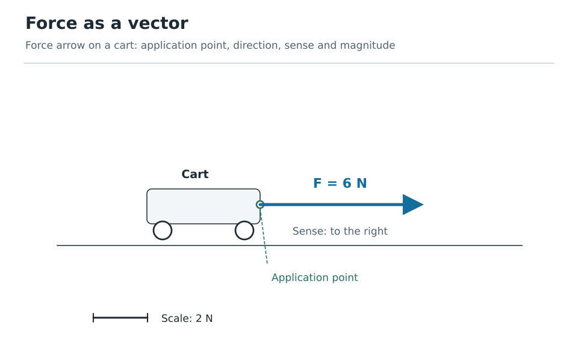

# M7-L1 – Forces as interactions and how to represent them {#L1}

**Course area:** M7 – Forces, pressure and buoyancy. **Level:** Lower secondary education. **Prior knowledge:** [M6-L6](M6-L6.md). **Learning objective:** Identify the effects of forces and draw complete force arrows on a selected object.

## Starting question {#S1}

Push a toy cart and it starts moving. Press a soft sponge and its shape changes. Both situations involve a force. Yet “something is pushed” is not a complete explanation: we need to identify **which object exerts a force on which other object**.

## Physical concepts and model {#S2}

A **force** describes an interaction, for instance between a hand and a cart or between Earth and a ball. A force may change speed or direction and may deform an object. Forces also act without visible motion: a book remains on a table even though Earth pulls it down and the table supports it.

Force is a **vector quantity**. A force arrow models its **point of application**, **line of action/direction**, **sense**, and **magnitude**. At a defined scale its length represents its magnitude; for example $1\,\mathrm{cm}$ may stand for $2\,\mathrm{N}$. The SI unit is the **newton** ($\mathrm{N}$), with $1\,\mathrm{N}=1\,\mathrm{kg\,m/s^2}$. Start an arrow on the object **receiving** the force in your diagram.

*Force* is not a synonym for *energy*. Forces can transfer energy, but newtons and joules measure different quantities.

**Original teaching diagram:** A cart on a horizontal track with a point of application, a rightward force arrow and a scale.

*Force arrows represent point of application, direction, sense and magnitude.*

## Worked example or application {#S3}

A hand pushes a cart horizontally with a force of $6\,\mathrm{N}$ to the right. With a drawing scale of $1\,\mathrm{cm}\widehat{=}2\,\mathrm{N}$, the arrow is **3 cm** long and points right. For now we draw **only that one force**; we must add all forces before inferring the cart's acceleration.

## Safe observation and experiment {#S4}

**Safe classroom activity:** Hang several small known masses from a suitable spring scale, one at a time, staying below the instrument’s range. Read newtons and sketch the direction of the force. Do not jerk the scale or handle heavy weights without supervision.

## Check your learning {#S5}

### Questions

1. Name two observable effects of a force.
2. Which four features are represented by a force arrow?
3. At $1\,\mathrm{cm}\widehat{=}2\,\mathrm{N}$, how long should an $8\,\mathrm{N}$ arrow be?
4. A cart moves to the right. Does that prove the net force points right?

### Answers

1. A change in motion and deformation.
2. Point of application, direction/line of action, sense and magnitude.
3. $8/2=4\,\mathrm{cm}$.
4. No. It may move uniformly to the right even if the net force is zero.

## Limits and transition {#S6}

A single arrow does not automatically include other forces such as friction and support. A force arrow is a model; real contact forces may be distributed across a surface.

**Next:** [M7-L2](M7-L2.md)

## Sources {#S7}

- [Berlin-Brandenburg education server – Physics topics](https://bildungsserver.berlin-brandenburg.de/rlp-online/c-faecher/physik/themen-und-inhalte) · Forces, motion, inertia, friction and differentiation in the curriculum · Last accessed: 2026-11-21 · Content verified: 2026-11-21
- [LEIFIphysik – Force and changes in motion](https://www.leifiphysik.de/mechanik/kraft-und-bewegungsaenderung) · Effects and interactions of forces; force versus motion · Last accessed: 2026-11-21 · Content verified: 2026-11-21
- [KMK – Lower-secondary physics educational standards](https://www.kmk.org/bildungsministerkonferenz/bildungsthemen/bildungsstandards.html) · Mechanics and competence domains (2024 standards) · Last accessed: 2026-11-21 · Content verified: 2026-11-21
