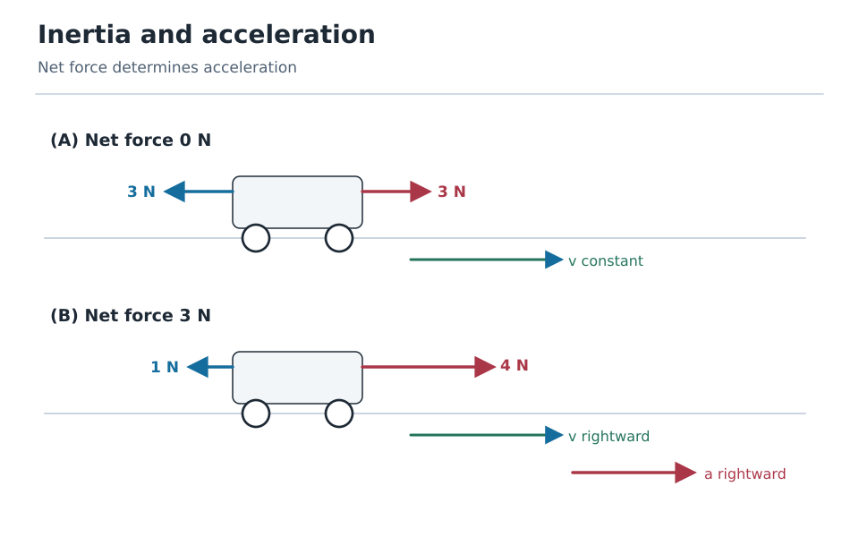

# M7-L2 – Inertia and Newton’s basic laws {#L2}

**Course area:** M7 – Forces, pressure and buoyancy. **Level:** Lower secondary education. **Prior knowledge:** [M7-L1](M7-L1.md). **Learning objective:** Interpret Newton’s laws using motion, net force and interactions between two objects.

## Starting question {#S1}

A skateboard keeps rolling for some distance after you stop pushing. This does not mean it carries a “stored pushing force”. The observation invites a better explanation of how force is related to changes in motion.

## Physical concepts and model {#S2}

**Newton’s first law**, the law of inertia, applies in an inertial frame: if the **sum of external forces is zero**, an object stays at rest or continues in a **straight line at constant velocity**. Real objects slow down mainly because of friction and air drag.

For constant mass, **Newton’s second law** relates net external force to acceleration:

$$
\vec F_{\mathrm{net}}=m\vec a.
$$

Acceleration points along the net force, which need not be the direction of the current velocity. Doubling the mass at the same net force halves the acceleration.

**Newton’s third law**, the interaction principle, says that when body A exerts a force on B, B simultaneously exerts an equal and opposite force on A. **The two forces act on different bodies** and therefore do not cancel when summing the forces on just one body. That is the key distinction between interaction pairs and equilibrium.

**Original teaching diagram:** A cart with zero net force compared with a cart experiencing a net pull, distinguishing velocity from acceleration arrows.

*Velocity does not have to point along force; net force determines acceleration.*

## Worked example or application {#S3}

A $2.0\,\mathrm{kg}$ cart experiences a $4\,\mathrm{N}$ pull to the right and $1\,\mathrm{N}$ friction to the left. Net force is $3\,\mathrm{N}$ to the right. Its acceleration is

$$
a=\frac{F_{\mathrm{net}}}{m}=\frac{3\,\mathrm{N}}{2.0\,\mathrm{kg}}=1.5\,\mathrm{m/s^2}
$$

to the right. Whether it was already moving does not change that instantaneous acceleration.

## Safe observation and experiment {#S4}

**Safe activity:** Roll a small wheeled toy across two level surfaces with different friction. Compare its motion after release; prevent it from rolling towards anyone. A smoother surface reduces deceleration but does not create an ideal friction-free system.

## Check your learning {#S5}

### Questions

1. What happens to an already moving object if net force is zero in an inertial frame?
2. Find acceleration if $m=3\,\mathrm{kg}$ and $F_{\mathrm{net}}=6\,\mathrm{N}$.
3. Why do a Newton’s-third-law pair of forces not cancel on the cart?
4. A car moves right but slows down. Which direction is its net force?

### Answers

1. It continues along a straight line at constant velocity.
2. $a=6/3=2\,\mathrm{m/s^2}$ in the direction of net force.
3. Because the action–reaction forces act on different objects.
4. Opposite the motion, here to the left.

## Limits and transition {#S6}

Here we work in approximately inertial frames with objects of constant mass. Rotating or accelerating frames require further treatment.

**Next:** [M7-L3](M7-L3.md)

## Sources {#S7}

- [Berlin-Brandenburg education server – Physics topics](https://bildungsserver.berlin-brandenburg.de/rlp-online/c-faecher/physik/themen-und-inhalte) · Forces, motion, inertia, friction and differentiation in the curriculum · Last accessed: 2026-11-21 · Content verified: 2026-11-21
- [LEIFIphysik – Newton’s first law](https://www.leifiphysik.de/mechanik/kraft-und-bewegungsaenderung/grundwissen/1-newtonsches-gesetz-traegheitsgesetz) · Inertia and constant velocity when net force vanishes · Last accessed: 2026-11-21 · Content verified: 2026-11-21
- [LEIFIphysik – Interaction is not equilibrium](https://www.leifiphysik.de/mechanik/kraft-und-bewegungsaenderung/grundwissen/wechselwirkung-ungleich-gleichgewicht) · Newton III: action–reaction forces act on different objects · Last accessed: 2026-11-21 · Content verified: 2026-11-21
- [KMK – Lower-secondary physics educational standards](https://www.kmk.org/bildungsministerkonferenz/bildungsthemen/bildungsstandards.html) · Mechanics and competence domains (2024 standards) · Last accessed: 2026-11-21 · Content verified: 2026-11-21
