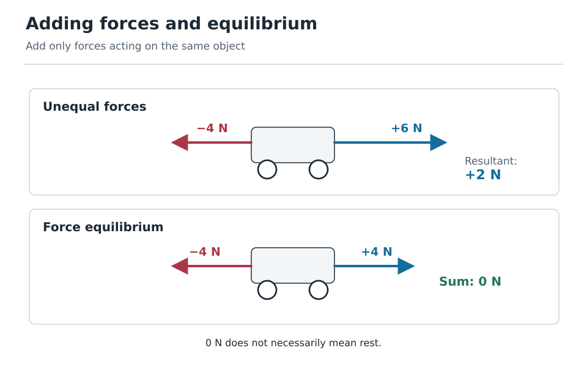

# M7-L3 – Adding forces and force equilibrium {#L3}

**Course area:** M7 – Forces, pressure and buoyancy. **Level:** Lower secondary education. **Prior knowledge:** [M7-L2](M7-L2.md). **Learning objective:** Add collinear forces with correct signs and assess whether an object is in equilibrium.

## Starting question {#S1}

Two people pull the same sled in opposite directions. A change in velocity depends not on one pull alone but on the vector sum of **all** forces exerted on the sled.

## Physical concepts and model {#S2}

Forces are vectors. To add forces along a straight axis, first define a positive direction. Then the **net force** obeys

$$
F_{\mathrm{net},x}=F_{1,x}+F_{2,x}+\dots.
$$

A rightward force is positive; a leftward one is negative. A positive sum means net force to the right, while a negative sum means left. Equal, opposite forces on **the same object** give zero net force: **force equilibrium**. This permits rest **or** constant straight-line velocity.

For forces acting in different directions, add components as vectors. With perpendicular components, for example, $|\vec F_{\mathrm{net}}|=\sqrt{F_x^2+F_y^2}$. Adding magnitudes alone would give the wrong result. The sled’s reaction force **on the person** is not part of the sled’s own force diagram.

**Original teaching diagram:** Two pairs of horizontal forces illustrating zero and nonzero resultant arrows.

*Add forces on the same body; zero net force also permits uniform motion.*

## Worked example or application {#S3}

Forces along a sled’s track are $F_1=+6\,\mathrm{N}$ and $F_2=-4\,\mathrm{N}$. The resultant is

$$
F_{\mathrm{net},x}=6\,\mathrm{N}-4\,\mathrm{N}=+2\,\mathrm{N}.
$$

Acceleration is rightwards. An **extra** $-2\,\mathrm{N}$ force would establish equilibrium. Even so, a sled originally moving left could first slow down, stop and then reverse direction.

## Safe observation and experiment {#S4}

**Safe classroom activity:** Attach two spring scales to a light ring on a level surface and pull with equal strength in opposite directions. Observe the stationary ring, then carefully change one pull. Stay within the scales’ ranges and never suddenly release a stretched spring.

## Check your learning {#S5}

### Questions

1. Add $+5\,\mathrm{N}$ and $-8\,\mathrm{N}$.
2. What additional force balances a resultant of $+3\,\mathrm{N}$?
3. Can an object be moving while in force equilibrium? Explain.
4. Find the magnitude of two perpendicular forces of $3\,\mathrm{N}$ and $4\,\mathrm{N}$.

### Answers

1. $-3\,\mathrm{N}$, meaning leftward.
2. $-3\,\mathrm{N}$, leftward.
3. Yes. In an inertial frame it may keep moving straight at constant velocity.
4. $\sqrt{3^2+4^2}=5\,\mathrm{N}$.

## Limits and transition {#S6}

Always assign the diagrammed forces to one chosen object. Forces applied at different places can also create a turning effect even when their vector sum is zero.

**Next:** [M7-L4](M7-L4.md)

## Sources {#S7}

- [Berlin-Brandenburg education server – Physics topics](https://bildungsserver.berlin-brandenburg.de/rlp-online/c-faecher/physik/themen-und-inhalte) · Forces, motion, inertia, friction and differentiation in the curriculum · Last accessed: 2026-11-21 · Content verified: 2026-11-21
- [LEIFIphysik – Vector addition of forces](https://www.leifiphysik.de/mechanik/kraefteaddition-und-zerlegung/grundwissen/kraefteaddition) · Net force obtained by vector addition · Last accessed: 2026-11-21 · Content verified: 2026-11-21
- [LEIFIphysik – Introduction to force equilibrium](https://www.leifiphysik.de/mechanik/kraft-und-kraftarten/grundwissen/gleichgewicht-von-kraeften-einfuehrung) · Balanced forces on an object, rest or constant velocity · Last accessed: 2026-11-21 · Content verified: 2026-11-21
- [KMK – Lower-secondary physics educational standards](https://www.kmk.org/bildungsministerkonferenz/bildungsthemen/bildungsstandards.html) · Mechanics and competence domains (2024 standards) · Last accessed: 2026-11-21 · Content verified: 2026-11-21
