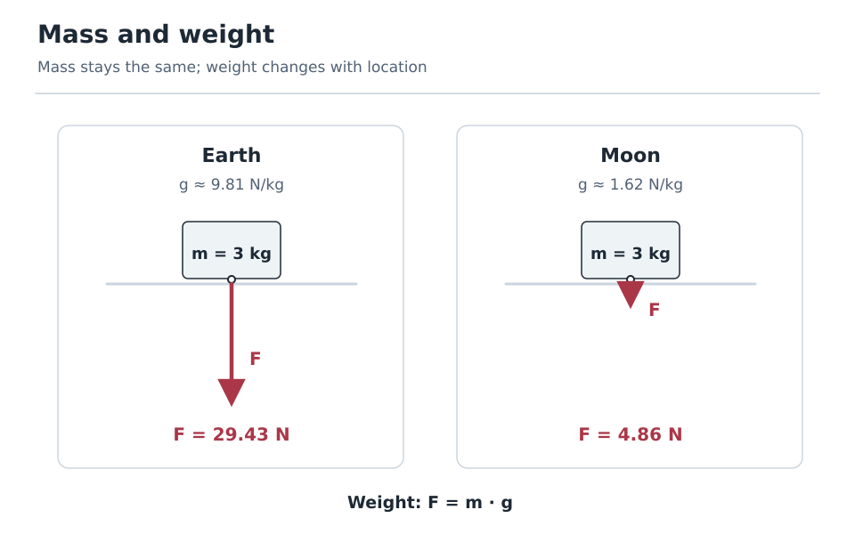

# M7-L4 – Mass, weight and gravitational field strength {#L4}

**Course area:** M7 – Forces, pressure and buoyancy. **Level:** Lower secondary education. **Prior knowledge:** [M7-L3](M7-L3.md). **Learning objective:** Distinguish mass from weight and calculate weight using the location-dependent factor g.

## Starting question {#S1}

An astronaut takes the same tool case to the Moon as on Earth. The case has less **weight**, but not less **mass**. Why does a spring scale change its reading while a properly used balance does not?

## Physical concepts and model {#S2}

**Mass**, $m$, is a measure related to inertia and is expressed in kilograms ($\mathrm{kg}$). **Weight**, $F_G$, is the gravitational force acting on an object. Near a planet’s or moon’s surface we use

$$
F_G=m\,g.
$$

Near Earth’s surface, gravitational field strength $g$ is approximately $9.81\,\mathrm{N/kg}$, while on the Moon it is about $1.62\,\mathrm{N/kg}$. Because $1\,\mathrm{N/kg}=1\,\mathrm{m/s^2}$, we can also express the magnitude of free-fall acceleration in these units when other influences are neglected.

A **spring scale** measures force. An ideal **beam balance** compares masses: the same local gravitational field acts on both sides. Everyday speech sometimes calls mass “weight”, but the two concepts differ in physics.

**Original teaching diagram:** The same case on Earth and the Moon, with identical mass labels but different-sized weight arrows.

*Mass remains unchanged; weight depends on local gravitational field strength.*

## Worked example or application {#S3}

A box has mass $m=3.0\,\mathrm{kg}$. Near Earth’s surface its weight is approximately

$$
F_{G,E}=3.0\,\mathrm{kg}\times9.81\,\mathrm{N/kg}=29.43\,\mathrm{N}.
$$

On the Moon, $F_{G,M}=3.0\times1.62=4.86\,\mathrm{N}$. Its mass stays $3.0\,\mathrm{kg}$ in either place.

## Safe observation and experiment {#S4}

**Safe activity:** With supervision, measure the weights of small, securely attached masses using a spring scale. Plot $F_G$ against $m$ and estimate local gravitational field strength from the slope. Stay below the instrument’s stated load limit.

## Check your learning {#S5}

### Questions

1. Which stays the same when moving an object from Earth to the Moon: mass or weight?
2. Calculate $F_G$ for $m=0.50\,\mathrm{kg}$ and $g=9.81\,\mathrm{N/kg}$.
3. What is the SI unit of weight as a force?
4. Why would a spring scale calibrated to show mass on the Moon give different readings on Earth?

### Answers

1. Mass stays the same; weight changes.
2. $F_G=0.50\times9.81=4.905\,\mathrm{N}\approx4.91\,\mathrm{N}$.
3. The newton (N).
4. It measures force, and gravitational field strength differs between the two locations.

## Limits and transition {#S6}

The stated field strengths are approximations. Position, altitude and planetary rotation slightly affect locally measured effective gravity. A freely falling scale may read zero even while gravity acts.

**Next:** [M7-L5](M7-L5.md)

## Sources {#S7}

- [Berlin-Brandenburg education server – Physics topics](https://bildungsserver.berlin-brandenburg.de/rlp-online/c-faecher/physik/themen-und-inhalte) · Forces, motion, inertia, friction and differentiation in the curriculum · Last accessed: 2026-11-21 · Content verified: 2026-11-21
- [LEIFIphysik – Weight as gravitational force](https://www.leifiphysik.de/mechanik/kraft-und-masse-ortsfaktor/grundwissen/gewichtskraft) · Distinction between mass, weight and gravitational field strength · Last accessed: 2026-11-21 · Content verified: 2026-11-21
- [KMK – Lower-secondary physics educational standards](https://www.kmk.org/bildungsministerkonferenz/bildungsthemen/bildungsstandards.html) · Mechanics and competence domains (2024 standards) · Last accessed: 2026-11-21 · Content verified: 2026-11-21
