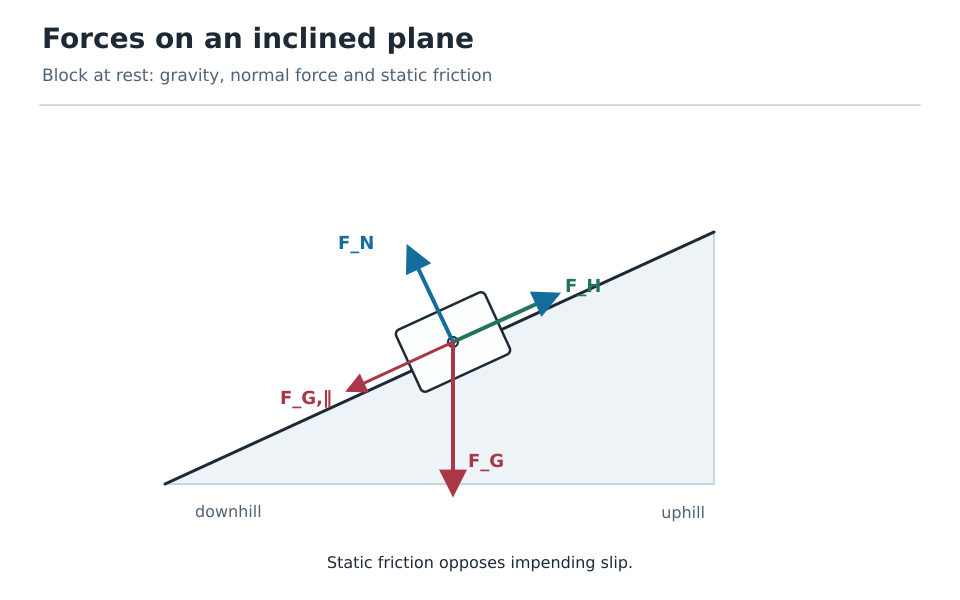

# M7-L5 – Friction and drag {#L5}

**Course area:** M7 – Forces, pressure and buoyancy. **Level:** Lower secondary education. **Prior knowledge:** [M7-L4](M7-L4.md). **Learning objective:** Distinguish static from kinetic friction and interpret forces on an inclined plane.

## Starting question {#S1}

A book stays put on a slightly tilted board. Increase the angle and it eventually slides. Friction is therefore not a single fixed opposing force: it adapts up to a limit.

## Physical concepts and model {#S2}

At the contact between two surfaces, **static friction** prevents relative slipping. It adjusts to the required magnitude up to $F_{s,\max}=\mu_s F_N$; it is **not always equal** to this maximum. Once sliding occurs, the simple school model uses $F_k\approx\mu_k F_N$. Here $F_N$ is the normal force and $\mu$ is a dimensionless coefficient of friction.

For a body on an inclined plane at angle $\alpha$, weight and contact forces act **on that same body**. With no other perpendicular forces,

$$
F_{G,\parallel}=m g\sin\alpha,\qquad F_N=m g\cos\alpha.
$$

If the object remains still, static friction opposes its downhill weight component and matches it exactly, **provided** the maximum static friction is large enough. Once it moves, kinetic friction can be smaller. **Air drag**, in contrast, is due to interaction with a fluid and depends on factors such as shape and speed. It does not generally follow the sliding-friction formula.

**Original teaching diagram:** A block on an incline, showing gravity, the normal force, static friction and the downhill gravity component.

*Static friction opposes impending downhill motion if its limit is sufficient.*

## Worked example or application {#S3}

A $1.0\,\mathrm{kg}$ block rests on an incline of $\alpha=30^\circ$. Taking $g=9.81\,\mathrm{N/kg}$:

$$
F_{G,\parallel}=1.0\times9.81\times\sin30^\circ=4.905\,\mathrm{N}
$$

downhill; the normal force is $F_N=9.81\cos30^\circ\approx8.50\,\mathrm{N}$. If the block stays still, static friction is **4.905 N uphill**; this is possible only if $\mu_s\geq4.905/8.50\approx0.577$.

## Safe observation and experiment {#S4}

**Safe activity:** Place a small wooden block on a firmly supported tilting board. Increase the angle slowly and record the angle at which sliding begins. Cushion the end of the board; avoid heavy objects or unstable setups.

## Check your learning {#S5}

### Questions

1. How do static and kinetic friction differ?
2. For a stationary object, must $F_s$ always equal $\mu_sF_N$?
3. Calculate $F_N$ for $m=2.0\,\mathrm{kg}$ at $\alpha=0^\circ$.
4. Which way does static friction act on a block that would otherwise slide down an incline?

### Answers

1. Static friction prevents slipping up to a limit; kinetic friction acts during sliding.
2. No; static friction takes the necessary value up to its maximum.
3. $F_N=m g=19.62\,\mathrm{N}$.
4. Up the incline.

## Limits and transition {#S6}

Constant friction coefficients are an idealisation; moisture, surface condition and speed affect real friction. The incline equations apply to the stated force situation without extra perpendicular forces.

**Next:** [M7-L6](M7-L6.md)

## Sources {#S7}

- [Berlin-Brandenburg education server – Physics topics](https://bildungsserver.berlin-brandenburg.de/rlp-online/c-faecher/physik/themen-und-inhalte) · Forces, motion, inertia, friction and differentiation in the curriculum · Last accessed: 2026-11-21 · Content verified: 2026-11-21
- [LEIFIphysik – Static, kinetic and rolling friction](https://www.leifiphysik.de/mechanik/reibung-und-fortbewegung/grundwissen/haft-gleit-und-rollreibung) · Friction types and applicability of simple models · Last accessed: 2026-11-21 · Content verified: 2026-11-21
- [LEIFIphysik – Forces on an inclined plane](https://www.leifiphysik.de/mechanik/kraefteaddition-und-zerlegung/grundwissen/kraefte-der-schiefen-ebene-rechnerisch) · Resolving weight into parallel and normal components · Last accessed: 2026-11-21 · Content verified: 2026-11-21
- [KMK – Lower-secondary physics educational standards](https://www.kmk.org/bildungsministerkonferenz/bildungsthemen/bildungsstandards.html) · Mechanics and competence domains (2024 standards) · Last accessed: 2026-11-21 · Content verified: 2026-11-21
