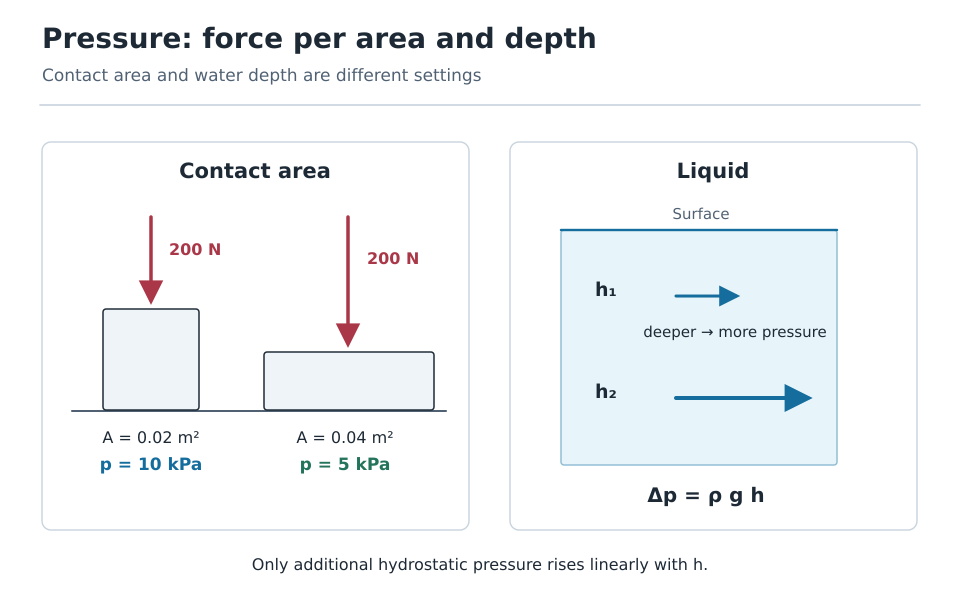

# M7-L6 – Pressure in solids, liquids and gases {#L6}

**Course area:** M7 – Forces, pressure and buoyancy. **Level:** Lower secondary education. **Prior knowledge:** [M7-L5](M7-L5.md). **Learning objective:** Calculate pressure as force per area and distinguish additional hydrostatic pressure at depth.

## Starting question {#S1}

A snowshoe carries the same weight as a narrow heel but usually sinks much less into soft snow. Force alone does not explain the outcome: the area over which it acts matters.

## Physical concepts and model {#S2}

**Pressure** $p$ is perpendicular force $F_\perp$ per unit area $A$:

$$
p=\frac{F_\perp}{A},\qquad 1\,\mathrm{Pa}=1\,\mathrm{N/m^2}.
$$

In the simple model of uniform contact, a larger area under the same force gives a smaller average contact pressure. Pressure in a liquid at rest acts in all directions on surrounding surfaces, with the force on any particular surface perpendicular to it. For a liquid of approximately constant density, the **additional hydrostatic pressure** at depth $h$ below the surface is

$$
\Delta p=\rho g h.
$$

Here $\rho$ is density in $\mathrm{kg/m^3}$, $g$ is gravitational field strength and $h$ is depth. To find **absolute pressure** in open water, also include atmospheric pressure at the surface. Gases exert pressure too; because they are more compressible, the constant-density formula cannot be extended unchanged over large altitude differences.

**Original teaching diagram:** One block on differently sized contact faces alongside a water column labelled at increasing depths.

*Pressure is force per area; additional hydrostatic pressure increases with depth.*

## Worked example or application {#S3}

An area $A=0.020\,\mathrm{m^2}$ carries a perpendicular force $F=200\,\mathrm{N}$. Average pressure is

$$
p=\frac{200\,\mathrm{N}}{0.020\,\mathrm{m^2}}=10\,000\,\mathrm{Pa}=10\,\mathrm{kPa}.
$$

For fresh water with $\rho\approx1000\,\mathrm{kg/m^3}$, the additional pressure at $h=2.0\,\mathrm{m}$ is $\Delta p=1000\times9.81\times2.0=19\,620\,\mathrm{Pa}\approx19.6\,\mathrm{kPa}$. This is **not** the complete absolute pressure.

## Safe observation and experiment {#S4}

**Safe activity:** Press the same small rectangular block gently into modelling clay, first on its largest and then on a smaller face. Compare the marks. A supervised transparent water column can demonstrate hydrostatic pressure; do not build pressurised vessels or use breakable glass apparatus.

## Check your learning {#S5}

### Questions

1. Find pressure for $F=60\,\mathrm{N}$ and $A=0.030\,\mathrm{m^2}$.
2. Why does a larger contact area lower average contact pressure?
3. What must be added to additional hydrostatic pressure to find absolute pressure in open water?
4. For unchanged liquid, what happens to $\Delta p=\rho gh$ if $h$ doubles?

### Answers

1. $p=2000\,\mathrm{Pa}=2.0\,\mathrm{kPa}$.
2. The same force is distributed across a greater area, reducing $F/A$.
3. Pressure at the surface, normally atmospheric pressure.
4. Additional hydrostatic pressure doubles.

## Limits and transition {#S6}

Hydrostatic pressure here assumes nearly constant density and gravitational field. Pressure across a real solid contact surface may be nonuniform; the simple model uses an average.

**Next:** [M7-L7](M7-L7.md)

## Sources {#S7}

- [Berlin-Brandenburg education server – Physics topics](https://bildungsserver.berlin-brandenburg.de/rlp-online/c-faecher/physik/themen-und-inhalte) · Forces, motion, inertia, friction and differentiation in the curriculum · Last accessed: 2026-11-21 · Content verified: 2026-11-21
- [LEIFIphysik – Pressure](https://www.leifiphysik.de/mechanik/druck-und-auftrieb/grundwissen/druck) · Definition of pressure as force per area · Last accessed: 2026-11-21 · Content verified: 2026-11-21
- [LEIFIphysik – Hydrostatic pressure](https://www.leifiphysik.de/mechanik/druck-und-auftrieb/grundwissen/schweredruck) · Hydrostatic pressure as additional pressure depending on depth · Last accessed: 2026-11-21 · Content verified: 2026-11-21
- [KMK – Lower-secondary physics educational standards](https://www.kmk.org/bildungsministerkonferenz/bildungsthemen/bildungsstandards.html) · Mechanics and competence domains (2024 standards) · Last accessed: 2026-11-21 · Content verified: 2026-11-21
