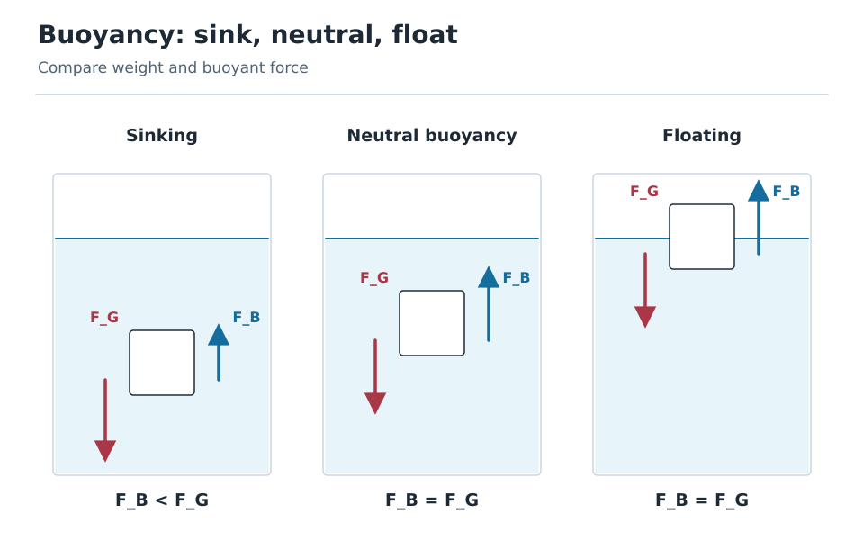

# M7-L7 – Buoyancy and floating {#L7}

**Course area:** M7 – Forces, pressure and buoyancy. **Level:** Lower secondary education. **Prior knowledge:** [M7-L6](M7-L6.md). **Learning objective:** Explain buoyancy through displaced fluid and distinguish sinking, neutral buoyancy and floating.

## Starting question {#S1}

A ball of modelling clay sinks in water, but a boat shaped from the same clay can float. The amount of clay has not changed. What matters is how much water is displaced and how the forces on the object compare.

## Physical concepts and model {#S2}

An object immersed in a fluid (liquid or gas) experiences an upward **buoyant force**. **Archimedes’ principle** states that its magnitude equals the weight of fluid displaced:

$$
F_B=\rho_{\mathrm{fluid}}\,g\,V_{\mathrm{displaced}}.
$$

For a fully submerged object, displaced volume is usually its total immersed volume. For a floating object, only the **submerged part** counts. The object’s weight $F_G=mg$ acts downward.

- **Sinking:** If the weight of a fully submerged object exceeds buoyancy (ignoring other forces here), it initially accelerates downwards.
- **Neutral buoyancy:** A fully immersed object with $F_B=F_G$ is in equilibrium in the simple model and may remain at a given depth.
- **Floating:** An object at the surface displaces enough fluid that, when at rest, $F_B=F_G$. It is therefore only partly immersed. A body that is accelerating upwards may first **rise**; this is not the same as floating at the surface.

The clay boat’s shape encloses air and displaces more water for the same overall mass than a compact lump. **Original teaching diagram:** Sinking, neutrally buoyant and floating objects with separate upward buoyancy and downward weight arrows.

*The relative size of weight and buoyancy explains the behaviour in water.*

## Worked example or application {#S3}

A fully immersed object displaces $V=0.0020\,\mathrm{m^3}$ of fresh water. With $\rho=1000\,\mathrm{kg/m^3}$ and $g=9.81\,\mathrm{N/kg}$,

$$
F_B=1000\times9.81\times0.0020\,\mathrm{N}=19.62\,\mathrm{N}.
$$

If its mass is $m=1.5\,\mathrm{kg}$, its weight is $F_G=14.715\,\mathrm{N}$. Buoyancy initially wins when fully immersed. At the surface the object can remain afloat at the **smaller displaced volume** $V_{\mathrm{displaced}}=m/\rho=0.0015\,\mathrm{m^3}$, provided its orientation is stable.

## Safe observation and experiment {#S4}

**Safe activity:** Shape the same amount of modelling clay into a compact ball and then into a broad, reasonably watertight bowl. Lower each gently into a shallow water tray on a nonslip surface and compare floating behaviour. Keep water away from electrical equipment.

## Check your learning {#S5}

### Questions

1. What determines buoyant force in the Archimedes model?
2. Calculate buoyancy for $1.0\,\mathrm{L}$ of displaced water with $\rho=1000\,\mathrm{kg/m^3}$ and $g=9.81\,\mathrm{N/kg}$.
3. How do $F_B$ and $F_G$ compare for an object floating at rest?
4. Why is a clay boat more likely to float than a clay ball of the same mass?

### Answers

1. Fluid density, gravitational field strength and displaced fluid volume.
2. $1.0\,\mathrm{L}=0.001\,\mathrm{m^3}$, so $F_B=9.81\,\mathrm{N}$.
3. $F_B=F_G$ when other vertical forces are negligible.
4. By its shape and enclosed air space, it can displace enough water before submerging completely to balance its weight.

## Limits and transition {#S6}

The model assumes fluids at rest. Fluid flow, surface tension, trapped air, changing density and floating stability may also affect real situations.

**Looking ahead:** The following module begins with [M8-L1 – Forms of energy and energy transfer](M8-L1.md).

## Sources {#S7}

- [Berlin-Brandenburg education server – Physics topics](https://bildungsserver.berlin-brandenburg.de/rlp-online/c-faecher/physik/themen-und-inhalte) · Forces, motion, inertia, friction and differentiation in the curriculum · Last accessed: 2026-11-21 · Content verified: 2026-11-21
- [LEIFIphysik – Buoyant force](https://www.leifiphysik.de/mechanik/druck-und-auftrieb/grundwissen/auftriebskraft) · Archimedes’ principle and the weight of displaced fluid · Last accessed: 2026-11-21 · Content verified: 2026-11-21
- [LEIFIphysik – Hydrostatic pressure](https://www.leifiphysik.de/mechanik/druck-und-auftrieb/grundwissen/schweredruck) · Hydrostatic pressure as additional pressure depending on depth · Last accessed: 2026-11-21 · Content verified: 2026-11-21
- [KMK – Lower-secondary physics educational standards](https://www.kmk.org/bildungsministerkonferenz/bildungsthemen/bildungsstandards.html) · Mechanics and competence domains (2024 standards) · Last accessed: 2026-11-21 · Content verified: 2026-11-21
