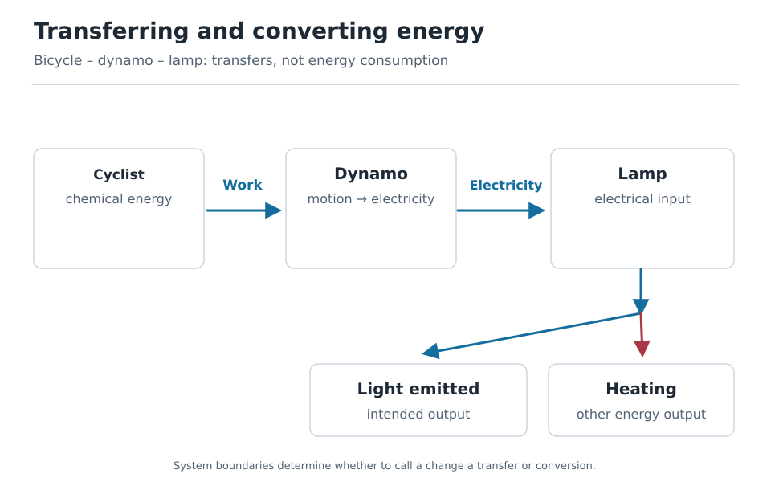

# M8-L1 – Forms of energy and energy transfer {#L1}

**Course area:** M8 – Energy, work and power. **Level:** Lower secondary education. **Prior knowledge:** [M7-L7](M7-L7.md). **Learning objective:** Distinguish energy forms and transfers in a clearly defined system diagram.

## Starting question {#S1}

A bicycle dynamo powers a lamp. The wheel becomes a little harder to turn as the lamp lights up and warms slightly. Where does the lamp’s energy come from, and why is it wrong to describe the process as “creating energy from nothing”?

## Physical concepts and model {#S2}

**Energy** is a conserved physical quantity. It can be assigned to a system, described using various forms and transferred between systems. The SI unit of energy is the **joule** ($\mathrm{J}$). School models distinguish, for instance, kinetic energy, the gravitational potential energy of the Earth–object system, elastic energy, internal or thermal energy, chemical energy and electrical energy. These are not separate substances: they are different ways of tracking one conserved quantity.

An **energy conversion** is a change in the form of energy within a chosen system. An **energy transfer** crosses the boundary of that system, for example via mechanical work, electrical work, heating or radiation. State the boundary explicitly. In the cycling example chemical energy from food is transferred by muscular work. The bicycle rotates, the dynamo transfers electrical energy to the lamp, and the lamp transfers energy to its surroundings by light and heating.

In an **energy-flow diagram**, boxes identify systems or energy accounts. Arrows describe transfers, while branches describe different outgoing routes. An arrow does not imply that energy is a material fluid. **Original diagram:** Bicycle–dynamo–lamp transfer network, branching into light and heating.

*Energy forms and transfers in a bicycle dynamo model.*

## Worked example or application {#S3}

A small device receives $120\,\mathrm{J}$ of electrical energy during a ten-second test. It transfers $24\,\mathrm{J}$ as light. In a simplified account the rest is assigned to heating and other outgoing pathways:

$$
E_{\mathrm{other\,outputs}}=120\,\mathrm{J}-24\,\mathrm{J}=96\,\mathrm{J}.
$$

The input energy has not vanished. The **intended** output (light) is only part of the total transfer.

## Safe observation and experiment {#S4}

**Safe observation:** Use a suitable LED and an approved, current-limited extra-low-voltage classroom supply to observe light emission and any gentle warming. Do not touch exposed electrical contacts; never experiment with mains wiring or dismantled batteries. Alternatively draw the complete energy path of a bicycle dynamo on paper.

## Check your learning {#S5}

### Questions

1. Name three energy forms and one system for each.
2. How does energy conversion differ from energy transfer?
3. A device receives 150 J and emits 40 J as light. Account for the remainder.
4. Why does an energy-flow diagram need a system boundary?

### Answers

1. For example kinetic energy of a bicycle, chemical energy associated with food, and internal energy of a warm body.
2. Conversion changes the form in the selected system; transfer crosses a system boundary.
3. 150 J − 40 J = 110 J transferred through other pathways.
4. It defines which changes occur inside and which transfers cross the boundary.

## Limits and transition {#S6}

The naming of energy forms depends partly on the chosen model. The example numbers are invented teaching data. Light and heating are outgoing transfer mechanisms; “heat” is not treated as a permanent substance stored inside an object.

**Next:** [M8-L2](M8-L2.md)

## Sources {#S7}

- [Berlin-Brandenburg Education Server – Physics curriculum topics](https://bildungsserver.berlin-brandenburg.de/rlp-online/c-faecher/physik/themen-und-inhalte) · Mechanical energy and work; energy transformation · Last accessed: 2026-11-21 · Content verified: 2026-11-21
- [Berlin-Brandenburg Education Server – Physics competences](https://bildungsserver.berlin-brandenburg.de/rlp-online/c-faecher/physik/kompetenzen-und-standards) · Conservation, conversion and efficiency in competence standards · Last accessed: 2026-11-21 · Content verified: 2026-11-21
- [LEIFIphysik – Work, energy and power](https://www.leifiphysik.de/mechanik/arbeit-energie-und-leistung) · Forms, conversion, work, power and conservation of energy · Last accessed: 2026-11-21 · Content verified: 2026-11-21
- [KMK – Physics standards for intermediate school certificate (2024)](https://www.kmk.org/bildungsministerkonferenz/bildungsthemen/bildungsstandards.html) · Official index of 2024 physics competence standards · Last accessed: 2026-11-21 · Content verified: 2026-11-21
