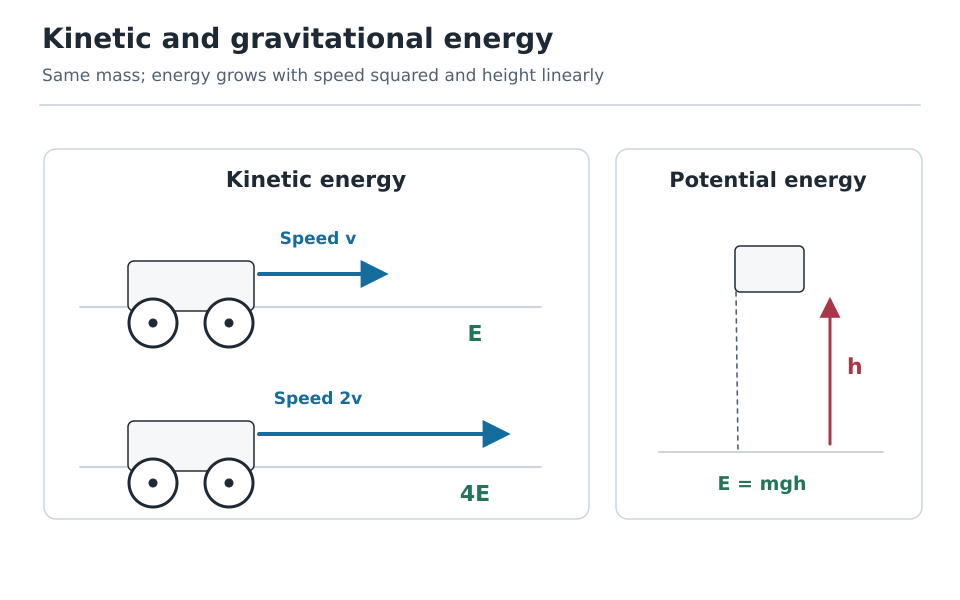

# M8-L2 – Kinetic and gravitational potential energy {#L2}

**Course area:** M8 – Energy, work and power. **Level:** Lower secondary education. **Prior knowledge:** [M8-L1](M8-L1.md). **Learning objective:** Calculate kinetic and gravitational potential energy and explain the effects of mass, speed and height.

## Starting question {#S1}

A quickly rolling ball can move an obstacle; the same ball may fall from a shelf. Both states can be described using energy, but different measured quantities matter: speed in one case and height in the other.

## Physical concepts and model {#S2}

For an object of mass $m$ moving at speed $v$, the nonrelativistic school model gives its **kinetic energy**:

$$
E_{\mathrm{kin}}=\frac12 mv^2.
$$

Doubling speed at fixed mass **quadruples** kinetic energy. Speed therefore has a particularly strong influence on energy. This formula describes centre-of-mass motion; a rolling object may have additional rotational kinetic energy.

Near Earth's surface we write the **gravitational potential energy**, measured relative to a chosen zero level, as

$$
E_{\mathrm{pot}}=mgh,\qquad g\approx9.81\,\mathrm{N/kg}.
$$

Here $h$ is height above the reference level. Strictly the energy belongs to the **Earth–object system**. We are free to select another reference level. Changes in gravitational energy, rather than the arbitrary zero, determine physical predictions. Energy is measured in joules: $1\,\mathrm{J}=1\,\mathrm{N\,m}$. Convert every measurement to SI units before calculating.

**Original diagram:** Two matching carts with speeds $v$ and $2v$ and a raised mass above a reference height.

*Comparing kinetic and gravitational potential energy.*

## Worked example or application {#S3}

A body of mass $m=2.0\,\mathrm{kg}$ travels at $v=3.0\,\mathrm{m/s}$. Its kinetic energy is

$$
E_{\mathrm{kin}}=\tfrac12\cdot2.0\cdot(3.0)^2\,\mathrm{J}=9.0\,\mathrm{J}.
$$

If the same body is lifted **from rest** by $h=1.5\,\mathrm{m}$, its gravitational energy increases by $\Delta E_{\mathrm{pot}}=2.0\cdot9.81\cdot1.5\,\mathrm{J}=29.43\,\mathrm{J}$. These are **two different situations** and should not be summed without a defined common state.

## Safe observation and experiment {#S4}

**Safe comparison:** Let a marble roll down a fixed low ramp from two starting heights. Observe its motion on a flat run-out section. Keep small objects away from young children and use low heights only. Because rotation and friction are present, $mgh=\tfrac12mv^2$ alone does not completely describe the experiment.

## Check your learning {#S5}

### Questions

1. What happens to kinetic energy when speed doubles?
2. Find $E_{\mathrm{kin}}$ for $m=0.50\,\mathrm{kg}$ and $v=4.0\,\mathrm{m/s}$.
3. Find the increase in gravitational energy for $3.0\,\mathrm{kg}$ raised by $2.0\,\mathrm{m}$.
4. Why does the reference height matter?

### Answers

1. It becomes four times as large because speed is squared.
2. $\frac12\cdot0.50\cdot4^2=4.0\,\mathrm{J}$.
3. $3.0\cdot9.81\cdot2.0=58.86\,\mathrm{J}$.
4. The absolute number depends on the chosen reference; the difference between two heights does not.

## Limits and transition {#S6}

The classical kinetic formula fails at very high speeds. A constant $g$ is not adequate over large altitude ranges. Rolling objects carry rotational energy, and real tracks also transfer energy by friction, heating and sound.

**Next:** [M8-L3](M8-L3.md)

## Sources {#S7}

- [LEIFIphysik – Kinetic energy](https://www.leifiphysik.de/mechanik/arbeit-energie-und-leistung/grundwissen/kinetische-energie) · Squared-speed dependence and the SI joule · Last accessed: 2026-11-21 · Content verified: 2026-11-21
- [LEIFIphysik – Work, energy and power](https://www.leifiphysik.de/mechanik/arbeit-energie-und-leistung) · Forms, conversion, work, power and conservation of energy · Last accessed: 2026-11-21 · Content verified: 2026-11-21
- [Berlin-Brandenburg Education Server – Physics curriculum topics](https://bildungsserver.berlin-brandenburg.de/rlp-online/c-faecher/physik/themen-und-inhalte) · Mechanical energy and work; energy transformation · Last accessed: 2026-11-21 · Content verified: 2026-11-21
- [KMK – Physics standards for intermediate school certificate (2024)](https://www.kmk.org/bildungsministerkonferenz/bildungsthemen/bildungsstandards.html) · Official index of 2024 physics competence standards · Last accessed: 2026-11-21 · Content verified: 2026-11-21
