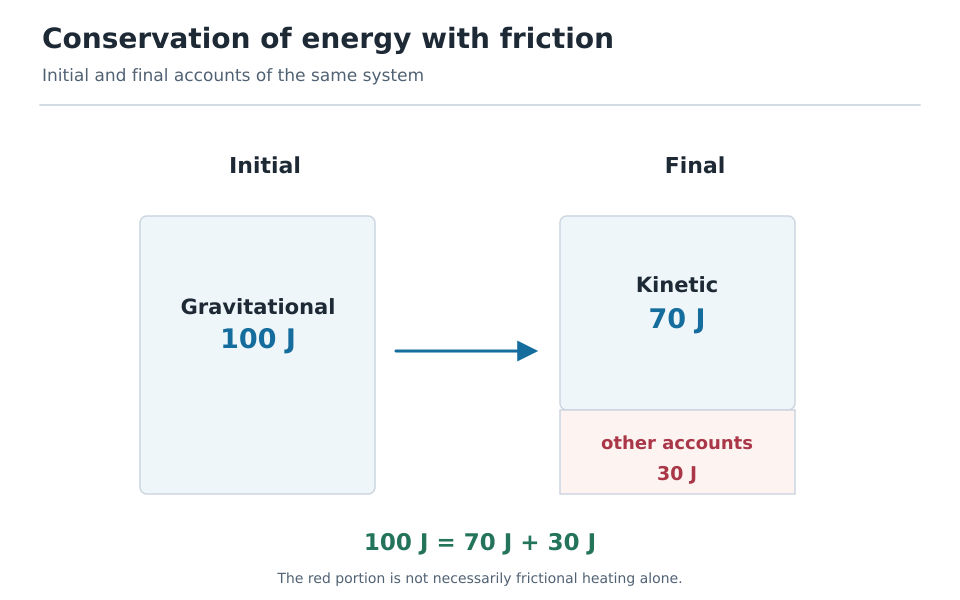

# M8-L3 – Conservation and conversion of energy {#L3}

**Course area:** M8 – Energy, work and power. **Level:** Lower secondary education. **Prior knowledge:** [M8-L2](M8-L2.md). **Learning objective:** Draw up energy accounts for a defined system, including frictional and thermal pathways.

## Starting question {#S1}

A cart rolls down a track and becomes faster at the bottom. How can gravitational energy decrease without violating energy conservation? A complete account includes the cart and its surroundings.

## Physical concepts and model {#S2}

The **conservation of energy** states that the **total energy** of a completely isolated system remains constant. Energy may change form or cross a chosen system boundary, but cannot appear from nowhere or cease to exist. A valid energy account therefore includes all relevant stores and transfers.

For an ideal body sliding along a track without rotation or friction,

$$
E_{\mathrm{kin}}+E_{\mathrm{pot}}=\mathrm{constant}
$$

is a useful approximation. It is **not** a universal conservation law involving only these two mechanical terms. Along a real track, energy passes to the cart, track and environment and increases internal energy. With a suitably broad system boundary, we may describe the result as

$$
E_{\mathrm{pot,initial}}+E_{\mathrm{kin,initial}}=E_{\mathrm{pot,final}}+E_{\mathrm{kin,final}}+E_{\mathrm{thermal}}+E_{\mathrm{other}}.
$$

The last two terms stand for other properly accounted-for energy components; they are not sources of “lost” energy. When the system is narrower, transfers beyond its boundary must be listed separately. **Original diagram:** Bar chart of a cart: initially 100 J gravitational energy; finally 70 J kinetic energy and 30 J in other accounts.

*All energy components belong in the total balance.*

## Worked example or application {#S3}

A cart loses $100\,\mathrm{J}$ of gravitational energy relative to a defined height. Initially it is at rest; at the bottom it has $70\,\mathrm{J}$ of kinetic energy. With no further changes the remaining accounts must contain $30\,\mathrm{J}$:

$$
100\,\mathrm{J}=70\,\mathrm{J}+30\,\mathrm{J}.
$$

Some energy warms the wheels and track; a smaller part may travel away as sound. Without measurements, we must **not** label the entire 30 J as heat stored in a single object.

## Safe observation and experiment {#S4}

**Safe observation:** Watch a toy marble move along a short, low wooden track. Compare its starting and final height during a back-and-forth motion. Fix the track securely, shield the run-out area and keep fingers away. Begin with a qualitative energy account; do not infer exact frictional energy from observation alone.

## Check your learning {#S5}

### Questions

1. State conservation of energy for an isolated system.
2. A ball begins with 80 J of gravitational energy and has 65 J kinetic energy at the bottom. Account for the rest.
3. Why is $E_{\mathrm{kin}}+E_{\mathrm{pot}}$ not generally constant in the presence of friction?
4. What changes in the account if the track lies outside the chosen system?

### Answers

1. The sum of all energy components remains constant.
2. 80 J − 65 J = 15 J for other energy components or outward transfers.
3. Mechanical energy can be transformed into internal energy and transferred to other objects.
4. Energy transferred to the track must be recorded as a transfer across the chosen boundary.

## Limits and transition {#S6}

The bar-chart numbers are fictional teaching values. In an open system the stored energy need not be constant when energy enters or leaves. Measurement uncertainty may explain small apparent imbalances; those do not establish a failure of conservation.

**Next:** [M8-L4](M8-L4.md)

## Sources {#S7}

- [LEIFIphysik – Energy conservation](https://www.leifiphysik.de/mechanik/arbeit-energie-und-leistung/grundwissen/energieerhaltung) · Ideal conservation of mechanical energy and frictional pathways · Last accessed: 2026-11-21 · Content verified: 2026-11-21
- [LEIFIphysik – Work, energy and power](https://www.leifiphysik.de/mechanik/arbeit-energie-und-leistung) · Forms, conversion, work, power and conservation of energy · Last accessed: 2026-11-21 · Content verified: 2026-11-21
- [Berlin-Brandenburg Education Server – Physics curriculum topics](https://bildungsserver.berlin-brandenburg.de/rlp-online/c-faecher/physik/themen-und-inhalte) · Mechanical energy and work; energy transformation · Last accessed: 2026-11-21 · Content verified: 2026-11-21
- [KMK – Physics standards for intermediate school certificate (2024)](https://www.kmk.org/bildungsministerkonferenz/bildungsthemen/bildungsstandards.html) · Official index of 2024 physics competence standards · Last accessed: 2026-11-21 · Content verified: 2026-11-21
