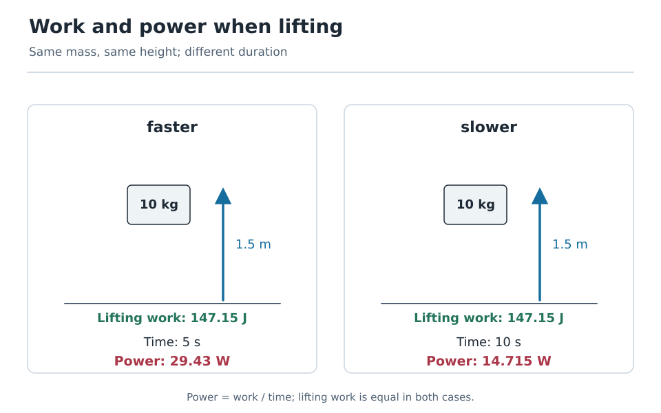

# M8-L4 – Mechanical work and power {#L4}

**Course area:** M8 – Energy, work and power. **Level:** Lower secondary education. **Prior knowledge:** [M8-L3](M8-L3.md). **Learning objective:** Calculate mechanical work including its direction and distinguish it from average power.

## Starting question {#S1}

Two people lift the same box through the same height. One takes five seconds; the other takes ten. The gravitational energy gain can be identical while the faster lift requires more power.

## Physical concepts and model {#S2}

**Mechanical work** $W$ is an energy transfer involving a force whose point of application moves. For a **constant** force and straight displacement,

$$
W=Fs\cos\alpha,
$$

where $\alpha$ is the angle between force and displacement. With force along the motion this reduces to $W=Fs$. A force opposite the displacement does negative work. A force perpendicular to displacement does **zero** work in this model. The unit is $1\,\mathrm{J}=1\,\mathrm{N\,m}$.

Work is **not stored inside a body**; it describes an energy transfer that can change a system's energy. Lifting a box slowly increases gravitational energy by $\Delta E_{\mathrm{pot}}=mgh$. The lifting force does approximately $+mgh$ of work, while gravity does $-mgh$.

**Average power** is energy transferred per unit time:

$$
\overline P=\frac{W}{\Delta t}=\frac{\Delta E}{\Delta t}.
$$

When comparing the magnitudes of useful transfers, use the corresponding positive quantity; general signs depend on the accounting convention. $1\,\mathrm{W}=1\,\mathrm{J/s}$. Do not confuse **watt**, a unit, with $W$, the symbol used for work. **Original diagram:** Equal lifting work completed in two different time intervals.

*The same work can require different power.*

## Worked example or application {#S3}

A box of mass $m=10\,\mathrm{kg}$ is raised by $h=1.5\,\mathrm{m}$ at approximately constant speed. The energy transferred by the lifting force is

$$
W_{\mathrm{lift}}=mgh=10\cdot9.81\cdot1.5\,\mathrm{J}=147.15\,\mathrm{J}.
$$

Over $5.0\,\mathrm{s}$ the average mechanical lifting power is $147.15/5.0=29.43\,\mathrm{W}$. Over $10.0\,\mathrm{s}$ it is $14.715\,\mathrm{W}$. This is **useful mechanical lifting power**, not the person's total metabolic power.

## Safe observation and experiment {#S4}

**Safe measurement:** Raise a light, unbreakable object of roughly 0.5 kg by 0.5 m and time the movement. Keep the floor clear, do not lift above head height and protect feet from dropped objects. Repeat using a different lifting duration without adding heavy weights. Treat the result as an approximation to average mechanical lifting power.

## Check your learning {#S5}

### Questions

1. Besides constant force, what condition makes $W=Fs$ valid?
2. Find the work of $20\,\mathrm{N}$ acting through $3.0\,\mathrm{m}$ in the same direction.
3. Find the average power for $180\,\mathrm{J}$ transferred in $6.0\,\mathrm{s}$.
4. What work does a force perpendicular to displacement perform?

### Answers

1. Force and displacement must point along the same line and direction (otherwise use the parallel component).
2. $20\cdot3.0=60\,\mathrm{J}$.
3. $180/6.0=30\,\mathrm{W}$.
4. Zero, because $\cos90^\circ=0$.

## Limits and transition {#S6}

Actual muscular work and metabolic power involve additional internal processes. Varying forces require an integral rather than a single arbitrary value of $Fs$. If an object accelerates while lifting, the gravitational energy increase alone is not all the work.

**Next:** [M8-L5](M8-L5.md)

## Sources {#S7}

- [LEIFIphysik – Work as energy transfer](https://www.leifiphysik.de/mechanik/energieerhaltung-und-umwandlung/grundwissen/arbeit-als-energietransfer) · Work as energy transfer and force component along displacement · Last accessed: 2026-11-21 · Content verified: 2026-11-21
- [LEIFIphysik – Definition of power](https://www.leifiphysik.de/mechanik/arbeit-energie-und-leistung/aufgabe/definition-der-leistung) · Average power as energy change per interval · Last accessed: 2026-11-21 · Content verified: 2026-11-21
- [Berlin-Brandenburg Education Server – Physics curriculum topics](https://bildungsserver.berlin-brandenburg.de/rlp-online/c-faecher/physik/themen-und-inhalte) · Mechanical energy and work; energy transformation · Last accessed: 2026-11-21 · Content verified: 2026-11-21
- [KMK – Physics standards for intermediate school certificate (2024)](https://www.kmk.org/bildungsministerkonferenz/bildungsthemen/bildungsstandards.html) · Official index of 2024 physics competence standards · Last accessed: 2026-11-21 · Content verified: 2026-11-21
