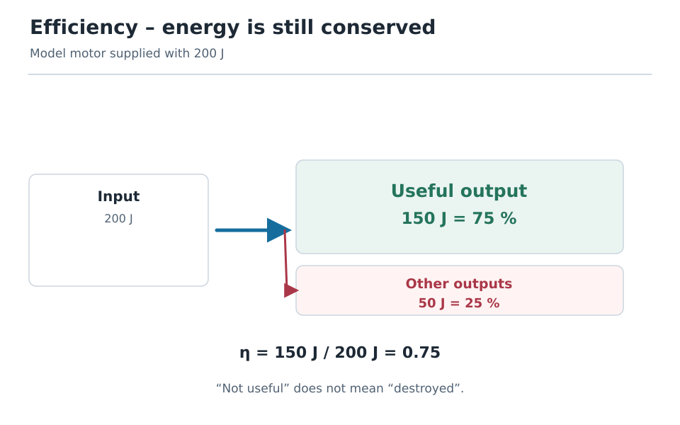

# M8-L5 – Efficiency and degradation of energy usefulness {#L5}

**Course area:** M8 – Energy, work and power. **Level:** Lower secondary education. **Prior knowledge:** [M8-L4](M8-L4.md). **Learning objective:** Calculate efficiency from useful output and energy input, and explain why degraded energy is not destroyed.

## Starting question {#S1}

A lamp converts electrical energy and emits light. Not all supplied joules become visible light: some energy is transferred through other radiation or by warming surrounding objects. Does the rest of the energy disappear?

## Physical concepts and model {#S2}

The **efficiency** $\eta$ compares energy **useful for a defined purpose** with the **energy supplied** over the same interval:

$$
\eta=\frac{E_{\mathrm{useful}}}{E_{\mathrm{input}}}\qquad\text{or over equal times}\qquad\eta=\frac{P_{\mathrm{useful}}}{P_{\mathrm{input}}}.
$$

Efficiency has no unit and is often expressed as a percentage. For a correctly bounded passive converter $0\leq\eta\leq1$. “Useful” is **purpose-dependent**. Heat output is desirable from a room heater, whereas the intended output of an electric motor is normally mechanical motion. A resistive heater may transfer almost all of its input energy into the room as heat while being unsuitable for producing motion.

**Degradation of energy usefulness** means that energy is still conserved but, after spreading through an environment, is **less available for a directed later purpose**. A slightly warmer room cannot simply provide all the electrical energy previously used. Saying energy is “lost” generally means **lost from the useful account**, not destroyed.

For two distinct conversion stages, efficiencies multiply: $\eta_{\mathrm{total}}=\eta_1\eta_2$, provided the useful output of the first stage feeds the second. **Original diagram:** A 200 J input dividing into 150 J useful energy and 50 J other transfers, with proportional widths.

*Useful output is only part of conserved total energy.*

## Worked example or application {#S3}

A model motor receives $E_{\mathrm{input}}=200\,\mathrm{J}$ of electrical energy and delivers $E_{\mathrm{useful}}=150\,\mathrm{J}$ mechanically. Therefore

$$
\eta=\frac{150\,\mathrm{J}}{200\,\mathrm{J}}=0.75=75\,\%.
$$

The other $50\,\mathrm{J}$ is accounted for by heating and other pathways. With a second stage of efficiency $\eta_2=0.80$, the useful final output is $150\cdot0.80=120\,\mathrm{J}$. The overall efficiency is $0.75\cdot0.80=0.60=60\,\%$.

## Safe observation and experiment {#S4}

**Safe modelling exercise:** Use 20 paper tokens to represent the input, putting 15 tokens in a useful-output pile and five in an other-outputs pile. Calculate efficiency without working with dangerous apparatus. Measure electrical efficiency only with approved, supervised classroom equipment.

## Check your learning {#S5}

### Questions

1. Calculate $\eta$ for 36 J of useful output from a 60 J input.
2. Why does 60% efficiency not mean that 40% of energy disappears?
3. Two stages have $\eta_1=0.80$ and $\eta_2=0.50$. Find the overall efficiency.
4. Why is the term “useful energy” purpose-dependent?

### Answers

1. $\eta=36/60=0.60=60\,\%$.
2. The remainder is transferred along other routes, and conservation still holds.
3. $0.80\cdot0.50=0.40=40\,\%$.
4. For instance, heating is useful for a heater but usually not the desired output of a mechanical motor.

## Limits and transition {#S6}

Efficiency requires specified system boundaries and matching intervals. A heat pump can have a coefficient of performance above 1 without violating conservation; this coefficient is not an ordinary energy-conversion efficiency because environmental heat is transferred as well. Energy degradation is treated qualitatively here, without a full entropy model.

**Next:** [M8-L6](M8-L6.md)

## Sources {#S7}

- [LEIFIphysik – Efficiency](https://www.leifiphysik.de/mechanik/arbeit-energie-und-leistung/grundwissen/wirkungsgrad) · Efficiency based on energy or power and successive conversion stages · Last accessed: 2026-11-21 · Content verified: 2026-11-21
- [LEIFIphysik – Energy conservation](https://www.leifiphysik.de/mechanik/arbeit-energie-und-leistung/grundwissen/energieerhaltung) · Ideal conservation of mechanical energy and frictional pathways · Last accessed: 2026-11-21 · Content verified: 2026-11-21
- [Berlin-Brandenburg Education Server – Physics competences](https://bildungsserver.berlin-brandenburg.de/rlp-online/c-faecher/physik/kompetenzen-und-standards) · Conservation, conversion and efficiency in competence standards · Last accessed: 2026-11-21 · Content verified: 2026-11-21
- [KMK – Physics standards for intermediate school certificate (2024)](https://www.kmk.org/bildungsministerkonferenz/bildungsthemen/bildungsstandards.html) · Official index of 2024 physics competence standards · Last accessed: 2026-11-21 · Content verified: 2026-11-21
