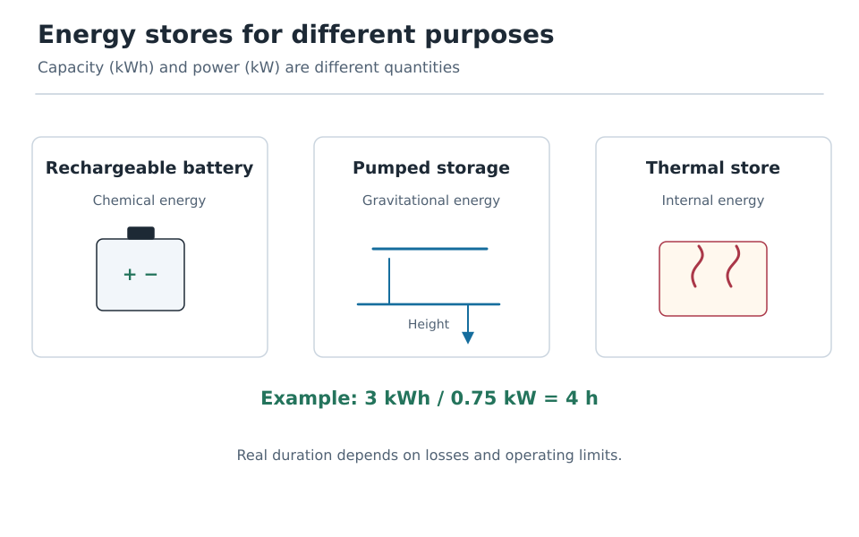

# M8-L6 – Energy storage and sustainable supply {#L6}

**Course area:** M8 – Energy, work and power. **Level:** Lower secondary education. **Prior knowledge:** [M8-L5](M8-L5.md). **Learning objective:** Compare storage systems by energy capacity, output power, discharge duration and conversion route.

## Starting question {#S1}

A battery can run a small lamp for a long time, while another device can deliver very high power only briefly. Asking “How big is the store?” is insufficient to decide whether it serves a particular purpose.

## Physical concepts and model {#S2}

An **energy store** can provide energy later by maintaining a particular state, such as chemical energy in a rechargeable battery, gravitational energy of water in an upper reservoir or internal energy in a heat store. Electrical energy is often converted into other forms for storage and later converted back into electricity.

**Capacity** $E$ is an amount of energy measured in J, Wh or kWh. **Power** $P$ describes how quickly energy can be delivered, measured in W or kW. For constant output power and idealised loss-free use,

$$
t=\frac{E}{P},\qquad 1\,\mathrm{kWh}=3.6\,\mathrm{MJ}.
$$

A device with $2\,\mathrm{kWh}$ of *usable* energy can ideally deliver $1\,\mathrm{kW}$ for **two hours**, not two kilowatts of energy. In reality, state of charge, temperature, converters, discharge rate and ageing limit performance. **Round-trip efficiency** compares useful energy recovered after a charge–discharge cycle to the energy supplied while charging.

Sustainable supply requires a systems view: electricity generation, stores, grids, raw materials, land use, reuse and environmental impacts interact. A battery often serves a different role from pumped hydro or a thermal store. **Original diagram:** Three storage principles labelled with their energy form and a small capacity-versus-power comparison.

*Capacity and power describe different aspects of a store.*

## Worked example or application {#S3}

A hypothetical store provides $E=3.0\,\mathrm{kWh}$ of **usable** energy. At a constant electrical load $P=0.75\,\mathrm{kW}$, the ideal duration is

$$
t=\frac{3.0\,\mathrm{kWh}}{0.75\,\mathrm{kW}}=4.0\,\mathrm{h}.
$$

This is an energy account assuming constant power. If a charging cycle consumes $4.0\,\mathrm{kWh}$ and then delivers $3.0\,\mathrm{kWh}$ of useful output, round-trip efficiency is $3/4=0.75$, or 75%. The figures are teaching assumptions, not typical manufacturer specifications.

## Safe observation and experiment {#S4}

**Safe modelling task:** Compare two fictional storage cards with capacities in Wh and rated outputs in W. Calculate which store can power a stated device for longer. Never open or damage battery cells, attempt improvised short-circuit demonstrations or connect experimental devices to household mains power.

## Check your learning {#S5}

### Questions

1. Explain the difference between 2 kWh and 2 kW.
2. An ideal store provides 1.2 kWh at a constant 300 W. For how long?
3. A store takes 5 kWh to charge and returns 4 kWh. Find round-trip efficiency.
4. Name two selection criteria besides energy capacity.

### Answers

1. 2 kWh is an amount of energy; 2 kW is a rate of energy transfer, or power.
2. $1.2\,\mathrm{kWh}/0.300\,\mathrm{kW}=4\,\mathrm{h}$.
3. $4/5=0.80=80\,\%$.
4. For example output power, charging time, lifetime, materials, safety, efficiency or environmental effects.

## Limits and transition {#S6}

The values in the example are fictional and are not up-to-date performance specifications. Different storage technologies have different physical forms and real-world constraints; there is no universally appropriate ranking. Sustainability requires considering manufacture and disposal as well as use.

**Next:** [M8-L7](M8-L7.md)

## Sources {#S7}

- [German Environment Agency – Electricity storage](https://www.umweltbundesamt.de/themen/klima-energie/energieversorgung/stromspeicher) · Storage principles, capacity and different conversion routes · Last accessed: 2026-11-21 · Content verified: 2026-11-21
- [Berlin-Brandenburg Education Server – Physics curriculum topics](https://bildungsserver.berlin-brandenburg.de/rlp-online/c-faecher/physik/themen-und-inhalte) · Mechanical energy and work; energy transformation · Last accessed: 2026-11-21 · Content verified: 2026-11-21
- [LEIFIphysik – Work, energy and power](https://www.leifiphysik.de/mechanik/arbeit-energie-und-leistung) · Forms, conversion, work, power and conservation of energy · Last accessed: 2026-11-21 · Content verified: 2026-11-21
- [KMK – Physics standards for intermediate school certificate (2024)](https://www.kmk.org/bildungsministerkonferenz/bildungsthemen/bildungsstandards.html) · Official index of 2024 physics competence standards · Last accessed: 2026-11-21 · Content verified: 2026-11-21
