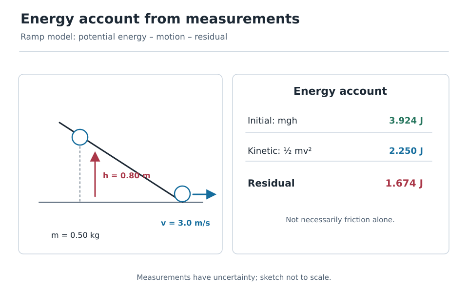

# M8-L7 – Measurement and calculation tasks for energy accounts {#L7}

**Course area:** M8 – Energy, work and power. **Level:** Lower secondary education. **Prior knowledge:** [M8-L6](M8-L6.md). **Learning objective:** Build an energy account from measurements, include uncertainty and interpret the result cautiously.

## Starting question {#S1}

You raise a toy cart onto a ramp, then measure its height and speed near the bottom. The energy calculated from its height may exceed the measured kinetic energy. Is this a contradiction, or a question of boundaries and measurement quality?

## Physical concepts and model {#S2}

A sound **energy account** follows four steps: (1) Select the system and its initial and final states. (2) Identify stored-energy terms and transfers. (3) Insert measured numbers with units and uncertainties. (4) Interpret any difference without attributing it to a single cause without evidence.

For a cart starting from rest, rolling down a vertical height difference $h$ and reaching speed $v$, we use the model

$$
E_{\mathrm{start}}=mgh,\qquad E_{\mathrm{kin,final}}=\tfrac12mv^2,\qquad E_{\mathrm{residual}}=mgh-\tfrac12mv^2.
$$

$E_{\mathrm{residual}}$ is initially just an **accounting residual**. With wheels it can include rotational kinetic energy; internal energy changes, vibration, sound and measurement error can also contribute. Height is measured from the chosen bottom reference level. A negative residual is not automatically “negative friction” but a reason to check the model and measurements.

**Measurement uncertainty:** Report values such as $h=(0.50\pm0.01)\,\mathrm{m}$ rather than numerous unjustified decimal places. A relative error in $h$ has a roughly proportional effect on $mgh$; because $v$ is squared, its relative error can have approximately twice the effect on the kinetic-energy estimate. At lower-secondary level a justified range is often more useful than a full statistical propagation calculation.

**Original diagram:** Ramp measurement sketch with a three-line accounting panel showing measurements, calculated joules and residual.

*Measured example with an explicitly unresolved energy residual.*

## Worked example or application {#S3}

A cart has $m=0.50\,\mathrm{kg}$, drops by $h=0.80\,\mathrm{m}$ and has a measured lower-point speed of $v=3.0\,\mathrm{m/s}$. Approximately,

$$
E_{\mathrm{start}}=0.50\cdot9.81\cdot0.80=3.924\,\mathrm{J},
$$
$$
E_{\mathrm{kin,final}}=\tfrac12\cdot0.50\cdot(3.0)^2=2.25\,\mathrm{J},
$$
$$
E_{\mathrm{residual}}=3.924-2.25=1.674\,\mathrm{J}.
$$

The residual is approximately $42.7\,\%$ of initial energy. It is **not necessarily all frictional work**, since wheel rotation and other sources must be considered. Report no more significant figures than the measurement quality supports.

## Safe observation and experiment {#S4}

**Safe measurement protocol:** Use a short, secured toy ramp and a harmless cart. Measure mass, height difference and speed using timed positions or a suitable classroom light gate. Catch the cart on a padded surface. Make a table of quantity, value, unit and estimated uncertainty. Change only one experimental condition at a time.

## Check your learning {#S5}

### Questions

1. List the four steps in a measurement-based energy account.
2. Find $mgh$ for 0.20 kg raised by 0.50 m, taking $g=9.81\,\mathrm{N/kg}$.
3. If the starting account has 2.0 J and the measured kinetic energy is 1.6 J, what is the residual?
4. Does the residual for a wheeled cart necessarily measure pure frictional energy? Explain.

### Answers

1. Select system/states, list accounts and transfers, calculate with units and uncertainties, interpret the residual.
2. $0.20\cdot9.81\cdot0.50=0.981\,\mathrm{J}$.
3. $2.0-1.6=0.4\,\mathrm{J}$.
4. No. Rotational energy, other transfers, measurement variation and incomplete modelling also matter.

## Limits and transition {#S6}

Without additional measurements of wheel rotation, friction and uncertainty, the residual cannot be uniquely separated. A negative result calls for careful diagnosis, not rejection of conservation of energy. Subsequent lessons revisit electrical circuits and energy transfer.

**Looking ahead:** The next module begins with [M9-L1 – Revisiting charge, current and voltage](M9-L1.md).

## Sources {#S7}

- [LEIFIphysik – Energy conservation](https://www.leifiphysik.de/mechanik/arbeit-energie-und-leistung/grundwissen/energieerhaltung) · Ideal conservation of mechanical energy and frictional pathways · Last accessed: 2026-11-21 · Content verified: 2026-11-21
- [LEIFIphysik – Work, energy and power](https://www.leifiphysik.de/mechanik/arbeit-energie-und-leistung) · Forms, conversion, work, power and conservation of energy · Last accessed: 2026-11-21 · Content verified: 2026-11-21
- [Berlin-Brandenburg Education Server – Physics competences](https://bildungsserver.berlin-brandenburg.de/rlp-online/c-faecher/physik/kompetenzen-und-standards) · Conservation, conversion and efficiency in competence standards · Last accessed: 2026-11-21 · Content verified: 2026-11-21
- [Berlin-Brandenburg Education Server – Physics curriculum topics](https://bildungsserver.berlin-brandenburg.de/rlp-online/c-faecher/physik/themen-und-inhalte) · Mechanical energy and work; energy transformation · Last accessed: 2026-11-21 · Content verified: 2026-11-21
- [KMK – Physics standards for intermediate school certificate (2024)](https://www.kmk.org/bildungsministerkonferenz/bildungsthemen/bildungsstandards.html) · Official index of 2024 physics competence standards · Last accessed: 2026-11-21 · Content verified: 2026-11-21
