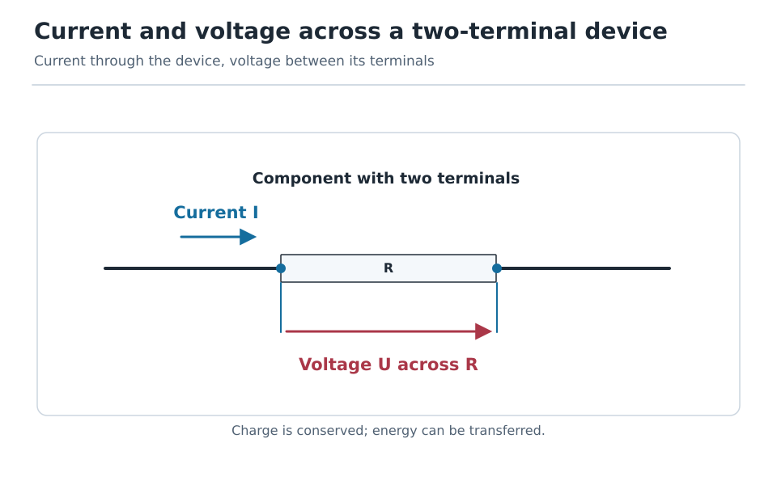

# M9-L1 – Revisiting charge, current and voltage {#L1}

**Course area:** M9 – Electrical networks and power. **Level:** Lower secondary education. **Prior knowledge:** [M8-L7](M8-L7.md). **Learning objective:** Distinguish charge, current and voltage, state their units, and label a two-terminal circuit correctly.

## Starting question {#S1}

A torch can shine for minutes without steadily running out of electrons in the filament. What circulates in the circuit, and where does the energy of the light come from?

## Physical concepts and model {#S2}

**Electric charge** $Q$ is a conserved quantity measured in coulombs ($\mathrm C$). Electrons move through metal conductors. **Conventional current direction** is defined from positive to negative, opposite to the drift of the electrons. **Current** $I$ is the charge that crosses a selected section per time interval:

$$I=\frac{\Delta Q}{\Delta t},\qquad 1\,\mathrm A=1\,\mathrm{C/s}.$$

**Voltage** $U$ between two points is the change in energy per unit of transported charge, $U=\Delta E/\Delta Q$. Its unit is the volt: $1\,\mathrm V=1\,\mathrm{J/C}$. Current is not an amount of energy, and voltage is not a substance used up in a load. The source maintains a potential difference and transfers energy via the circuit; a device subsequently transfers energy, for example by emitting light or heating the surroundings.

For a **two-terminal component**, distinguish the current $I$ **through** the component from the voltage $U$ **across** it. Connect an ammeter in series and a voltmeter in parallel with the component. In a steady unbranched circuit the current is the same along the entire path. **Original teaching diagram:** A two-terminal resistor with a conventional current arrow, voltage arrow and separate labels for both quantities.

*Current describes through-flow; voltage compares two terminals.*

## Worked example or application {#S3}

A device carries $I=0.20\,\mathrm A$ for $t=30\,\mathrm s$. The charge passing a cross-section is

$$\Delta Q=I\Delta t=0.20\cdot30=6.0\,\mathrm C.$$

If the voltage across the device is $U=3.0\,\mathrm V$, the model gives an energy transfer of

$$\Delta E=U\Delta Q=3.0\cdot6.0=18\,\mathrm J.$$

The $6\,\mathrm C$ of charge has not itself been converted into light.

## Safe observation and experiment {#S4}

**Safe comparison:** First draw a supply, resistor and measurement points on paper. Physical measurements require an approved, current-limited, safely isolated extra-low-voltage classroom supply with teacher supervision. Switch off before reconnecting anything. Never use mains sockets, exposed live conductors or high-power battery packs.

## Check your learning {#S5}

### Questions

1. State the units of charge, current and voltage.
2. What charge passes a section at 0.50 A in eight seconds?
3. How much energy is transferred at 6 V per 2 C of charge?
4. Why can a load receive energy without permanently using up charge?

### Answers

1. Coulomb (C), ampere (A) and volt (V).
2. Q = 0.50 A × 8 s = 4.0 C.
3. E = UQ = 6 V × 2 C = 12 J.
4. Charge carriers continue around the circuit, while the source and device transfer energy without destroying charge.

## Limits and transition {#S6}

The simple model describes steady direct current. Alternating-current circuits and fast switching require a time-dependent treatment. Electron drift, conventional current direction and energy transfer must not be confused.

**Next lesson:** [M9-L2](M9-L2.md)

## Sources {#S7}

- [Berlin-Brandenburg Education Server – Physics: topics and content](https://bildungsserver.berlin-brandenburg.de/rlp-online/c-faecher/physik/themen-und-inhalte) · Lower-secondary curriculum: current, voltage, resistance, circuits, power and energy · Last accessed: 2026-11-21 · Content verified: 2026-11-21
- [DGUV Safe School – Electricity experiments](https://www.sichere-schule.de/physik/praktisches-arbeiten/elektrik) · Safe extra-low-voltage supplies and safety measures for pupils · Last accessed: 2026-11-21 · Content verified: 2026-11-21
