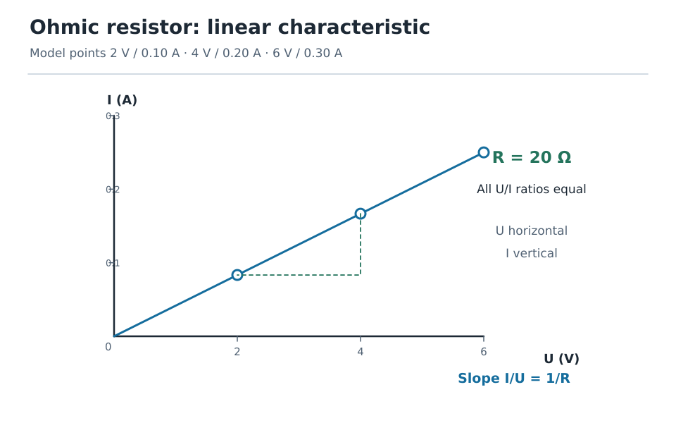

# M9-L2 – Electrical resistance and Ohm’s law {#L2}

**Course area:** M9 – Electrical networks and power. **Level:** Lower secondary education. **Prior knowledge:** [M9-L1](M9-L1.md). **Learning objective:** Calculate resistance from current–voltage data and distinguish ohmic proportionality from a single U/I ratio.

## Starting question {#S1}

Why does doubling the voltage often double the current through a fixed technical resistor, but not through an incandescent lamp?

## Physical concepts and model {#S2}

At a measured operating point of a two-terminal device, **electrical resistance** is defined by

$$R=\frac UI,\qquad 1\,\Omega=1\,\mathrm{V/A},\quad I\ne0.$$

A component is **ohmic** when voltage and current are proportional at constant temperature: $U=RI$ with $R$ independent of the operating point. A straight line through the origin on a plot of **voltage $U$ horizontally and current $I$ vertically** has slope $I/U=1/R$. When voltage is plotted against current, the slope is $R$ instead. Axis choice must be explicit.

A resistor limits current at a given voltage and can transfer electrical energy into internal energy. Metal conductors may warm up; their resistance can then change with temperature and their measured characteristic need not be exactly straight. **Original teaching diagram:** Model $I$–$U$ characteristic of an ohmic resistor with three sample points and a slope triangle. These are designed example values, not laboratory measurements.

*Ohmic behaviour means constant U/I within the chosen thermal range.*

## Worked example or application {#S3}

Take a model component with $U=2.0\,\mathrm V$, $4.0\,\mathrm V$ and $6.0\,\mathrm V$ and currents $I=0.10\,\mathrm A$, $0.20\,\mathrm A$ and $0.30\,\mathrm A$.

$$R=\frac{2.0\,\mathrm V}{0.10\,\mathrm A}=20\,\Omega.$$

The other two ratios also equal $20\,\Omega$. These proportional data are consistent with ohmic behaviour over the tested range. A single data point cannot establish this pattern.

## Safe observation and experiment {#S4}

**Supervised low-voltage experiment:** Use an approved classroom supply, a suitably rated technical resistor and suitable meters. Put the ammeter in series and the voltmeter across the resistor. Increase the voltage only within the equipment ratings and switch off before changing connections. As a paper-based alternative, calculate ratios from the supplied table.

## Check your learning {#S5}

### Questions

1. What is the SI-derived unit of resistance?
2. Find R for U = 9 V and I = 0.30 A.
3. What does a straight line through the origin in an I-versus-U graph mean?
4. Why is an operating incandescent lamp often non-ohmic?

### Answers

1. The ohm (Ω), equal to volt per ampere.
2. R = 9 V / 0.30 A = 30 Ω.
3. Current is proportional to voltage; the slope equals 1/R.
4. Its filament gets hotter at larger current and its resistance increases.

## Limits and transition {#S6}

$R=U/I$ defines a ratio at one operating point; Ohm’s law additionally requires the ratio to stay constant across operating points in the chosen range. Thermal conditions and component ratings matter.

**Next lesson:** [M9-L3](M9-L3.md)

## Sources {#S7}

- [LEIFIphysik – Ohm’s law](https://www.leifiphysik.de/elektrizitaetslehre/ohmsches-gesetz-kennlinien/grundwissen/ohmsches-gesetz) · Proportional U–I behaviour only for ohmic elements; resistance ratio U/I · Last accessed: 2026-11-21 · Content verified: 2026-11-21
- [LEIFIphysik – Characteristics of resistors](https://www.leifiphysik.de/elektrizitaetslehre/ohmsches-gesetz-kennlinien/grundwissen/kennlinien-von-widerstaenden) · Linear and nonlinear U–I characteristics and temperature dependence · Last accessed: 2026-11-21 · Content verified: 2026-11-21
- [Berlin-Brandenburg Education Server – Physics: topics and content](https://bildungsserver.berlin-brandenburg.de/rlp-online/c-faecher/physik/themen-und-inhalte) · Lower-secondary curriculum: current, voltage, resistance, circuits, power and energy · Last accessed: 2026-11-21 · Content verified: 2026-11-21
