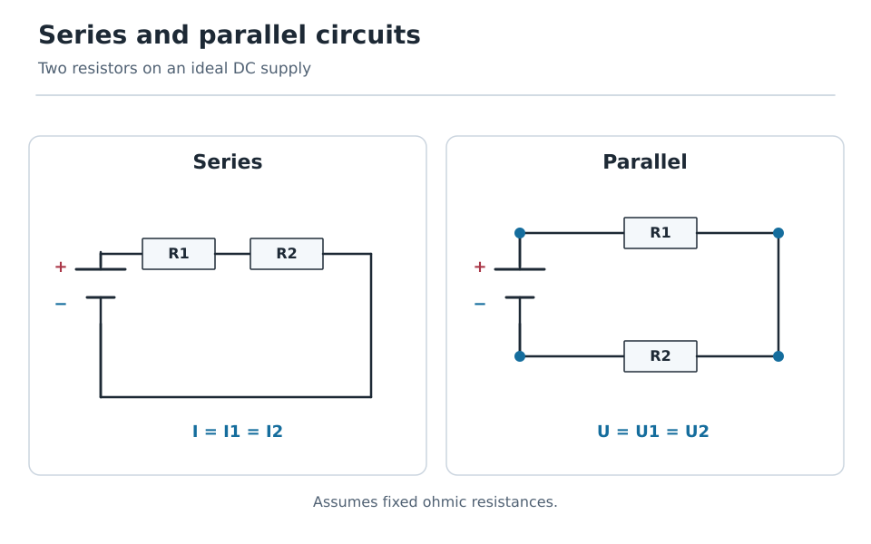

# M9-L3 – Series and parallel circuits {#L3}

**Course area:** M9 – Electrical networks and power. **Level:** Lower secondary education. **Prior knowledge:** [M9-L2](M9-L2.md). **Learning objective:** Use the current, voltage and resistance rules for two ohmic resistors connected in series or in parallel.

## Starting question {#S1}

Two resistors are connected first one after the other and then side by side to the same source. Which arrangement draws more current?

## Physical concepts and model {#S2}

In a **series circuit**, both resistors share a single current path. The current is equal through both components, and the source voltage is distributed: $I=I_1=I_2$ and $U=U_1+U_2$. For ohmic resistors,

$$R_{\mathrm{series}}=R_1+R_2.$$

In a **parallel circuit**, both components connect between the same two nodes. Consequently, $U=U_1=U_2$, while currents add: $I=I_1+I_2$. For ohmic resistors,

$$\frac1{R_{\mathrm{parallel}}}=\frac1{R_1}+\frac1{R_2}.$$

For positive resistances, the parallel equivalent is smaller than either component. The rules assume ideal wires and steady operation; the source must be capable of supplying the combined current. **Original teaching diagram:** The same two labelled resistors in series and parallel, with arrows for total and branch current. In practical experiments ammeters belong in the appropriate current path, whereas voltmeters are connected across components.

*Current is shared in series; voltage is shared in parallel under stated model assumptions.*

## Worked example or application {#S3}

An ideal $6.0\,\mathrm V$ supply drives $20\,\Omega$ and $40\,\Omega$ ohmic resistors. In **series**,

$$R_\mathrm{total}=60\,\Omega,\quad I=6.0/60=0.10\,\mathrm A,$$

so $U_1=2.0\,\mathrm V$ and $U_2=4.0\,\mathrm V$. In **parallel**, both resistors have $6.0\,\mathrm V$ across them: $I_1=0.30\,\mathrm A$ and $I_2=0.15\,\mathrm A$. The total is $0.45\,\mathrm A$, corresponding to $R_\mathrm{total}=13.3\,\Omega$ (rounded).

## Safe observation and experiment {#S4}

**Classroom experiment:** Compare two suitably rated resistors using a supervised current-limited extra-low-voltage supply. Switch off before changing the layout. Do not substitute incandescent lamps for fixed resistors when checking the equations quantitatively. Predict currents first and check ratings for both resistors and the supply.

## Check your learning {#S5}

### Questions

1. What stays equal across two series resistors?
2. Find the total resistance of 10 Ω and 30 Ω in series.
3. Find the total resistance of two 40-Ω resistors in parallel.
4. Why does the parallel arrangement usually draw more current from an ideal voltage source?

### Answers

1. The current through both components.
2. Rtotal = 10 Ω + 30 Ω = 40 Ω.
3. 1/Rtotal = 1/40 + 1/40 = 1/20, giving Rtotal = 20 Ω.
4. The equivalent resistance is lower, so I = U/Rtotal is greater.

## Limits and transition {#S6}

Real power supplies have internal resistance and current limits. Fixed-resistance formulas must not be applied blindly to nonlinear devices. Parallel components share voltage, not necessarily current.

**Next lesson:** [M9-L4](M9-L4.md)

## Sources {#S7}

- [LEIFIphysik – Resistors in series](https://www.leifiphysik.de/elektrizitaetslehre/komplexere-schaltkreise/grundwissen/reihenschaltung-von-widerstaenden) · Equivalent resistance and voltage splitting in series · Last accessed: 2026-11-21 · Content verified: 2026-11-21
- [LEIFIphysik – Resistors in parallel](https://www.leifiphysik.de/elektrizitaetslehre/komplexere-schaltkreise/grundwissen/parallelschaltung-von-widerstaenden) · Equivalent resistance and branch currents in parallel · Last accessed: 2026-11-21 · Content verified: 2026-11-21
- [Berlin-Brandenburg Education Server – Physics: topics and content](https://bildungsserver.berlin-brandenburg.de/rlp-online/c-faecher/physik/themen-und-inhalte) · Lower-secondary curriculum: current, voltage, resistance, circuits, power and energy · Last accessed: 2026-11-21 · Content verified: 2026-11-21
