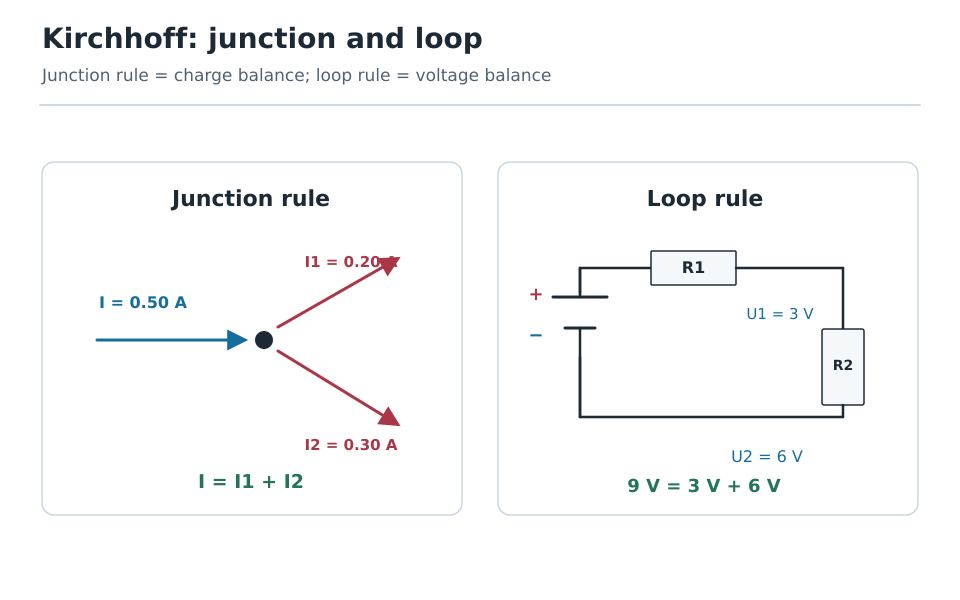

# M9-L4 – Kirchhoff’s rules at school level {#L4}

**Course area:** M9 – Electrical networks and power. **Level:** Lower secondary education. **Prior knowledge:** [M9-L3](M9-L3.md). **Learning objective:** Apply junction and loop rules as expressions of conservation to simple DC networks.

## Starting question {#S1}

At a junction one current splits into two branches; the branches join again later. Why can their currents not take arbitrary values?

## Physical concepts and model {#S2}

The **junction rule** follows from conservation of electric charge. In a steady circuit the total current flowing **into** a node equals the total flowing **out**. For one incoming and two outgoing currents:

$$I_\mathrm{in}=I_1+I_2.$$

The **loop rule** describes potential changes around a closed path. With a consistently chosen direction, all **signed** voltage changes add to zero. For one ideal source and two series loads, the classroom form is

$$U_\mathrm{source}=U_1+U_2.$$

These rules are not competing mnemonics: they express charge and energy conservation in the steady or quasistatic network model. Signs matter. Going around the loop, a voltage rise across an ideal source is assigned the opposite sign from a voltage drop across a load. **Original teaching diagram:** A three-current junction on the left and a closed loop with a source and two resistors on the right.

*Junction and loop rules illustrate conservation of charge and energy.*

## Worked example or application {#S3}

An incoming current $I_\mathrm{in}=0.50\,\mathrm A$ splits into $I_1=0.20\,\mathrm A$ and $I_2$. The junction rule gives

$$I_2=0.50-0.20=0.30\,\mathrm A.$$

In a **separate** ideal circuit, two series loads are supplied by $U_\mathrm{source}=9.0\,\mathrm V$. The voltage across the first is $U_1=3.0\,\mathrm V$, leaving $U_2=6.0\,\mathrm V$ for the second. These examples are independent; they do not define one combined network.

## Safe observation and experiment {#S4}

**Paper exercise:** Draw a junction, choose arrow directions and check current balance. Next draw one loop and mark the voltage rise and voltage drops. Any physical test should use supervised, isolated extra-low voltage, suitable resistors and a source that is switched off before rewiring.

## Check your learning {#S5}

### Questions

1. State the junction rule in one sentence.
2. Find the second branch current if 0.80 A enters and 0.35 A leaves via the first branch.
3. An ideal 12-V supply feeds two series loads; U1 = 5 V. Find U2.
4. Why is choosing a loop direction important?

### Answers

1. For steady conditions, total current into a node equals total current out.
2. I2 = 0.80 A − 0.35 A = 0.45 A.
3. U2 = 12 V − 5 V = 7 V.
4. The choice fixes the signs of voltage changes but does not change the physical result.

## Limits and transition {#S6}

The simple loop rule here assumes a quasistatic circuit without changing magnetic flux threading the loop. A negative solved current means that the actual current direction is opposite to the chosen arrow.

**Next lesson:** [M9-L5](M9-L5.md)

## Sources {#S7}

- [LEIFIphysik – Kirchhoff’s circuit rules](https://www.leifiphysik.de/elektrizitaetslehre/komplexere-schaltkreise/grundwissen/kirchhoffsche-gesetze) · Junction rule from charge conservation; loop rule from energy account · Last accessed: 2026-11-21 · Content verified: 2026-11-21
- [Berlin-Brandenburg Education Server – Physics: topics and content](https://bildungsserver.berlin-brandenburg.de/rlp-online/c-faecher/physik/themen-und-inhalte) · Lower-secondary curriculum: current, voltage, resistance, circuits, power and energy · Last accessed: 2026-11-21 · Content verified: 2026-11-21
