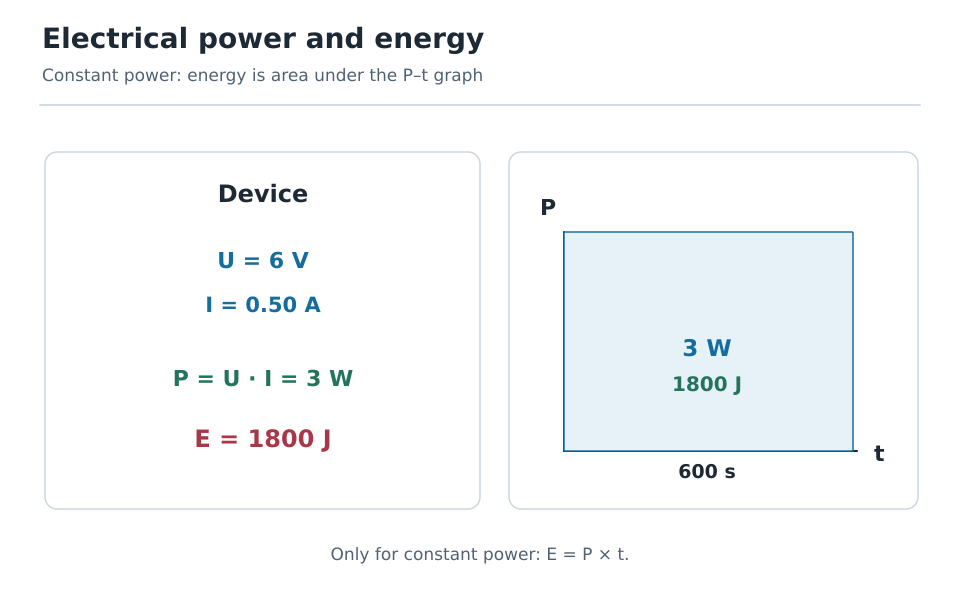

# M9-L5 – Electrical power and electrical energy {#L5}

**Course area:** M9 – Electrical networks and power. **Level:** Lower secondary education. **Prior knowledge:** [M9-L4](M9-L4.md). **Learning objective:** Calculate electrical power and transferred energy from U, I and time, and convert kWh to joules.

## Starting question {#S1}

A small motor runs briefly while an LED shines for many hours. Which quantity measures the rate of energy transfer, and which measures the total transferred energy?

## Physical concepts and model {#S2}

**Electrical power** $P$ is energy transferred per unit time. For a DC two-terminal device with constant current and voltage,

$$P=UI,\qquad 1\,\mathrm W=1\,\mathrm{J/s}.$$

The **energy** $E$ transferred during time $t$ is $E=Pt=UIt$. Some school contexts also call this electrical work $W_\mathrm{el}$. Energy and power must be kept separate: $\mathrm{kW}$ is a unit of power, whereas $\mathrm{kWh}$ is a unit of energy. One kilowatt-hour is one kilowatt sustained for one hour:

$$1\,\mathrm{kWh}=1000\,\mathrm W\times3600\,\mathrm s=3.6\times10^6\,\mathrm J.$$

For ohmic resistors, $P=I^2R=U^2/R$ can also be used. For a nonlinear component, $P=UI$ still applies at the particular operating point even when resistance varies. **Original teaching diagram:** An energy input to a device, its power label and a time axis; the area model is explicitly limited to constant power.

*For constant power, transferred energy equals power multiplied by duration.*

## Worked example or application {#S3}

A supervised model device operates at $U=6.0\,\mathrm V$ and $I=0.50\,\mathrm A$ for $t=10\,\mathrm{min}=600\,\mathrm s$.

$$P=6.0\times0.50=3.0\,\mathrm W,\qquad E=3.0\times600=1800\,\mathrm J.$$

This is $0.0005\,\mathrm{kWh}$. The 3.0 W describes the power, while 1800 J is the total energy transferred during the interval.

## Safe observation and experiment {#S4}

**Safe data exercise:** Compare three supplied combinations of voltage, current and duration on paper. Practical measurements require supervised, isolated current-limited extra-low voltage, suitable resistors and meters. Do not measure power at household outlets.

## Check your learning {#S5}

### Questions

1. Which unit describes power and which describes energy?
2. Calculate P at 12 V and 0.25 A.
3. A 5-W model device operates for 120 s. How much energy is transferred?
4. Convert 0.25 kWh into joules.

### Answers

1. Watt (W) measures power; joule (J) or kWh measures energy.
2. P = 12 V × 0.25 A = 3 W.
3. E = 5 W × 120 s = 600 J.
4. 0.25 × 3.6 MJ = 0.9 MJ = 900,000 J.

## Limits and transition {#S6}

For time-varying power, energy must be summed across intervals or integrated. An appliance’s electrical input power is not necessarily its useful mechanical or light output power.

**Next lesson:** [M9-L6](M9-L6.md)

## Sources {#S7}

- [LEIFIphysik – Electrical power](https://www.leifiphysik.de/elektrizitaetslehre/elektrische-energie/grundwissen/elektrische-leistung) · P = UI and additional forms in terms of resistance · Last accessed: 2026-11-21 · Content verified: 2026-11-21
- [LEIFIphysik – Electrical energy](https://www.leifiphysik.de/elektrizitaetslehre/elektrische-energie/grundwissen/elektrische-energie) · E = P t and conversion 1 kWh = 3.6 MJ · Last accessed: 2026-11-21 · Content verified: 2026-11-21
- [Berlin-Brandenburg Education Server – Physics: topics and content](https://bildungsserver.berlin-brandenburg.de/rlp-online/c-faecher/physik/themen-und-inhalte) · Lower-secondary curriculum: current, voltage, resistance, circuits, power and energy · Last accessed: 2026-11-21 · Content verified: 2026-11-21
