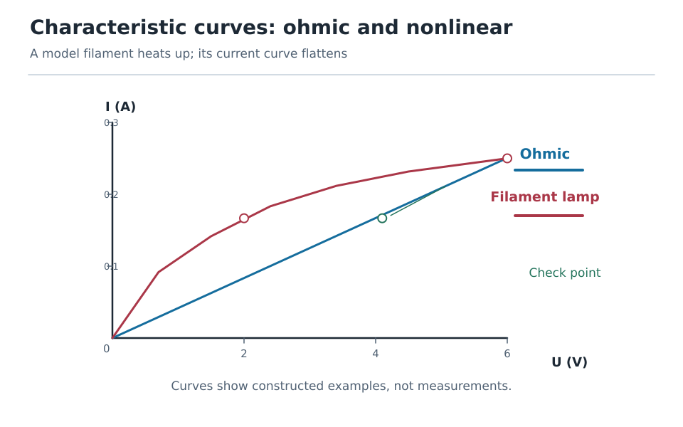

# M9-L6 – Characteristics, measurement errors and real components {#L6}

**Course area:** M9 – Electrical networks and power. **Level:** Lower secondary education. **Prior knowledge:** [M9-L5](M9-L5.md). **Learning objective:** Recognise nonlinear current–voltage characteristics and separate measurement issues from device properties.

## Starting question {#S1}

In an incandescent lamp, current does not always increase in direct proportion to voltage. Is that a measurement error or a property of the heated filament?

## Physical concepts and model {#S2}

A **characteristic curve** shows how current $I$ changes with voltage $U$. For an ohmic resistor kept at a stable temperature, a plot of current against voltage is a straight line through the origin. In a filament lamp, resistance typically rises with temperature, so current increases **less than proportionally** at higher applied voltage. This reproducible behaviour is a component property, not an error that should be erased by forcing a straight-line fit.

**Measurement problems** include random scatter (small reading fluctuations), systematic errors (for example a zero offset or incorrect range) and model mismatch (for example assuming constant temperature). Draw axes, units and all data points. At one operating point the resistance ratio is $R(U)=U/I(U)$, which may vary across the curve. The slope $\Delta I/\Delta U$ is not itself resistance for this axis choice.

**Original teaching diagram:** A straight ohmic model line and a downward-flattening filament-lamp model curve share the same axes. An isolated point is marked for possible rechecking, not silently deleted.

*A curved characteristic may be a genuine feature of the device.*

## Worked example or application {#S3}

Suppose a model filament has $U_1=2.0\,\mathrm V$, $I_1=0.20\,\mathrm A$ and $U_2=6.0\,\mathrm V$, $I_2=0.30\,\mathrm A$.

$$R_1=2.0/0.20=10\,\Omega,\qquad R_2=6.0/0.30=20\,\Omega.$$

The rising ratio suggests temperature-dependent or other device behaviour. These numbers are deliberately constructed teaching values. Repeating the measurement under controlled conditions helps identify systematic errors and possible outliers.

## Safe observation and experiment {#S4}

**Data exercise without a power supply:** Plot the two fictional model points from the worked example and an explicitly invented third point $U_3=4.0\,\mathrm V$, $I_3=0.26\,\mathrm A$ in an I-versus-U diagram. Label axes in V and A, then explain why a curved model characteristic is plausible from the three points. If a real experiment is conducted, use supervised approved low-voltage equipment; filament lamps may become hot and must not be touched immediately after use.

## Check your learning {#S5}

### Questions

1. How does an ohmic resistor appear on an I-against-U plot?
2. Find R1 and R2 in the worked example.
3. Give one possible systematic and one random measurement error.
4. Why must a curved characteristic not automatically be rejected as wrong?

### Answers

1. A line through the origin at approximately constant temperature.
2. R1 = 10 Ω, R2 = 20 Ω.
3. Systematic: meter zero offset. Random: small reading fluctuations.
4. A nonlinear characteristic can reflect repeatable temperature or operating-point behaviour of the device.

## Limits and transition {#S6}

Not all nonlinear behaviour comes from heating; diodes have different physical mechanisms. The curves shown here are conceptual and are not copied measured data.

**Next lesson:** [M9-L7](M9-L7.md)

## Sources {#S7}

- [LEIFIphysik – Characteristics of resistors](https://www.leifiphysik.de/elektrizitaetslehre/ohmsches-gesetz-kennlinien/grundwissen/kennlinien-von-widerstaenden) · Linear and nonlinear U–I characteristics and temperature dependence · Last accessed: 2026-11-21 · Content verified: 2026-11-21
- [LEIFIphysik – Ohm’s law](https://www.leifiphysik.de/elektrizitaetslehre/ohmsches-gesetz-kennlinien/grundwissen/ohmsches-gesetz) · Proportional U–I behaviour only for ohmic elements; resistance ratio U/I · Last accessed: 2026-11-21 · Content verified: 2026-11-21
- [Berlin-Brandenburg Education Server – Physics: topics and content](https://bildungsserver.berlin-brandenburg.de/rlp-online/c-faecher/physik/themen-und-inhalte) · Lower-secondary curriculum: current, voltage, resistance, circuits, power and energy · Last accessed: 2026-11-21 · Content verified: 2026-11-21
