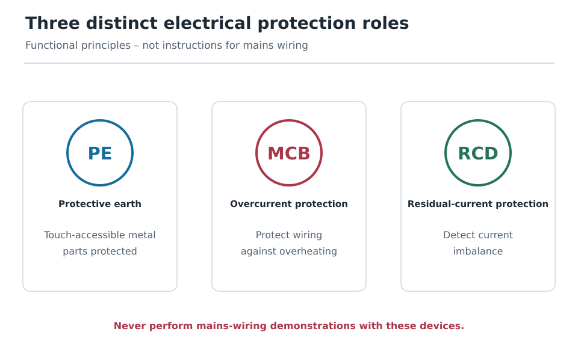

# M9-L7 – Electrical protection and safe use {#L7}

**Course area:** M9 – Electrical networks and power. **Level:** Lower secondary education. **Prior knowledge:** [M9-L6](M9-L6.md). **Learning objective:** Distinguish protective earth, overcurrent protection and residual-current protection by function and justify safe conduct.

## Starting question {#S1}

An appliance has a metal case and a cable with several conductors. Why is simply switching off its lamp not enough to prove electrical safety?

## Physical concepts and model {#S2}

Real electrical installations use **several coordinated safeguards**. **Protective earth (PE)** connects designated touchable conductive parts to a protective system. For certain faults it provides a route that helps protective devices disconnect the supply; it is **not a normal working-current conductor**. Whether PE is required depends on the appliance protection class.

A **fuse or miniature circuit breaker** disconnects excessive current, primarily protecting cables and installations from overheating and fire. A **residual-current device (RCD)** compares outward and returning currents. A sufficient imbalance causes it to trip and can provide additional protection against fault current. It does not replace proper wiring or overcurrent protection, nor does it protect against every possible kind of contact.

This is a **functional teaching diagram, not a wiring or installation guide**. Wire colours and consumer-unit internals are deliberately excluded from practical activities. The safe response to damaged electrical equipment is to keep clear, not attempt repairs, and inform a responsible adult or qualified electrician. **Original teaching diagram:** Three separate pictogram boxes marked PE, overcurrent and RCD, each identifying its distinct protective role without a usable mains-wiring schematic.

*Protective earth, overcurrent protection and an RCD solve different safety problems.*

## Worked example or application {#S3}

A model circuit uses a $12\,\Omega$ resistor at $6.0\,\mathrm V$. Ideal current is $I=U/R=0.50\,\mathrm A$. This gives **no basis** for selecting protection for a household socket circuit. In installations, conductor size, supply arrangement, fault conditions, disconnection time and relevant rules are assessed by qualified specialists. Neither this calculation nor a simple DC circuit establishes whether an RCD will provide sufficient protection.

## Safe observation and experiment {#S4}

**Observation only:** Match the descriptions “overloaded cable”, “fault current to earth” and “touchable metal enclosure” to appropriate protection principles. Classroom work must use approved safely isolated extra-low-voltage equipment under responsible supervision. Do not open sockets, bypass fuses, disconnect protective earth, or dismantle or rewire RCDs.

## Check your learning {#S5}

### Questions

1. What is the main role of a circuit breaker protecting a cable?
2. What does an RCD compare in principle?
3. Is protective earth meant to carry normal operating current?
4. Why cannot a 6-V resistor calculation determine protection for a mains installation?

### Answers

1. It disconnects excessive current to protect wiring from overheating and fire.
2. The total current flowing out and returning on the active conductors; a difference can indicate fault current.
3. No. Protective earth is part of the fault-protection system, not a normal load-current path.
4. Because it omits the supply system, fault currents, disconnection conditions, cable sizing, regulations and expert assessment.

## Limits and transition {#S6}

An RCD is not universal protection from electric shock, especially not for every contact between two active conductors. Protective devices must be correctly selected, coordinated and installed by professionals. If equipment appears faulty, keep clear and inform a responsible person.

**Looking ahead:** The next module begins with [M10-L1 – Electromagnets and electric motors](M10-L1.md) and goes on to electromagnetic induction.

## Sources {#S7}

- [DGUV Safe School – Electricity experiments](https://www.sichere-schule.de/physik/praktisches-arbeiten/elektrik) · Safe extra-low-voltage supplies and safety measures for pupils · Last accessed: 2026-11-21 · Content verified: 2026-11-21
- [DGUV Safe School – Electrical installations](https://www.sichere-schule.de/physik/ausstattung-und-geraete/elektrische-installation) · Safety of school experiment outlets and RCD protection · Last accessed: 2026-11-21 · Content verified: 2026-11-21
- [Berlin-Brandenburg Education Server – Physics: topics and content](https://bildungsserver.berlin-brandenburg.de/rlp-online/c-faecher/physik/themen-und-inhalte) · Lower-secondary curriculum: current, voltage, resistance, circuits, power and energy · Last accessed: 2026-11-21 · Content verified: 2026-11-21
